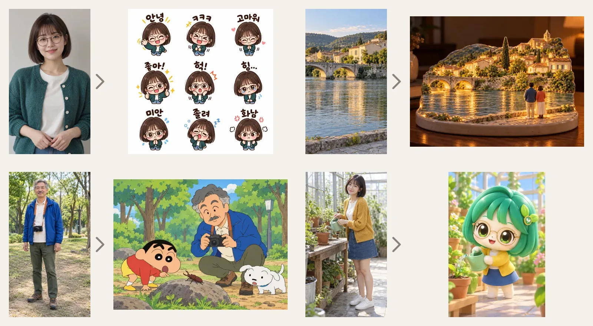

# Prompt Gallery

내 사진 한 장으로 카톡 이모티콘, 애니메이션 속 장면, 도자기 무드등, 아이돌 화보를 만드는 ChatGPT 이미지 프롬프트 모음입니다.

**[갤러리 바로가기 → q07k-prompt-gallery.pages.dev](https://q07k-prompt-gallery.pages.dev/)**



<sub>왼쪽이 첨부한 사진, 오른쪽이 공개 프롬프트만 그대로 적용한 결과입니다. 예시 사진은 모두 AI로 만든 가상 인물과 장소입니다.</sub>

## 사용법

1. 갤러리에서 마음에 드는 결과를 고르고 **프롬프트 복사**를 누릅니다.
2. ChatGPT에 내 사진 한 장을 첨부합니다. 카드마다 필요한 사진 종류(인물, 반려동물, 풍경 등)가 적혀 있습니다.
3. 복사한 프롬프트를 붙여넣고 보냅니다.

상세 화면에서 예시를 크게 보고, 검색·카테고리로 찾고, 마음에 드는 프롬프트를 북마크할 수 있습니다. 북마크는 이 브라우저에만 저장되며 다른 기기와 동기화되지 않습니다.

## 인기 프롬프트

2026년 9월 24일~10월 21일 갤러리에서 프롬프트 복사가 많았던 순서입니다.

| 프롬프트 | 필요한 사진 |
|---|---|
| [내 사진으로 카카오톡 이모티콘 9종](https://q07k-prompt-gallery.pages.dev/prompts/kakao-emoticons/) | 인물 사진 1장 |
| [야르·아자스·샤갈! 카톡 리액션 — 2026.10](https://q07k-prompt-gallery.pages.dev/prompts/slang-chat-reactions-2026-10/) | 인물 사진 1장 |
| [내 여행 사진을 따뜻한 도자기 무드등으로](https://q07k-prompt-gallery.pages.dev/prompts/travel-ceramic-nightlight/) | 여행 풍경 사진 1장 |
| [내 얼굴로 만드는 일상 스티커 9종](https://q07k-prompt-gallery.pages.dev/prompts/cozy-stickers/) | 인물 사진 1장 |
| [내 사진으로 완성하는 월간 패션 매거진](https://q07k-prompt-gallery.pages.dev/prompts/monthly-magazine/) | 성인 인물 사진 1장 |
| [내 사진이 짱구는 못말려 속으로](https://q07k-prompt-gallery.pages.dev/prompts/shinchan-world/) | 인물·동물·풍경 사진 1장 |

전체 목록은 [갤러리](https://q07k-prompt-gallery.pages.dev/)에서 캐릭터, 인물, 일러스트, 제품, 포스터, 아트·밈 카테고리로 볼 수 있습니다.

## 기여와 개발

HTML, CSS, JavaScript만 쓰는 정적 사이트입니다. 런타임 서버, API 키, 데이터베이스가 필요하지 않습니다. Node.js 22 이상에서 실행합니다.

```sh
npm ci
npm run dev
```

`http://127.0.0.1:4173/`에서 열립니다. PR 전에는 전체 검사를 실행합니다.

```sh
npx playwright install chromium
npm run check
```

| 문서 | 내용 |
|---|---|
| [기여 안내](CONTRIBUTING.md) | 저장소 스킬로 기여를 시작하는 방법 |
| [개발 문서 목차](docs/README.md) | 개발 흐름, 테스트, 배포, SEO, GA4 문서 모음 |
| [프롬프트 등록 원칙](docs/prompt-publishing.md) | 원본·결과 검토, `data/prompts.json` 항목 형식, 정렬 순서 |
| [스킬 사용 가이드](docs/prompt-gallery-workflow-guide.md) | [prompt-gallery-workflow 스킬](.agents/skills/prompt-gallery-workflow/SKILL.md)로 프롬프트를 만들고 게시하는 방법 |
| [Cloudflare Pages 운영](docs/cloudflare-pages.md) | 운영 주소, 자동 배포, 환경 변수 |
| [공유 링크와 미리보기](docs/sharing.md) | 프롬프트별 공유 페이지, 카카오톡 미리보기 캐시 |
| [카탈로그 등록 기록](docs/catalog-history.md) | 날짜별 등록·수정 기록, 샘플 출처 |

운영 상태를 확인하거나 오래된 작업 브랜치에서 작업할 때는 [AGENTS.md](AGENTS.md)의 절차를 따릅니다. 상단 예시 이미지는 `node scripts/readme-examples.mjs`로 다시 만들 수 있습니다. 초기 참고 컬렉션의 CC0 문서는 `licenses/sample-collection-CC0.txt`에 보관합니다.
