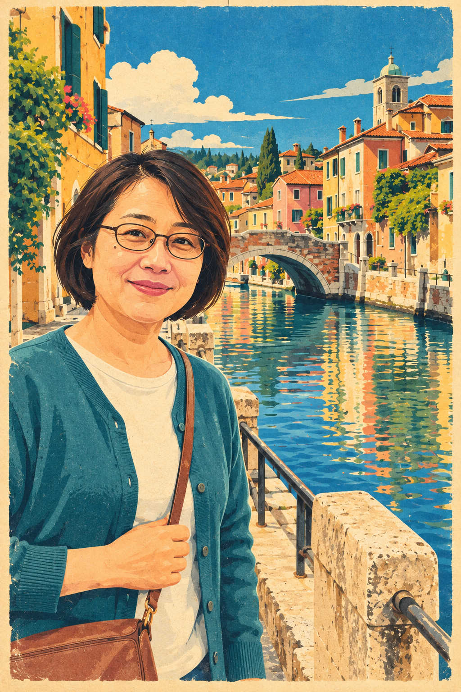
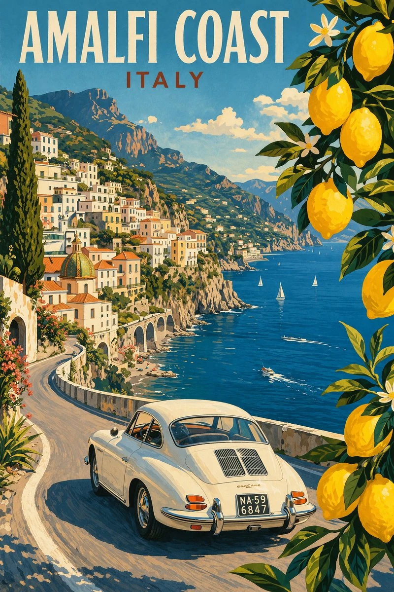

# 빈티지 여행 포스터 v2 얼굴 보존 개선

2026-10-22. 기존 항목 `amalfi-summer`의 ID·제목·정렬값·저자와 기존 풍경 원본은 유지하고, 얼굴 보존 지시·사용 안내·결과 예시를 갱신한다. 사용자가 v2 결과를 검토한 뒤 “결과 확정·PR 제출”을 선택했다. 제출 범위는 Draft PR이며 병합·운영 배포 승인은 포함하지 않는다.

## 문제와 변경

빈티지 포스터에서 원래 얼굴 대신 다른 사람이 나온다는 피드백을 받았다. 기존 문구는 “외모와 위치도 유지”만 요구해 얼굴 구조·연령과 스타일 단순화의 우선순위가 모호했다. 이는 원인 후보이며 실제 제보 사진·실패 결과·사용 도구·설정이 없어 해당 사례의 정확한 원인을 확정하지 않는다.

[승인된 v2 문구](amalfi-summer-prompt-v2.txt)는 얼굴 윤곽·눈매·코와 입의 상대 비례·표정·나이·헤어라인·안경·점·주름을 보존하고 과도한 미화와 다른 얼굴로의 재해석을 피하도록 명시한다. 강한 색면 단순화와 닮은 정도가 충돌하면 얼굴 형태와 명암 단서를 더 남긴다. 풍경의 촬영 시점·주요 구도·인물의 위치와 자세도 유지한다.

## 실제 비교

각 변환은 원본 한 장과 해당 문구만 사용했다. 스타일 참고 이미지·사진별 추가 지시·이전 결과·후편집을 사용하지 않았다. 가상 성인 사진은 이번에 내장 이미지 도구로 새로 생성했다. 풍경 원본은 기존 저장소 자산이며 [당시 원본 제작 설명](photo-transform-prompts.md)에 AI 생성 예시로 기록돼 있다.

| 원본 | 기존 문구 v1 | 개선 문구 v2 |
|---|---|---|
|  |  |  |

| 기존 풍경 원본 | 같은 v2 문구 적용 |
|---|---|
|  |  |

- 인물 두 결과 모두 안경·단발·점·청록색 가디건·가방과 원본 위치·자세를 대체로 유지했다. 기존 문구에서도 크게 다른 사람으로 교체되는 실패는 재현되지 않았다.
- 이번 v2에서는 눈매·입매와 얼굴의 명암·주름 단서가 더 세밀하게 남았다. 얼굴은 v1보다 사실적이고 강한 색면 단순화는 줄었다. 피부색은 빈티지 팔레트에 따라 따뜻하게 바뀌고 얼굴과 손의 세부도 재해석됐다.
- 풍경 v2는 전차·내리막길·건물·강과 다리의 주요 관계와 인쇄 질감을 유지했다. 작은 승객·보행자의 얼굴은 식별 평가가 어렵고 전차의 작은 숫자 등은 원본과 다르게 재생성됐다.
- 단일 인물 비교이며 정량 평가·반복 실행·여러 인물·측면·흐린 얼굴 테스트는 하지 않았다. 모든 사진에서의 개선이나 정체성의 완전한 보존을 보장하지 않는다.

## 등록과 기록

풍경 예시를 v2 결과로 교체하고 두 번째 “인물 포함” 예시를 추가했다. 카드·썸네일·공유 미리보기는 풍경을 유지한다. 상세에서 예시를 고르면 원본·결과·설명·확대·다운로드 대상이 함께 바뀌고 공개 프롬프트는 공통으로 사용한다.

원본 PNG와 무손실 WebP의 디코딩 픽셀이 일치함을 네 파일(인물 원본·인물 v1·인물 v2·풍경 v2)에서 확인했다. 결과는 모두 1024×1536이며 썸네일은 비율을 유지한 480×720이다. 원본·각 결과·썸네일의 실제 치수와 SHA-256, 도구가 반환한 파일 식별자·원본 생성 문구·정확한 변환 입력은 [생성 기록](image-generation-2026-10-22-amalfi-summer-face.json)에 보관했다. 개인 절대 경로·인증 정보는 공개 기록에 넣지 않았다.

이전 풍경 결과·문구는 Git 이력과 [2026-10-15 생성 기록](image-generation-2026-10-15.json)에 보존한다. 이번 인물 v1 비교 결과는 공개 카탈로그 자산에 섞지 않고 문서 검토 자산으로만 보관한다.

## 검증

기존 45개 항목 중 이번 항목 이외의 44개 데이터와 전체 정렬값이 기준 main과 동일함을 확인했다. 등록 문구·별도 문구 파일·두 예시에 실제 사용한 v2 입력이 일치한다.

npm run check를 통과했다: 단위·데이터 검사 34개, 공유 페이지 45개 빌드, 데스크톱·모바일 Chromium 검사 54개. 새 amalfi-summer 예시의 선택·원본/결과 확대·다운로드 연결·공통 문구 유지 및 복사를 두 화면 크기에서 확인했다. 별도로 공개 문구 일치, 자산 6개의 SHA-256, 생성 단계 4개의 입력·출력 파일과 검토 문서 링크를 확인했다. git diff --check도 통과했다.

