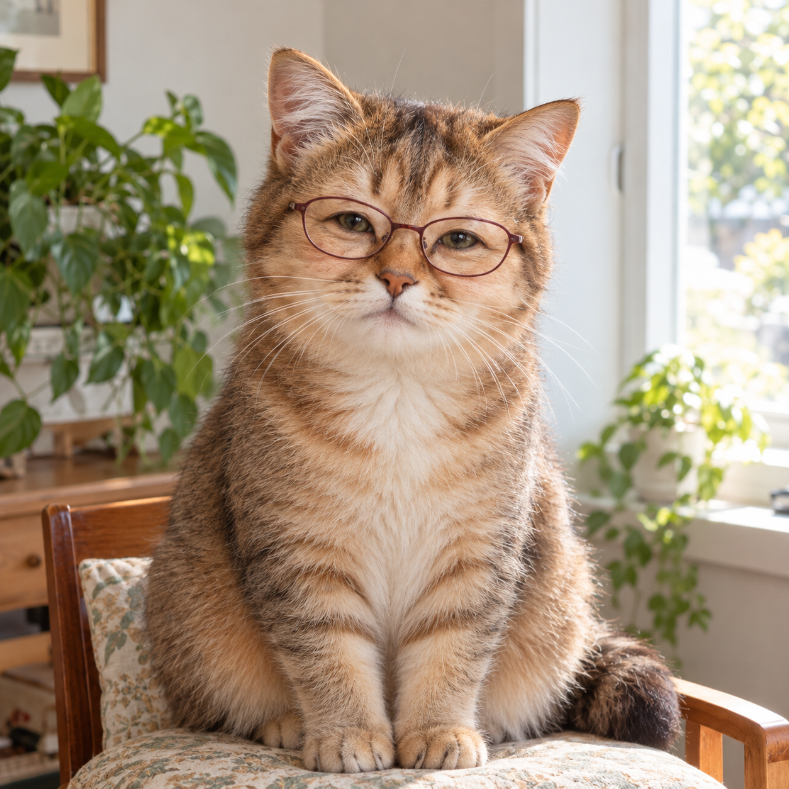
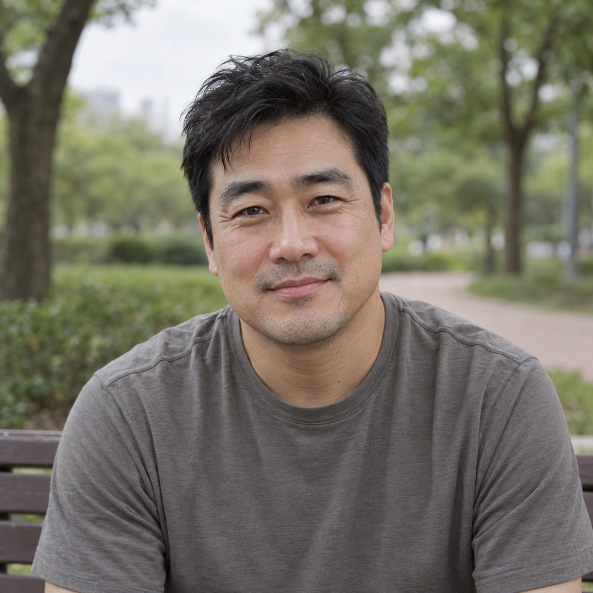
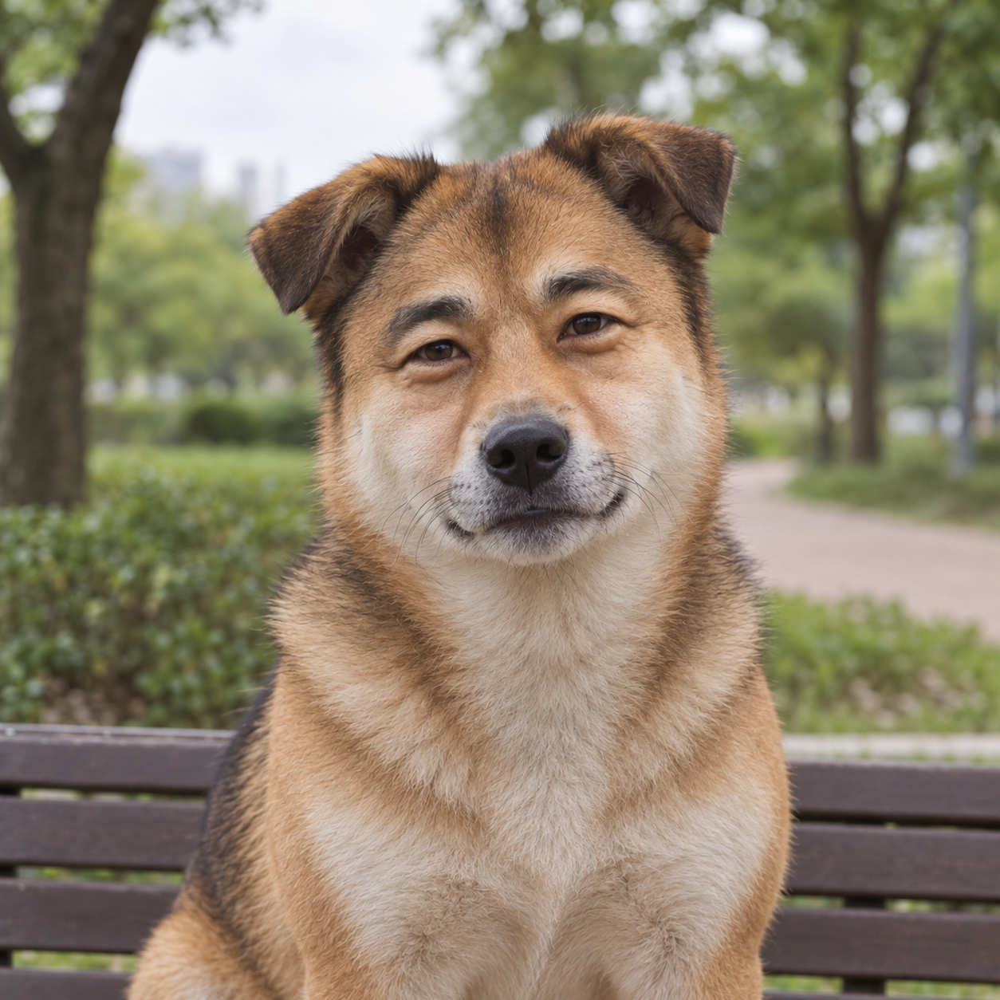

# 나를 닮은 동물로 실사 변신 — v8 게시 검토

사용자는 v8을 확정하고 PR·main 병합·배포 및 작업 브랜치 정리를 요청했다. 본인 사진은 비공개로 유지하고 가상 예시로 대체하도록 선택했으며 공개 자산에는 가상 원본과 그 변환 결과만 포함했다.

## 원문과 실제 입력

두 예시 모두 원본 한 장과 [동일한 v8 공개 원문](animal-lookalike-prompt-v8.txt)만 전달했다. 추가 스타일 참고·사진별 보정 지시·후편집은 없다. 원본 생성 문구, 실제 도구 입력, 생성 파일 식별자, 치수와 SHA-256은 [생성 기록](image-generation-2026-10-23-animal-lookalike.json)에 연결했다. 이전 v5 결과를 v8 예시로 재사용하지 않았다.

| 예시 | AI 가상 원본 | v8 결과 |
|---|---|---|
| 안경 있음 · 실내 |  |  |
| 안경 없음 · 공원 |  |  |

## 관찰과 한계

안경 예시는 버건디색 타원 테를 유지했고 안경 없는 예시는 새 안경을 만들지 않았다. 안경 예시는 같은 v8 문구로 2회 생성했고, 사람 머리 모양이 강하게 남은 첫 결과 대신 머리 털이 자연스러운 두 번째 고양이 결과를 선택했다. 같은 사진과 문구에서도 개와 고양이로 종이 달라졌다. 닮은 정도·동물 종류·안경 각도·몸과 머리 비율은 생성마다 달라질 수 있다. 눈썹과 눈 주변에 사람 같은 인상이 남고, 안경 없는 결과는 전신 대신 상반신 구도로 나왔다. 두 가상 인물과 제한된 재시도로 모든 얼굴에서의 정확성이나 종 다양성을 보장하지 않는다.

원본과 결과는 무손실 WebP 변환 전후 디코딩 RGBA 픽셀 일치를 확인했다. 썸네일은 비율을 유지해 축소했다. 기존 카탈로그 항목과 order는 그대로 보존하고 신규 항목만 최상단 order를 부여했다.
