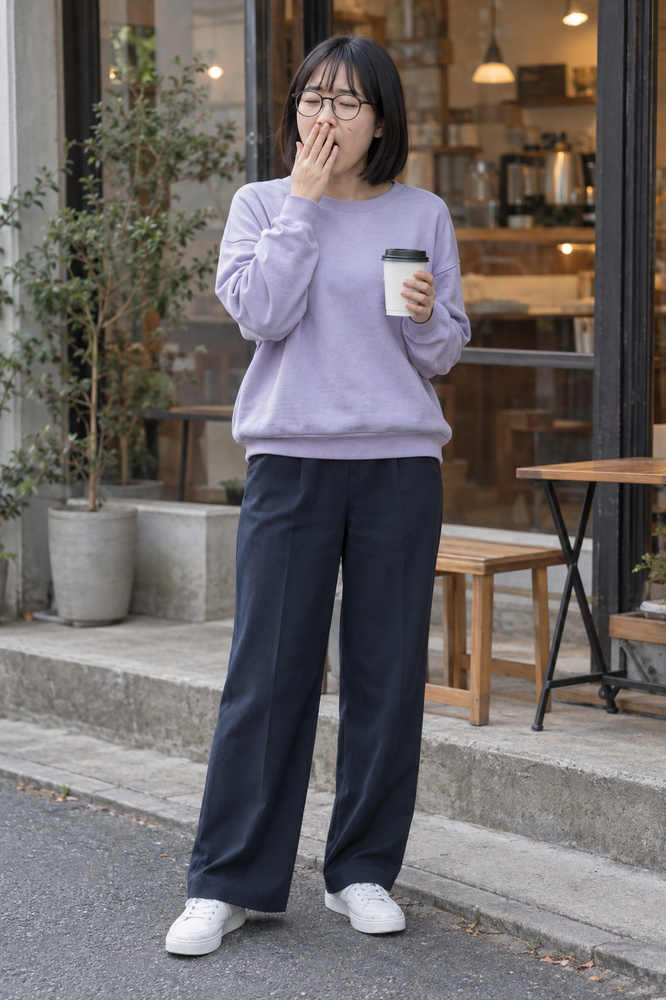
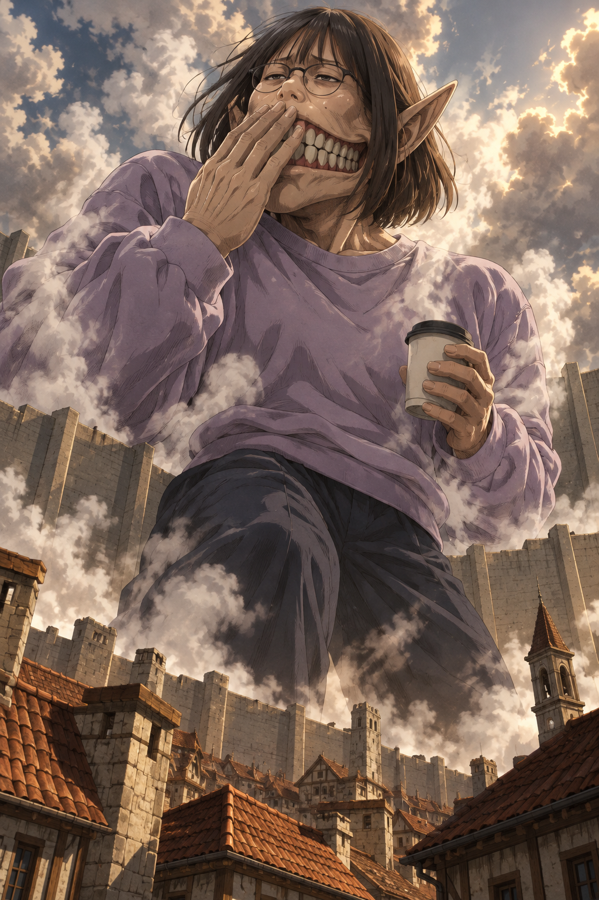
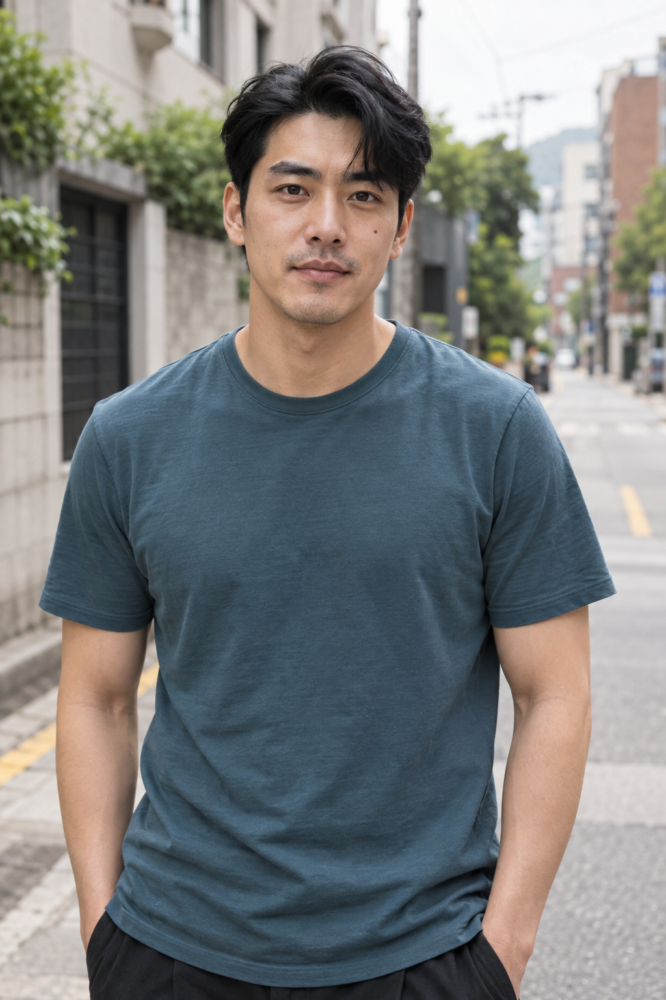
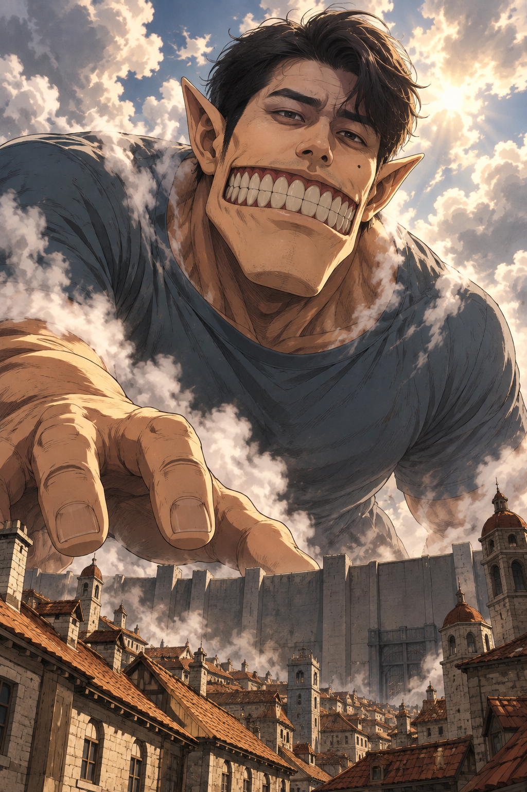
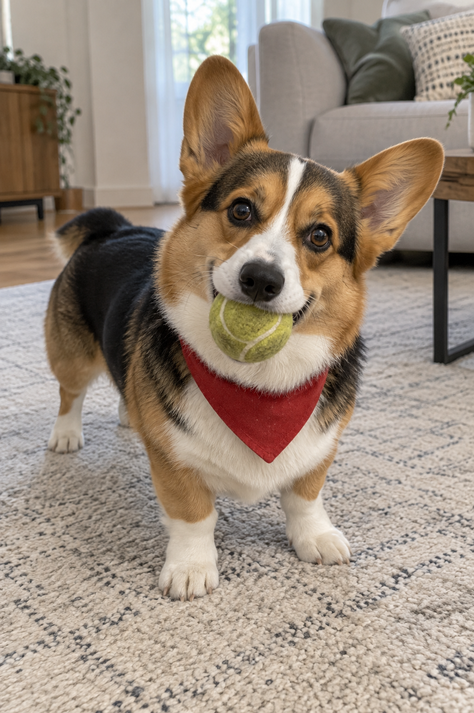
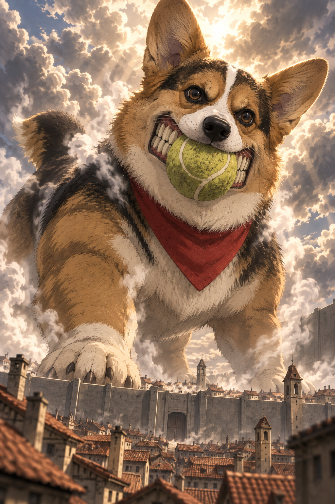

# 진격의 거인 변신 — 공개 v6 검토

사용자가 여성 v6를 확정하고 같은 버전으로 이전 남성·코기 원본도 시험한 뒤 제출하라고 요청했다. 등록 예시는 아래 세 원본에 같은 공개 v6 문구만 적용한 결과다.

| 예시 | AI 가상 원본 | v6 결과 |
| --- | --- | --- |
| 여성 · 커피를 들고 하품 |  |  |
| 남성 · 거대한 턱과 손 |  |  |
| 반려동물 · 공놀이를 기다리는 코기 |  |  |

## 실제 입력과 공개 문구

공개 문구는 data/prompts.json의 become-a-titan 항목이며 세 예시의 실제 도구 입력과 같다. 각 원본 한 장만 전달했고 사진별 추가 지시·스타일 참조·후편집은 없다. 여성 v6는 승인한 기존 결과를 그대로 사용했고 남성·코기는 이전 원본에서 새로 생성했다. 이전 버전 결과를 v6 예시로 재표시하지 않았다.

의복 유지 조건은 성별에 관계없이 적용한다. 얼굴과 턱·치아·귀·상체 비율을 변형하되 의상은 함께 커지고 가슴·복부·골반을 불투명한 옷으로 덮도록 지시한다. 일상 행동과 원본에 보이는 장난감·소품을 활용하며, 모든 사진에 하품·커피컵·테니스공을 강제하지 않는다.

## 예시별 관찰과 한계

- 여성 · 커피를 들고 하품: AI 가상 원본·결과 · 성인 여성 사진 한 장에 공개 v6 문구만 적용했습니다. 단발·안경·볼 점·연보라 긴팔 상의·남색 긴 바지·커피컵과 하품 동작이 남고, 넓은 턱·큰 치아·긴 뾰족한 귀가 추가됐습니다. 가슴·복부·골반의 노출·비침은 보이지 않습니다. 얼굴 하부의 닮음은 줄었고 손이 입 한쪽을 가리며 하체·발은 일부 가려졌습니다.
- 남성 · 거대한 턱과 손: AI 가상 원본·결과 · 성인 남성 사진 한 장에 같은 공개 v6 문구만 적용했습니다. 가르마 머리·짙은 눈썹·볼 점·옅은 수염·청록 상의가 남고 턱·치아·귀·어깨·손이 거인 비율로 바뀌었습니다. 차분한 표정이 큰 치아를 드러내는 표정으로 바뀌어 얼굴 하부의 닮음은 줄었습니다. 하체와 손 일부가 가려져 전신 비율·손가락 전체는 확인하기 어렵습니다.
- 반려동물 · 공놀이를 기다리는 코기: AI 가상 원본·결과 · 코기 사진 한 장에 같은 공개 v6 문구만 적용했습니다. 삼색 털·흰 이마 선·빨간 스카프·테니스공·갸웃한 자세가 남고 성문 앞에서 놀아 달라고 기다리는 거대 코기로 표현됐습니다. 코기에도 사람처럼 각진 큰 치아가 추가됐고 꼬리가 원본보다 길어졌습니다. 뒷다리 일부와 한쪽 귀 끝이 가려지거나 잘려 전체 비율 보존은 불완전합니다.

한 가지 여성·남성·코기 입력만 시험했다. 고양이·단체사진 등은 미시험이며, 이미지 도구의 생성 성공과 보이는 의복 덮임을 다른 입력이나 외부 심사 통과의 보장으로 확대하지 않는다.

## 자산과 기록

원본·결과 6개를 무손실 WebP로 저장한 뒤 디코딩 픽셀 동일성을 확인했다. 썸네일은 첫 여성 결과의 비율을 유지해 축소했다. 기존 카탈로그 항목과 상대 순서를 보존하고 신규 항목만 상단에 배치했다.

[실제 문구·원본 생성 프롬프트·도구 입력·치수·SHA-256](image-generation-2026-10-22-become-a-titan.json)

브랜치: codex/become-a-titan. 기준 커밋: 4e13342e762b34da383b546a4969d04b5520b9c2. 원본/head 저장소: Q07K/prompt-gallery (origin).
