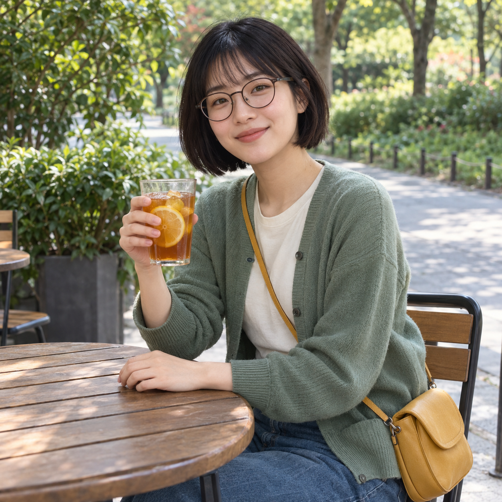
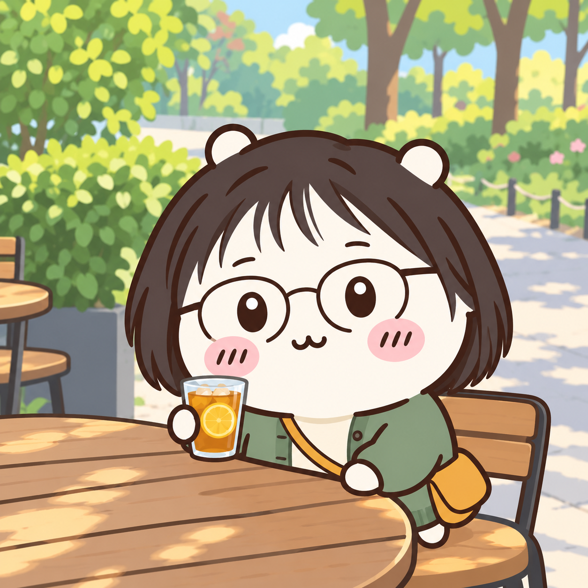

# 치이카와풍 사진 변환 — v2 확정 예시

사용자는 2026-10-24에 **결과 확정·PR 제출**을 선택했습니다. 확정한 v2 문구와 결과를 변경 없이 등록합니다.

## 입력과 결과

| 입력: AI 가상 성인 인물 | 출력: 치이카와풍 v2 |
|---|---|
|  |  |

[실제 공개·시험 문구 v2](chiikawa-prompt-v2.txt) · [생성·실제 도구 입력·해시·무손실 픽셀 검사 기록](image-generation-2026-10-24-chiikawa.json)

사용자 첨부 치이카와 포스터는 특징을 읽어 v2 문구를 수정하는 내부 참고로만 사용했습니다. 최종 생성 입력은 AI 가상 원본 사진 한 장과 공개 v2 문구뿐이며 추가 스타일 이미지·추가 지시·후편집은 없습니다. 공개 사용자는 본인 사진 한 장과 문구만 사용합니다. 포스터는 공개 자산에 포함하지 않습니다. v1 문구와 생성 사실도 생성 기록의 history에 보존했습니다.

원본·결과 WebP는 PNG와 디코딩 RGBA 픽셀이 동일한 무손실 변환입니다. 썸네일만 비율을 유지해 너비 640px로 축소했습니다.

## 관찰과 한계

- 단발머리·둥근 안경·초록 카디건·노란 가방·레몬차와 카페의 사물 배치를 유지했습니다.
- v1보다 수채화 결이 줄고 외곽선과 색면이 또렷해졌으며 고개 기울기가 원본에 가까워졌습니다.
- 타원 눈의 흰 하이라이트, 분홍 볼과 짧은 빗금을 표현했습니다.
- 머리카락의 비중이 커서 원작 캐릭터 그대로보다는 개인화된 캐릭터 느낌입니다. 일부 부드러운 명암이 남아 완전한 평면 채색은 아닙니다.
- 가상 성인 한 명의 같은 사진으로만 시험했습니다. 다인 사진이나 다른 연령대·입력 유형의 품질은 확인하지 않았습니다.

## 등록과 제출 범위

- 항목: chiikawa / 캐릭터 / 인물 사진 한 장
- 브랜치: codex/chiikawa
- 기준 커밋: 722add0fe01f84a542b02c2ee08245d9bbd233ab
- base·head: Q07K/prompt-gallery, origin
- 신규 order: -50; 기존 모든 항목의 값과 상대 순서를 유지했습니다.
- 승인 범위: 등록·검증·Draft PR 제출. 병합·운영 배포 요청은 없습니다.
- 필수 검증: npm run check, git diff --check. 실행 결과는 PR 본문에 기록합니다.
