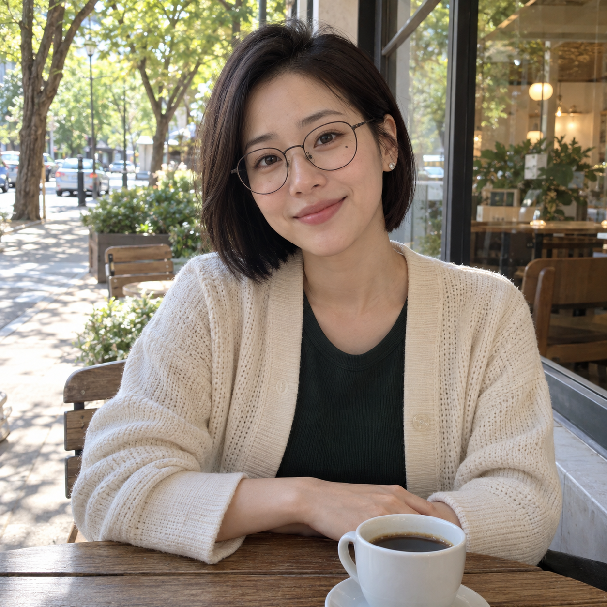
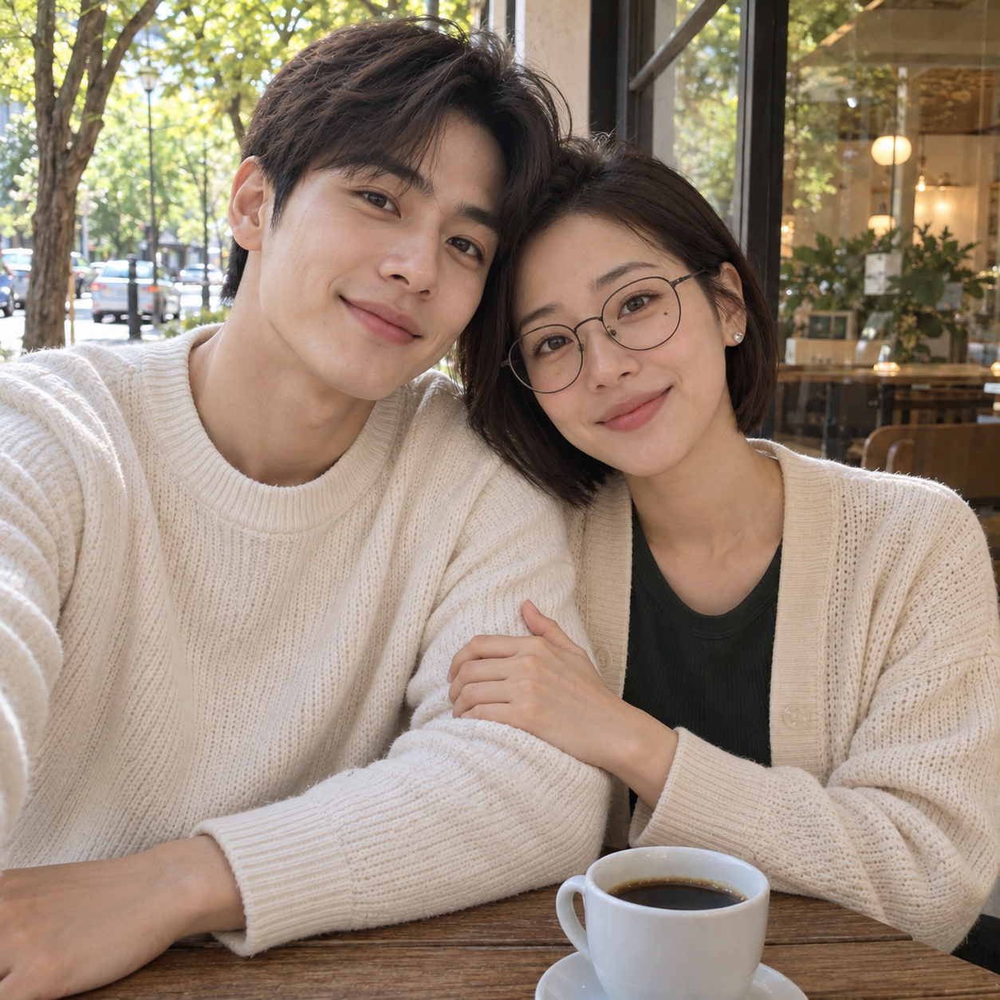

# 나와 어울리는 애인과 같이 찍은 사진 — v1 검토

2026-10-26 사용자가 “결과 확정·PR 제출”을 선택했습니다. 승인 범위는 갤러리 등록·검증·Draft PR 제출입니다.

## 입력과 결과

| 입력: AI 가상 성인 여성 | 출력: v1 커플 사진 |
|---|---|
|  |  |

[실제 도구 입력과 전체 v1 문구·치수·SHA-256](image-generation-2026-10-26-compatible-partner.json), [공개 카탈로그](../data/prompts.json)를 연결했습니다. 원본 한 장과 공개 문구만 전달했으며 추가 지시·스타일 참고·후편집은 없습니다.

## 관찰

- 얼굴의 전체 인상, 둥근 안경, 단발, 눈 아래 점, 귀걸이, 크림 카디건과 녹색 상의
- 카페 배경, 커피잔, 자연광
- 정확히 두 명의 성인 인물
- 서로 기대고 팔을 가볍게 잡은 포즈
- 유사한 조명과 피부 질감, 새 인물과 구별되는 얼굴

## 한계

- 구도가 셀카처럼 가까워지고 원래 인물이 오른쪽으로 이동함
- 애인 성별을 지정하지 않아 이번 결과는 남성으로 생성됨. 매번 같은 성별을 보장하지 않음
- 가상 성인 여성 원본 한 장으로만 시험함
- 시각적 조화를 창작한 예시이며 실제 성격이나 궁합 판단은 아님

## 등록·검증 범위

원본과 결과는 무손실 WebP로 변환하고 RGBA 디코딩 픽셀이 PNG와 완전히 같은지 비교했습니다. 썸네일은 비율을 유지해 폭 640px로 축소했습니다. 기존 항목은 값과 상대 순서를 유지하고 신규 항목만 더 작은 order로 등록했습니다. 자동 검사 결과와 실제 제출 상태는 PR에 기록합니다.

- 브랜치: codex/compatible-partner
- 기준 커밋: f21a684fe89d40ca78ba3a7ac01339fd7ad413b5
- base/head 저장소: Q07K/prompt-gallery (origin)

제출 준비 중 main에 추가된 학창 시절 첫사랑 항목을 보존했습니다. 제출 기준은 6003fe01ffc2150521d995913e4e72330c75ff2c이고 신규 order는 -55입니다. 생성 당시 기준 커밋은 위에 별도로 유지합니다.
