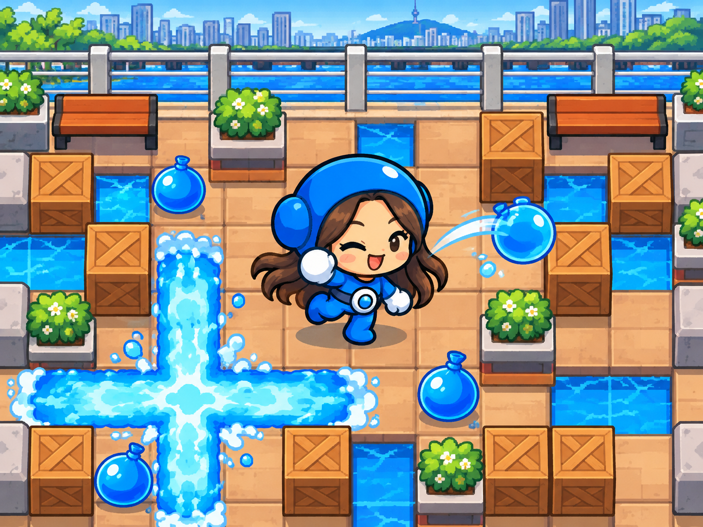
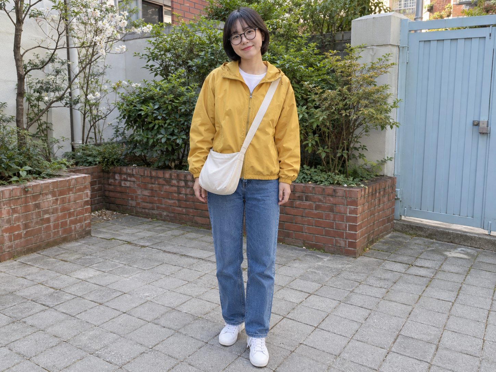
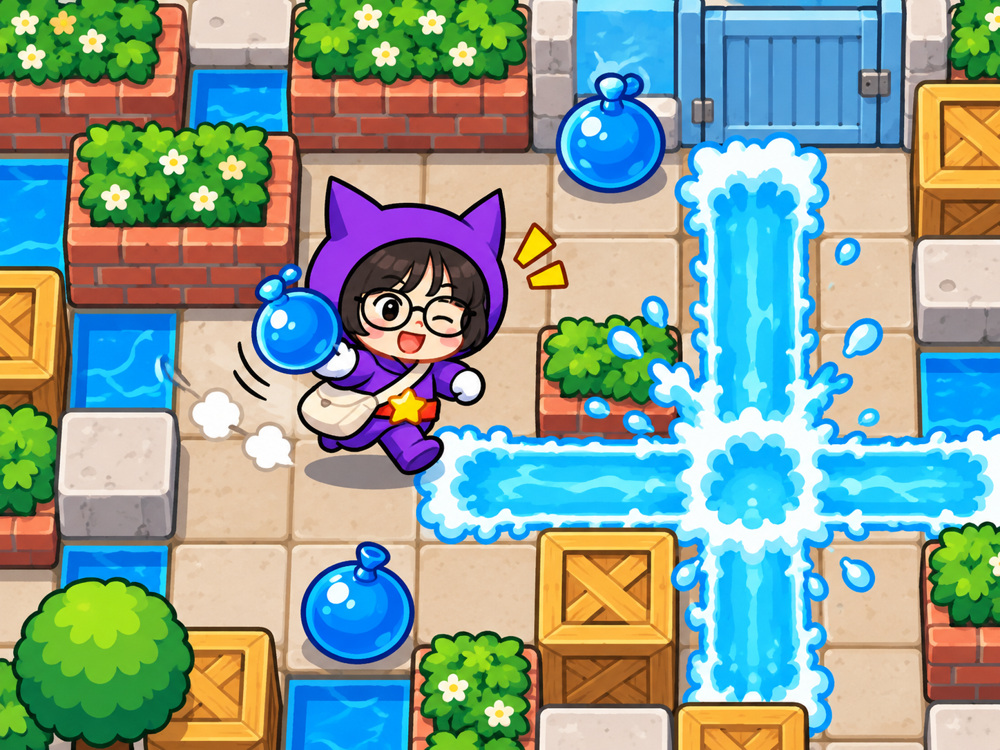
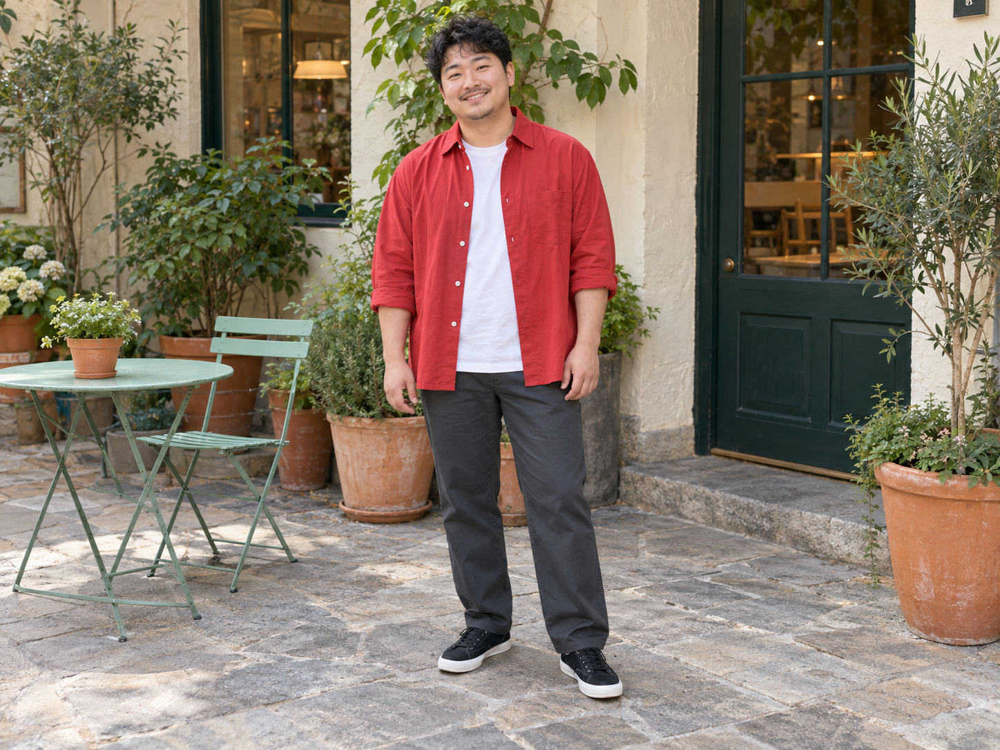
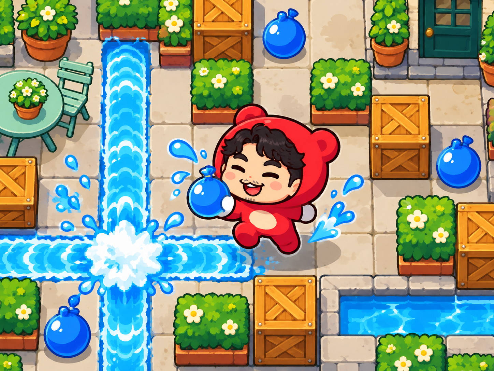

# 크레이지아케이드 캐릭터 v4 등록 검토

사용자가 다오 등 여러 캐릭터로 확장한 결과를 검토한 뒤 GitHub Actions 통과 후 병합·브랜치 정리를 요청했다. 최종 v4 문구와 같은 문구로 만든 세 예시를 등록한다.

[공개 문구](crazy-arcade-prompt-v4.txt) · [실제 입력·원본 생성 문구·치수·해시](image-generation-2026-10-22-crazy-arcade.json)

| 예시 | AI 가상 원본 | v4 결과 |
|---|---|---|
| 다오 · 긴 머리와 강변 |  |  |
| 디지니 · 안경과 크로스백 |  |  |
| 배찌 · 곱슬머리와 수염 |  |  |

AI 가상 원본·결과 · 강변의 성인 사진 한 장에 공개 v4 문구만 적용했습니다. 긴 갈색 머리·가르마와 안경·가방 없음이 유지되고, 파란 헬멧·흰 장갑·원형 버클의 다오 모습으로 바뀌었습니다. 강·난간·주황 벤치·도시 테마가 남았습니다. 얼굴과 귀걸이는 단순화되고 물풍선을 타일에 놓는 대신 던지는 모습도 생겼습니다.

AI 가상 원본·결과 · 마당의 성인 사진 한 장에 같은 공개 v4 문구만 적용했습니다. 단발·앞머리·둥근 안경·크림색 가방이 남고, 보라색 뾰족 후드·빨간 허리띠·노란 별 버클의 디지니 모습으로 바뀌었습니다. 화단·파란 문을 맵 테마로 옮겼습니다. 얼굴은 단순해지고 물풍선을 손에 든 모습도 생겼습니다.

AI 가상 원본·결과 · 카페 앞 성인 사진 한 장에 같은 공개 v4 문구만 적용했습니다. 짧은 검은 곱슬머리·콧수염·턱수염이 남고, 빨간 곰 귀 후드·크림색 배 부분의 통통한 배찌 모습으로 바뀌었습니다. 민트색 가구·화분·초록 문 테마가 남았습니다. 반쯤 감긴 눈 대신 웃으며 감은 눈이며 물풍선을 손에 든 모습도 생겼습니다.

세 시험 모두 해당 원본 한 장과 같은 v4 문구만 전달했고 캐릭터 별도 지정·참고 이미지·후편집은 없다. 원작 스프라이트를 그대로 복제한 결과가 아니라 사진 인물의 머리·착용물을 결합한 커스텀 모습이다. 캐릭터 선택은 세 사례에서 구분됐지만 모든 입력이나 매 실행의 다양성을 보장하지 않는다. 여러 인물이 함께 있는 사진과 직접 캐릭터 지정은 미검증이다.

v1 일반 치비, v2 배찌 전용, v3 자동 선택의 한계와 문구 이력은 생성 기록에 남겼다. 특히 v3 노란 곰 후드를 우니 성공 예시로 공개하지 않는다. 최종 공개는 v4 세 결과뿐이다.

원본·결과 여섯 파일은 Sharp 무손실 WebP 변환 후 디코딩 픽셀 전체 일치를 검사했다. 썸네일만 비율을 유지해 너비 800px로 축소했다. 기존 48개 카탈로그 항목과 상대 순서를 유지하고 신규 order -43를 부여했다.

## 검증

npm run check: 단위 검사 34/34, 49개 항목 빌드, 데스크톱·모바일 Chromium 검사 58/58 통과. git diff --check 통과. 기존 48개 항목의 내용·상대 순서와 공개 문구·세 실제 입력의 일치를 검사했다. 현재 커밋의 GitHub CI 통과 후 병합하고 Cloudflare Pages에서 같은 병합 커밋의 운영 배포를 확인한다.
