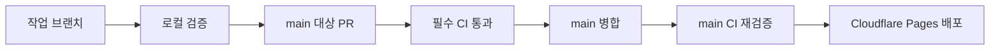

# 개발 흐름

## 기본 경로



로컬 검증은 빠르게 오류를 찾기 위한 단계다. PR의 GitHub Actions 검증은 병합 판단에 사용한다. `main`에 병합된 커밋도 다시 검증하고, 성공한 실행의 산출물을 배포한다.

## 작업 시작

작업 중인 변경이 없는지 먼저 `git status --short`로 확인한다. 다른 작업의 수정·미추적 파일은 그대로 둔다. 깨끗한 작업 공간에서 확인한 원본 프로젝트의 최신 기본 브랜치를 기준으로 시작한다. 아래 예시는 `origin`이 원본 프로젝트이고 기본 브랜치가 `main`인 경우다. fork에서는 [기여 안내](../CONTRIBUTING.md)에 따라 확인한 base remote(예: `upstream`)와 기본 브랜치를 사용한다.

```sh
git switch main
git pull --ff-only origin main
git switch -c codex/describe-the-change
npm ci
npx playwright install chromium
```

기존 작업 브랜치를 이어서 작업할 때는 새 브랜치를 만들지 않는다. 다른 변경을 지우기 위한 `reset --hard`, 강제 푸시, 일괄 파일 삭제를 사용하지 않는다.

## 로컬 화면

```sh
npm run dev
```

소스 미리보기는 `http://127.0.0.1:4173/`다. 빌드 결과를 실제 Pages의 하위 경로와 같이 보려면 다음을 실행한다.

```sh
npm run build
node scripts/serve.mjs --dist --base /prompt-gallery/ --port 4174
```

접속 주소는 `http://127.0.0.1:4174/prompt-gallery/`다. 서버를 실행한 터미널을 유지하고, 종료할 때 `Ctrl+C`를 누른다. 포트 4180은 자동 브라우저 테스트가 사용한다. 이 포트에 수동 서버를 띄우지 않는다.

브라우저가 접속하지 못하면 주소·포트·실행 프로세스를 확인한다. `localhost` 주소가 있어도 서버가 꺼졌거나 격리된 실행 환경 안에서만 열려 있으면 접속할 수 없다. 관리형 에이전트 환경에서는 필요한 실행 권한으로 서버를 띄우고 실제 HTTP 응답을 확인한다. 복구할 때는 해당 프로젝트와 포트의 프로세스임을 확인하고 그 서버만 재시작한다.

## 변경과 검증

- 동작 수정에는 그 실패를 잡는 검증을 추가한다. 내부 구현을 그대로 반복하는 검사보다 사용자에게 보이는 결과를 검사한다.
- 문구나 문서만 바꿨다면 해당 내용·링크를 확인한다. PR의 CI는 문서 변경에도 실행된다.
- 프롬프트·자산 추가는 [등록 원칙](prompt-publishing.md)을 따른다.
- 자동 생성물 `dist/`, 브라우저 보고서, 로컬 캐시는 커밋하지 않는다. 패키지 변경은 `package.json`과 `package-lock.json`을 함께 커밋한다.
- 기존 검증을 약하게 만들거나 실패한 테스트를 건너뛰어 통과시키지 않는다.

기능·데이터 변경을 PR로 올리기 전에는 `npm run check`를 실행한다. 상세 범위는 [테스트와 배포](testing-and-deployment.md)에 있다.

## 기여자와 담당자의 범위

일반 기여자는 fork 또는 권한 있는 작업 저장소에서 PR을 제출하는 데까지 진행한다. 원본 프로젝트의 최신 기준 브랜치와 본인 fork의 push 대상을 구분한다. 담당자 역할·실제 병합 권한·명시적인 병합 또는 배포 요청이 확인된 경우에만 아래 병합·배포를 진행한다. 외부 fork의 CI 실행 승인 대기는 담당자 후속 단계이며, 열린 PR의 기여 브랜치는 보존한다. 상세 절차와 스킬 사용 예시는 [기여 안내](../CONTRIBUTING.md)에 있다.

## PR과 병합

```sh
git add <이번 작업에 필요한 파일들>
git diff --cached --check
git commit -m "Describe the resulting change"
git push -u origin codex/describe-the-change
```

`git add .`로 다른 작업을 섞지 않는다. GitHub에서 `main` 대상 PR을 열고 문제·변경 결과·검증·제한을 작성한다. PR 템플릿을 사용하되 무관한 항목은 제거한다.

`main` 보호 규칙은 PR과 필수 상태 검사 `CI`를 요구하고 최신 `main` 반영을 요구한다. 단독 개발도 가능하도록 다른 사람의 승인 개수는 0으로 둔다. 이는 CI 통과 조건을 없애는 설정이 아니다. 강제 푸시와 `main` 삭제를 차단하고 별도 우회 대상을 두지 않는다.

담당자는 현재 PR head의 CI 통과 후 PR을 병합한다. 병합 후에는 Cloudflare Pages의 해당 병합 커밋 배포 성공과 공개 URL을 확인한다. 배포 실패와 CI 실패는 구분해서 보고하며, 실행을 시작했다는 이유만으로 배포 완료라고 기록하지 않는다.

## 수정과 복구

CI 실패는 같은 작업 브랜치에서 고치고 다시 푸시한다. `main` 변경으로 최신 상태 조건에 걸렸다면 확인한 base 원격의 최신 기본 브랜치(예: fork에서는 `upstream/main`)를 작업 브랜치에 반영하고 필요한 검사를 다시 실행한다. 배포된 변경을 되돌릴 때는 되돌림 커밋을 작업 브랜치에 만들어 PR과 동일한 검증 경로를 거친다. 이력을 지우거나 보호 규칙을 해제해 복구하지 않는다.
