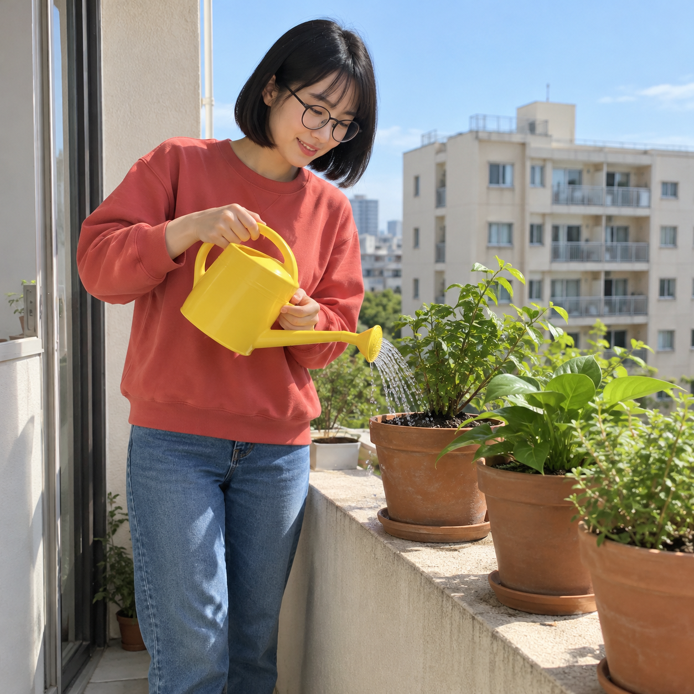
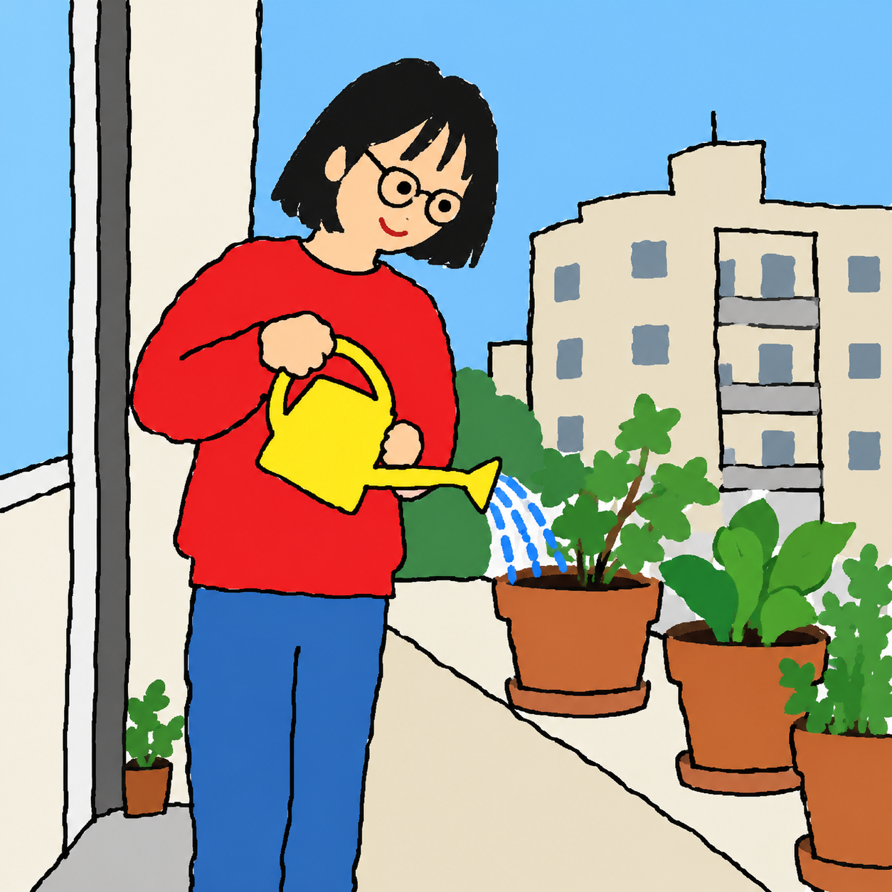

# 초등학생 그림판 변환 v2 등록 검토

2026-10-19 사용자가 표시한 v2 결과에 대해 “결과 확정·PR 제출”을 선택했다. 승인된 v2 문구를 수정 없이 등록하고 Draft PR으로 제출한다. 병합·배포는 이번 요청 범위에 포함되지 않는다.

## 원본과 결과

| 예시 | AI 가상 원본 | 승인한 v2 결과 |
|---|---|---|
| 발코니에서 식물에 물을 주는 성인 |  |  |

새 AI 원본 한 장에 v2 문구만 적용했다. v1 결과를 참조하거나 수정한 결과가 아니다.

AI 생성 원본·결과 · 새 가상 성인 사진 한 장에 공개 v2 프롬프트만 적용했습니다. 단발머리·안경·빨간 상의·파란 바지·노란 물뿌리개와 물주기 동작, 주요 구도를 살렸습니다. 색면에 약한 명암과 그라데이션이 남고 일부 식물의 위치와 형태가 달라졌습니다. 다른 입력 유형은 아직 시험하지 않았습니다.

v1은 빗금 채색이 크레용처럼 보이고 사진에 없던 신발이 추가되어, 페인트통의 단색 면과 원본의 잘린 범위를 강조한 v2로 재시험했다. v1의 실제 문구·출력 식별자·해시는 생성 기록에 남기고 공개 예시 자산에는 승인된 v2만 포함한다.

## 등록과 보존

- 신규 ID: elementary-mspaint, order: -30 (기존 최솟값보다 1 작음). 기존 35개 항목과 상대 순서를 그대로 보존했다.
- 실제 원본·결과: 1254×1254. 원본과 결과를 무손실 WebP로 바꾸고 RGBA 디코딩 픽셀이 입력 PNG와 일치함을 확인했다. 썸네일은 560×560로 비율을 유지했다.
- 실제 생성 문구·모든 시도·자산 SHA-256: [생성 기록](image-generation-2026-10-19-elementary-mspaint.json).

## 실제 적용 문구 — v2

```text
첨부한 사진을 초등학교 저학년 학생이 마우스로 윈도우 기본 그림판에서 보고 따라 그린 서툰 그림으로 바꿔 주세요. 그림판의 딱딱한 기본 연필 선과 페인트통으로 채운 단색 면이 핵심입니다.

주요 대상의 수와 위치, 자세, 시선 방향, 대표 색, 사진의 잘린 범위를 유지하세요. 머리 모양·안경·옷·소품 등 알아볼 특징과 배경의 큰 구조만 남기고 세부 묘사는 과감하게 생략하세요. 사진에 없는 인물이나 물건, 장식은 추가하지 마세요.

검은 윤곽선은 마우스로 한 번에 그리다 삐끗한 것처럼 울퉁불퉁하게 그리세요. 찌그러진 원과 네모, 어색하게 이어진 직선으로 얼굴·몸·사물을 만들고 비례와 원근은 어설프게 표현하세요. 눈은 점, 코와 입은 짧은 선, 손은 투박한 덩어리 정도로 단순화하세요. 작고 낮은 해상도의 그림판 캔버스를 확대한 듯 선 가장자리에 살짝 계단이 보여도 좋습니다.

채색 영역 내부는 페인트통을 한 번 눌러 채운 것처럼 완전히 균일하고 불투명한 단색이어야 합니다. 그림판 기본 팔레트 같은 밝은 색을 적게 쓰세요. 덜 닫힌 선, 잘못 이어진 선, 경계에 남은 작은 흰 틈 몇 군데만 서툴게 남기세요. 넓은 면을 빗금이나 낙서로 칠하지 마세요. 종이 결, 크레용·색연필·붓 질감, 거친 입자, 명암, 그라데이션 없이 흰 디지털 캔버스 위의 투박한 그림으로 표현하세요. 전문가가 정돈한 벡터 일러스트처럼 매끈하게 만들지 마세요. 그림 자체만 출력하고 프로그램 창·도구 모음·글자·서명·워터마크는 넣지 마세요.
```

## 로컬 검증

2026-10-19 전용 작업 공간에서 npm run check가 종료 코드 0으로 통과했다. 단위·데이터 검사 19개, 36개 상세 페이지 빌드, 데스크톱·모바일 Chromium 브라우저 검사 26개가 모두 성공했다. git diff --check도 통과했다. 최신 origin/main과 비교해 기존 35개 항목 내용·순서 보존, 신규 상단 배치, 승인 문구와 생성 기록 일치를 별도로 확인했다.
