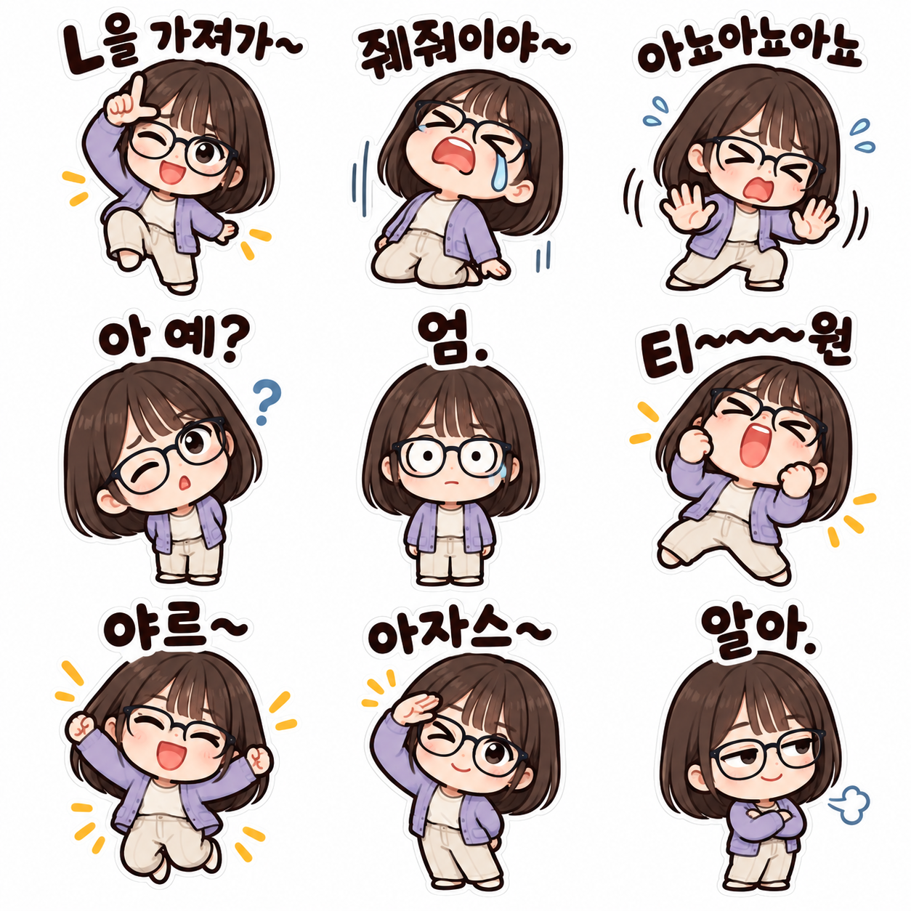

# 흰 배경·잘라 쓰기 이모티콘 수정 검토 — 2026-10-22

사용자 피드백을 반영해 기존 3개 프롬프트의 대표 예시를 불투명 흰 배경으로 교체했다. 사용자가 세 결과를 확인한 뒤 “결과 확정·PR 제출”을 선택했다. 이전 투명 결과와 투명 선택지는 이번 카탈로그에 제공하지 않는다.

## 변경 범위

- 기존 ID·공유 경로·정렬 순서·작성자·원본 사진을 유지했다. 다른 프롬프트 항목은 변경하지 않았다.
- 각 칸에 글씨·캐릭터·소품·효과선을 함께 배치하고, 가로·세로 균등 분할 기준을 사용 안내에 썼다.
- 생성 PNG를 무손실 WebP로 변환하고 디코딩 픽셀이 일치함을 확인했다. 대표 이미지에 맞춰 썸네일을 다시 만들었다.
- 기존 6종의 여성 비교 예시는 이전 v3 문구의 결과임을 표시해 보존한다. 현재 v8-white 문구의 직접 시험 결과로 표시하지 않는다.

## 원본과 확정 결과

### kakao-emoticons

[실제 공개 문구 v6-white](kakao-emoticons-prompt-v6-white.txt)

| 기존 AI 가상 원본 | 확정한 흰 배경 결과 |
|---|---|
|  |  |

AI 가상 원본·결과 · 기존 성인 여성 원본 한 장에 공개 v6-white 문구만 적용했습니다. 단발·안경·청록 카디건과 한국어 감정 9종을 유지한 불투명 흰 배경 시트입니다. 예시의 가로·세로 3등분 경계에서 글씨·손발·효과선 침범이 없음을 확인했습니다. 지시한 여백 비율 자체가 정확히 구현되지는 않았습니다.

### slang-chat-reactions-2026-10

[실제 공개 문구 v8-white](slang-chat-reactions-2026-10-prompt-v8-white.txt)

| 기존 AI 가상 원본 | 확정한 흰 배경 결과 |
|---|---|
|  |  |

AI 가상 원본·결과 · 기존 성인 남성 원본 한 장에 공개 v8-white 문구를 적용한 뒤, 생성된 시트를 별도 AI 편집해 각 문구·캐릭터 그룹을 축소하고 칸 중앙으로 재배치했습니다. 공개 문구만 단독 적용한 결과는 아닙니다. 곱슬머리·수염·초록 상의를 유지하고 원본에 없는 안경이 추가되지 않았습니다. 불투명 흰 배경이며 보정 후 가로 2등분·세로 3등분 경계에서 잘림이 없음을 확인했습니다. 샤갈의 자세는 앉기 대신 서 있는 모습입니다.

추가 배치 편집 문구: [흰 배경 배치 보정](slang-chat-reactions-2026-10-layout-white-2026-10-22.txt). 이 예시는 공개 프롬프트 단독 결과가 아니다.

### meme-reaction-emoticons

[실제 공개 문구 v6-white](meme-reaction-emoticons-prompt-v6-white.txt)

| 기존 AI 가상 원본 | 확정한 흰 배경 결과 |
|---|---|
|  |  |

AI 가상 원본·결과 · 기존 성인 여성 원본 한 장에 공개 v6-white 문구만 적용했습니다. 단발·남색 안경·보라 카디건과 서로 다른 리액션 9종을 유지한 불투명 흰 배경 시트입니다. 가로·세로 3등분 경계에서 잘림이 없음을 확인했습니다. 일부 글씨의 위쪽 여백은 좁으므로 경계를 안쪽으로 옮기지 말고 정확히 등분하세요. 긴 물결 기호 개수는 장식적으로 표현됐습니다.

## 자르기 확인과 한계

| 항목 | 전체 크기 | 나누기 | 한 칸 | 실제 최소 여백 |
|---|---|---|---|---|
| 기본 감정 9종 | 1254×1254 | 가로·세로 3등분 | 418×418 | 11px |
| 카톡 리액션 6종 | 1024×1536 | 가로 2등분·세로 3등분 | 512×512 | 36px |
| 밈 리액션 9종 | 1254×1254 | 가로·세로 3등분 | 418×418 | 5px |

각 분할 경계의 3px 폭 띠에서 흰색 대비 24/255 이상인 픽셀은 0개였다. 최종 파일 3개는 알파 채널이 없는 불투명 RGB 이미지다. 분할선 검사 통과는 해당 예시에 대한 관측이며, 생성기에 지시한 중앙 50% 영역과 여백 비율이 그대로 구현됐거나 앞으로의 모든 생성에서 같은 배치를 보장한다는 뜻은 아니다. 밈 9종의 일부 글씨는 위 여백이 좁으므로 임의의 위치 대신 정확한 등분 경계를 사용한다.

6종은 첫 생성에서 발끝이 경계에 걸려 추가 AI 배치 편집을 거쳤다. 샤갈은 앉기 대신 서 있는 자세이며, 긴 문구와 물결 기호의 표현에도 생성 변동이 있다. 카카오톡 실제 송수신과 이모티콘 상품 등록 규격은 검증하지 않았다.

세 원본은 기존 자산을 그대로 사용했다. 원본 생성 이력은 [상세 생성 기록](image-generation-2026-10-22-emoticon-white-cutout.json)의 referenceGenerationHistory에서 연결한다. 기록에는 최종 공개 문구, 실제 도구 입력, 6종의 추가 지시, 원본·결과·썸네일의 SHA-256, 생성 파일 식별자와 검증 값을 보관했다. 과거 생성 기록은 덮어쓰지 않았다.

## 검증

로컬 npm run check에서 단위 검사 34개·데스크톱/모바일 브라우저 검사 54개가 통과했다. 기본 감정 9종의 검색 안내도 흰 배경·등분 자르기에 맞춰 갱신했으며 수정 후 단위 검사 34개·빌드·검색 안내/SEO 브라우저 검사 8개가 다시 통과했다. PR head의 CI 관측은 제출 기록에 남긴다. 이 변경은 Draft PR 제출 범위이며 병합·운영 배포는 포함하지 않는다.
