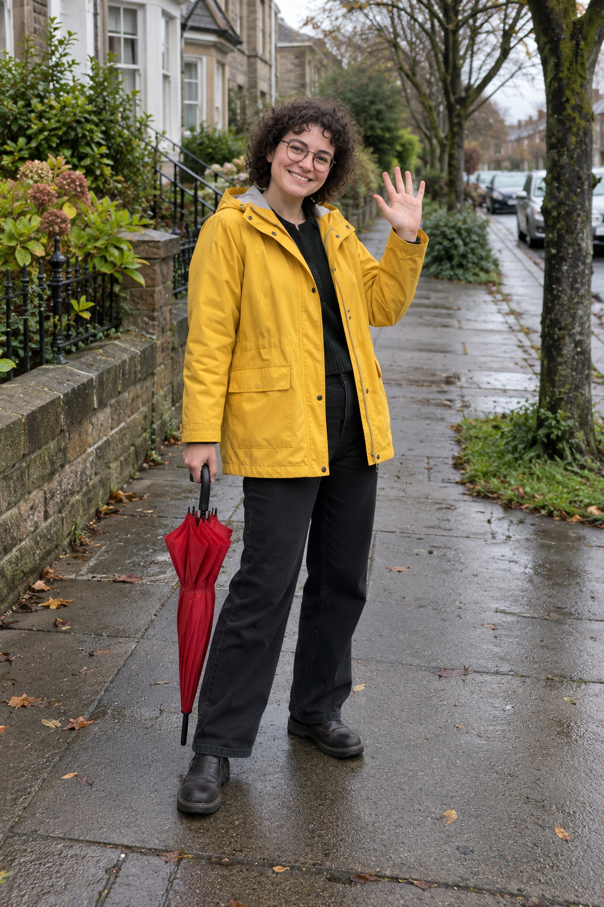
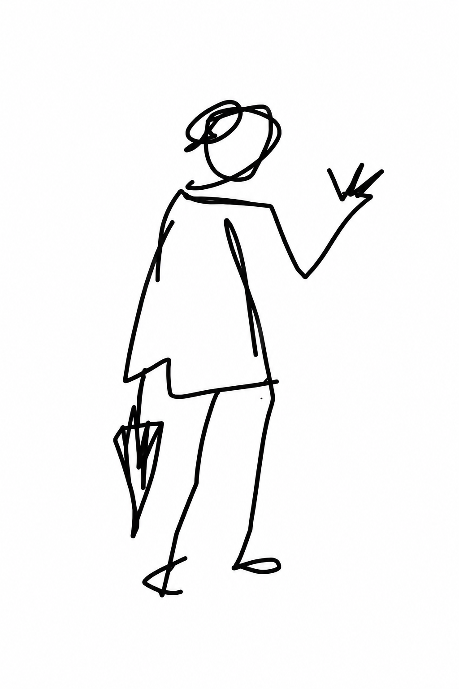
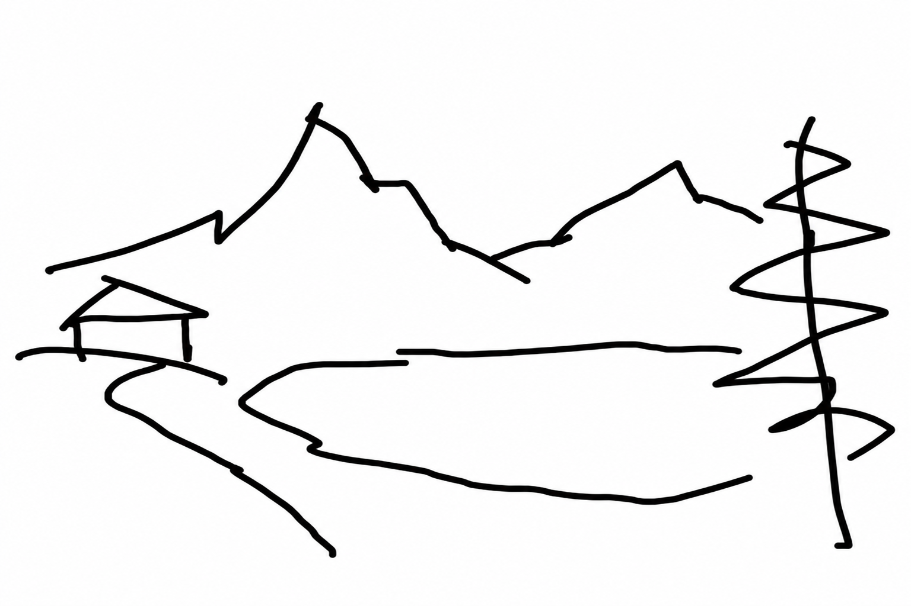
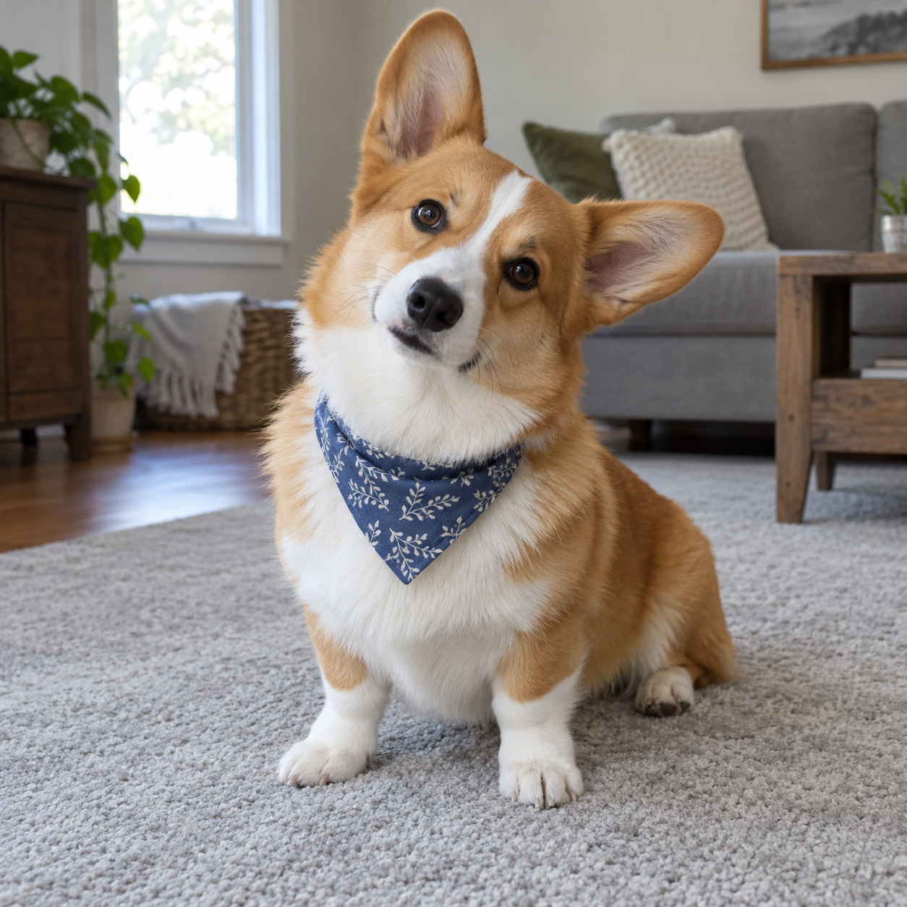
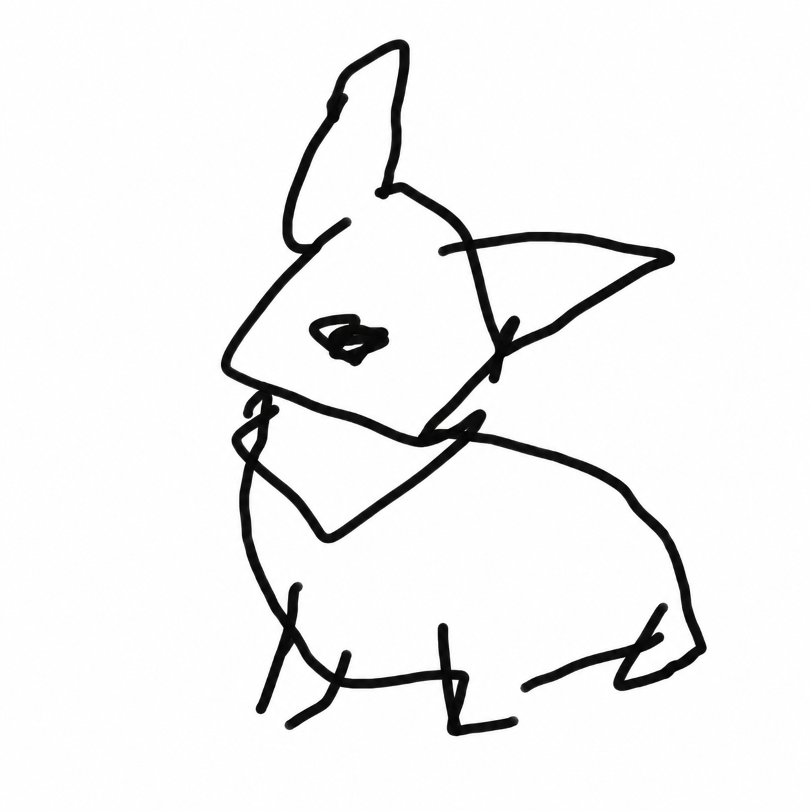

# 눈 감고 그림판으로 그린 내 사진 — v4 등록 검토

2026-10-19 사용자가 v4 결과에 대해 “결과 확정·PR 제출”을 선택했습니다. 승인된 문구와 AI 가상 예시 세 쌍만 등록하며, 병합·배포는 요청 범위에 포함되지 않습니다.

## 원본과 결과

| 예시 | AI 가상 원본 | 승인한 v4 결과 |
|---|---|---|
| 인물 · 우산과 손 인사 |  |  |
| 풍경 · 산과 호수 |  |  |
| 반려동물 · 갸웃한 코기 |  |  |

세 예시는 원본 사진을 변경하지 않고 동일한 v4 문구를 적용했습니다. 스타일 참고 입력·사진별 추가 지시·후편집은 없습니다.

- 인물 · 우산과 손 인사: AI 생성 원본·결과 · 가상 성인 사진 한 장에 공개 v4 문구만 적용했습니다. 손을 든 자세와 반대편 우산을 남기고 얼굴·안경을 생략했습니다. 몸과 발의 연결이 어긋난 검정 낙서이며, 원본의 식별 특징은 크게 줄었습니다. 지시한 6~8번의 마우스 움직임을 정확히 재현한 결과는 아닙니다.
- 풍경 · 산과 호수: AI 생성 원본·결과 · 가상 풍경 사진 한 장에 인물·반려동물과 같은 공개 v4 문구만 적용했습니다. 두 봉우리·왼쪽 집·오른쪽 나무의 배치를 남기고 돌·잔물결·산 내부 묘사를 생략했습니다. 길과 호숫가의 구분이 흐려지고 나무와 집은 원본보다 단순해졌습니다. 지시보다 많은 선이 남습니다.
- 반려동물 · 갸웃한 코기: AI 생성 원본·결과 · 가상 코기 사진 한 장에 인물·풍경과 같은 공개 v4 문구만 적용했습니다. 큰 귀·기울어진 고개·목수건과 앉은 자세는 남고, 눈과 털 무늬는 생략됐습니다. 얼굴 윤곽과 발의 연결이 어긋나며 품종의 세부 유사성은 낮아집니다. 코에는 검은 낙서 덩어리가 남습니다.

## 수정 이력

- v2: 특징은 알아보기 쉬우나 형태가 정돈돼 더 대충 그리도록 수정을 요청받았습니다.
- v3: 긴 설명으로 획을 줄이려 했지만 인물에 옷·손·배경이 늘고 풍경과 동물도 충분히 거칠지 않았습니다.
- v4: 설명을 줄여 6~8번의 성급한 마우스 움직임과 단서 한두 개만 남기도록 바꿨습니다. 얼굴·안경·눈 같은 단서도 함께 사라지고 일부 결과는 지시보다 많은 획을 사용했습니다.
- 미선택 결과는 공개 자산에 포함하지 않으며 문구·출력 식별자·SHA-256만 생성 이력에 남겼습니다.

## 등록

- ID: eyes-closed-mspaint, order: -36. 기존 41개 항목의 내용·순서·order는 그대로입니다.
- 원본·결과 6개를 무손실 WebP로 변환하고 PNG와 RGBA 디코딩 픽셀이 동일함을 확인했습니다. 썸네일은 560×840로 원본 결과의 비율을 유지했습니다.
- 실제 생성 문구, 입력 파일 연결, 원본 생성 문구, 각 자산 크기와 SHA-256은 [생성 기록](image-generation-2026-10-19-eyes-closed-mspaint.json)에 있습니다.

## 실제 적용 문구 — v4

```text
이 사진을 눈 감고 마우스로 2초 만에 찍 그린 그림판 낙서로 바꿔줘. 진짜 못 그려야 해.

흰 바탕에 굵은 검정 선. 전체 그림을 겨우 6~8번의 성급한 마우스 움직임으로 끝내. 대상의 큰 덩어리와 자세만 삐뚤한 고리와 꺾인 막대 몇 개로 뭉개. 원본을 떠올릴 단서 딱 한두 개만 남기고 나머지는 버려.

제대로 된 윤곽선 대신 덜 닫힌 고리, 엉뚱하게 겹친 선, 빗나간 연결을 써. 얼굴과 몸도 모양이 무너져야 해. 풍경이면 덩어리 위치만 남겨. 화면 대부분은 빈 흰색. 주변 배경은 주제가 아니면 지워.

디테일을 그리면 실패야. 표정, 머리카락, 옷, 손발, 털, 장식, 질감을 묘사하지 마. 귀엽거나 깔끔하거나 잘 그린 그림은 실패야. 색칠·글자 없이, 대체 뭘 그린 건지 잠깐 헷갈릴 만큼 엉망인 낙서만 보여줘.
```

## 로컬 검증

2026-10-19 전용 작업 공간에서 npm run check가 종료 코드 0으로 통과했습니다. 단위·데이터 검사 19개, 42개 상세 페이지 빌드, 데스크톱·모바일 Chromium 검사 32개가 모두 성공했습니다. git diff --check도 통과했습니다. 승인 v4 문구 일치, 기존 41개 항목 보존, 신규 상단 배치, 공개 문서의 개인 경로 제외를 별도로 확인했습니다.
