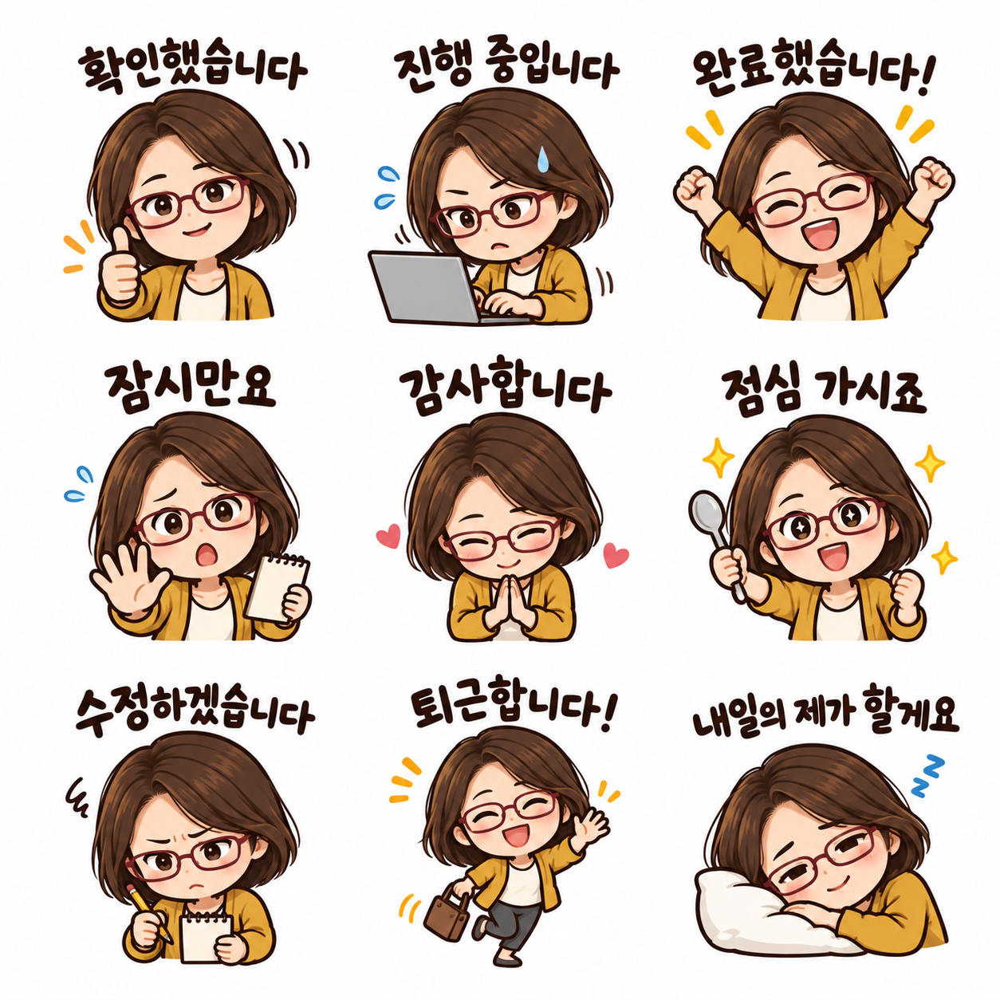
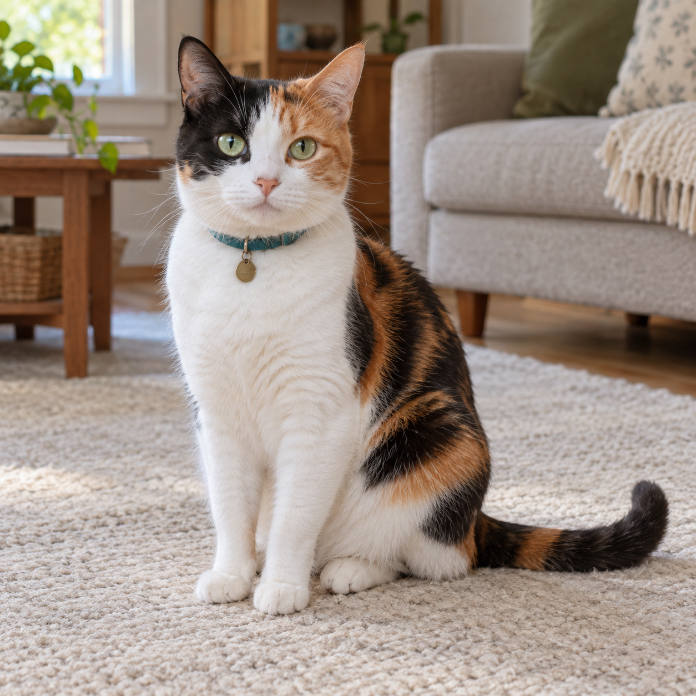
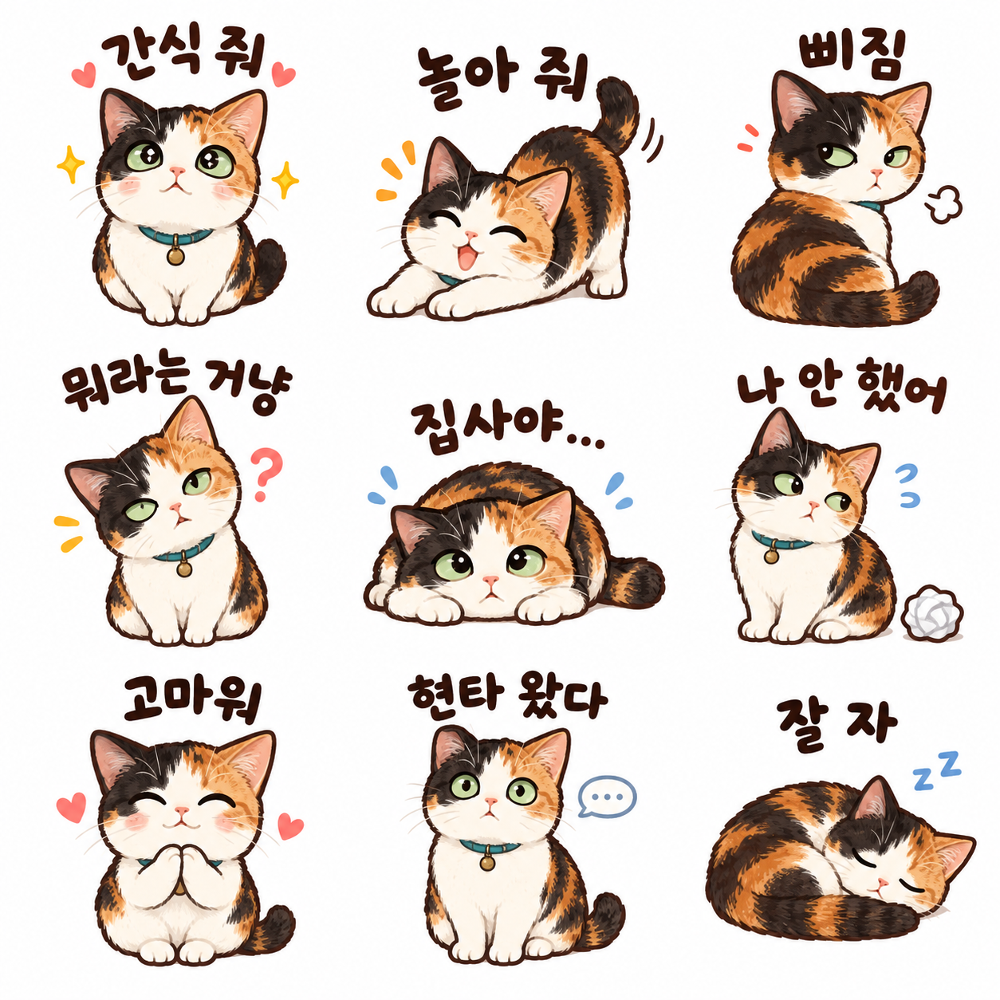
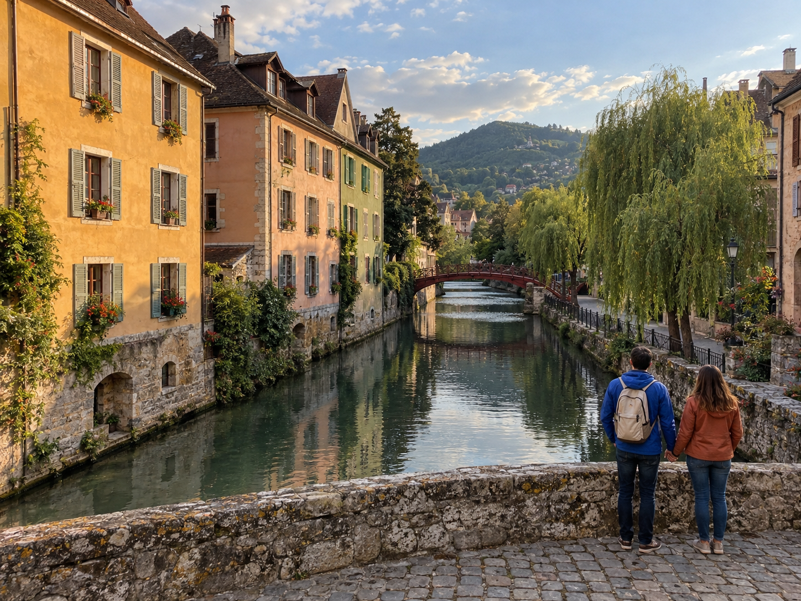
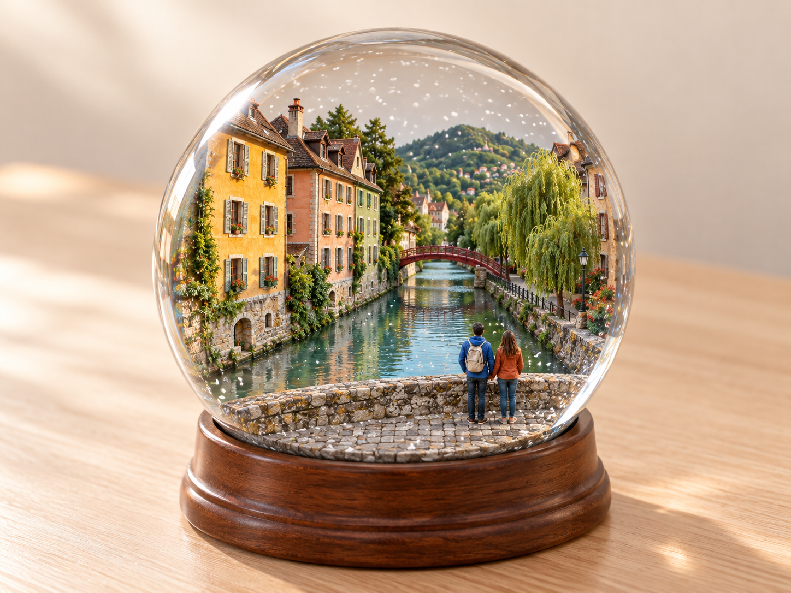

# GA4 추천 3종 등록 검토 — 2026-10-24

사용자가 가상 원본 테스트 결과를 확정·보관한 뒤 세 항목의 일괄 배포를 요청했습니다. 직장인 v1·반려동물 v1·스노볼 v2를 문구 수정 없이 등록합니다. 기존 51개 항목은 그대로 보존하고 요청 순서대로 세 개를 위에 추가해 총 54개입니다.

모든 원본은 AI 가상 사진입니다. 각 결과는 해당 원본 한 장과 공개 문구만 사용했으며 후편집하지 않았습니다. 원본·결과 PNG에서 무손실 WebP로 변환하고 디코딩한 RGBA 픽셀의 일치를 확인했습니다. 썸네일만 비율을 유지해 축소했습니다.

## 내 얼굴로 만드는 직장인 단톡 리액션 9종 — v1

| AI 가상 원본 | 해당 문구로 만든 결과 |
|---|---|
|  |  |

AI 가상 원본·AI 변환 결과 · 원본 사진 한 장에 공개 v1 문구만 적용했습니다. 단발머리·버건디색 안경·겨자색 카디건과 아홉 한글 문구를 반영했습니다. 일부는 상반신으로 표현됐고, 그림과 문구가 요청한 중앙 60% 범위보다 크게 배치되어 목표 여백을 지키지 못했습니다. 얼굴 닮음과 손의 세부 표현은 생성마다 달라질 수 있습니다.

## 우리 반려동물로 만드는 하찮은 리액션 임티 9종 — v1

| AI 가상 원본 | 해당 문구로 만든 결과 |
|---|---|
|  |  |

AI 가상 원본·AI 변환 결과 · 삼색 고양이 사진 한 장에 공개 v1 문구만 적용했습니다. 얼굴의 검정·주황 무늬 방향, 연녹색 눈, 청록색 목걸이와 아홉 한글 리액션을 반영했습니다. 세부 털 무늬는 단순화·변형됐고 일부 보이지 않는 무늬는 새로 해석됐습니다. 그림과 문구가 요청한 중앙 60%보다 커서 목표 여백을 지키지 못했습니다. 강아지 대응은 미검증입니다.

## 내 여행 사진을 추억 스노볼로 — v2

| AI 가상 원본 | 해당 문구로 만든 결과 |
|---|---|
|  |  |

AI 가상 원본·AI 변환 결과 · 원본 여행 사진 한 장에 공개 v2 문구만 적용한 새 변환입니다. 왼쪽 건물·운하·붉은 다리·오른쪽 버드나무와 두 사람의 뒷모습·의상색·배낭을 반영했습니다. v1의 유리구 상단 잘림은 해소됐지만 요청한 제품 크기와 상하 여백은 지켜지지 않았고 언덕·수면에는 실사 사진 같은 표현이 남습니다. 자연 풍경만 있는 입력은 미검증입니다.

## 기록과 검증

- [실제 생성 입력·버전·파일 해시](image-generation-2026-10-24-ga4-three-prompts.json)
- 공개 문구는 data/prompts.json의 해당 ID 및 생성 기록과 동일합니다.
- 반려동물은 고양이 한 장, 스노볼은 운하 도시 여행 한 장을 시험했습니다. 강아지·자연 풍경 전용 입력은 미검증입니다.
- 원본·결과의 상세 비교와 알려진 한계는 각 예시 설명에도 표시합니다.
- 로컬 검증·PR·CI·운영 배포 상태는 게시 실행 기록에서 별도로 확인합니다.

로컬 검증: 단위 검사 34개·54개 항목 빌드 통과. 첫 전체 브라우저 실행은 데스크톱 31개 통과 후 전체 5분 제한에 도달했습니다. 기존 조건 그대로 모바일 프로젝트 전체를 별도 실행해 31개 모두 통과했습니다. 검사 설정·단언은 수정하지 않았습니다. 원본·결과 6개의 무손실 RGBA 픽셀 일치와 공개/실제 문구 일치를 확인했습니다.
