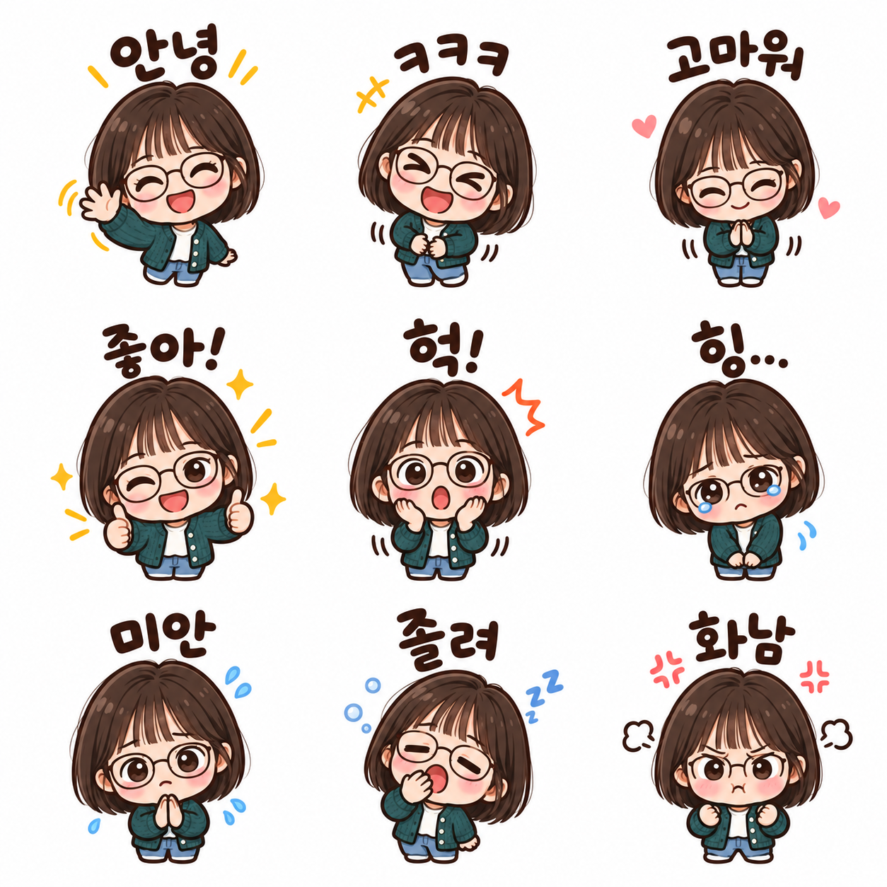

# 카카오톡 이모티콘 9종 — v2 검토

사용자가 v2 결과 확정·PR 제출을 선택했습니다. 공개 문구는 실제 최종 시험 문구와 동일합니다.

| 입력: AI 가상 성인 사진 | 출력: v2 이모티콘 시트 |
|---|---|
|  |  |

AI 생성 원본·결과 · 가상 성인 인물 사진 한 장에 공개 v2 문구만 적용했습니다. 단발머리·둥근 안경·청록색 카디건·아이보리 상의를 살려 한국어 문구가 있는 9개 감정 이모티콘으로 바꿨으며 모든 칸에서 안경을 유지합니다. 투명 여백에 흰 잔점과 고르지 않은 경계가 남고, 몸은 주로 상반신으로 표현됐습니다. 한 장만 시험했으며 카카오 제출 규격이나 9개 개별 파일은 검증·준비하지 않았습니다.

v1의 졸린 칸에서는 안경이 빠졌습니다. v2는 원본 사진에 안경 유지·간결한 색면·깨끗한 투명 여백을 강조한 문구를 적용한 새 시험입니다. 졸린 칸의 안경은 복원됐지만 흰 잔점은 남았습니다. 사진 얼굴의 세부 유사성, 전신 비율, 다른 인물·동물·단체 입력까지 검증한 결과는 아닙니다.

[실제 공개 문구 v2](kakao-emoticons-prompt-v2.txt) · [생성 입력·파일명·해시·검토 기록](image-generation-2026-10-19-kakao-emoticons.json)

원본·결과는 무손실 WebP로 변환하고 디코딩 픽셀을 비교했습니다. 알파와 보이는 RGB는 같으며 완전 투명 픽셀의 숨은 RGB 차이 여부는 생성 기록에 보존했습니다. 썸네일은 비율을 유지해 640×640으로 축소했습니다. 공개 이미지의 잔점을 후편집으로 제거하지 않았습니다.
