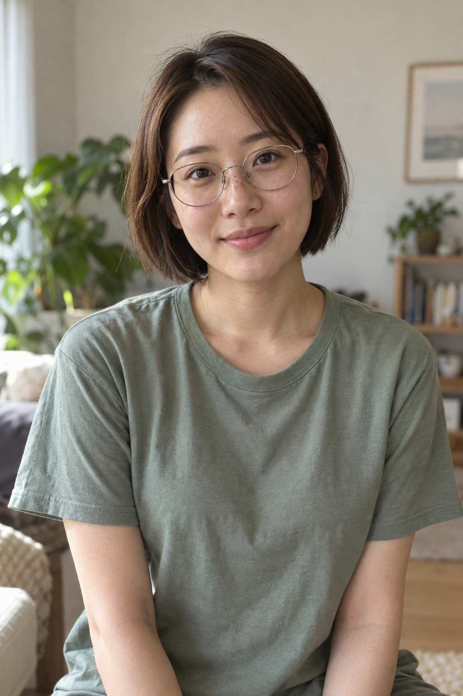
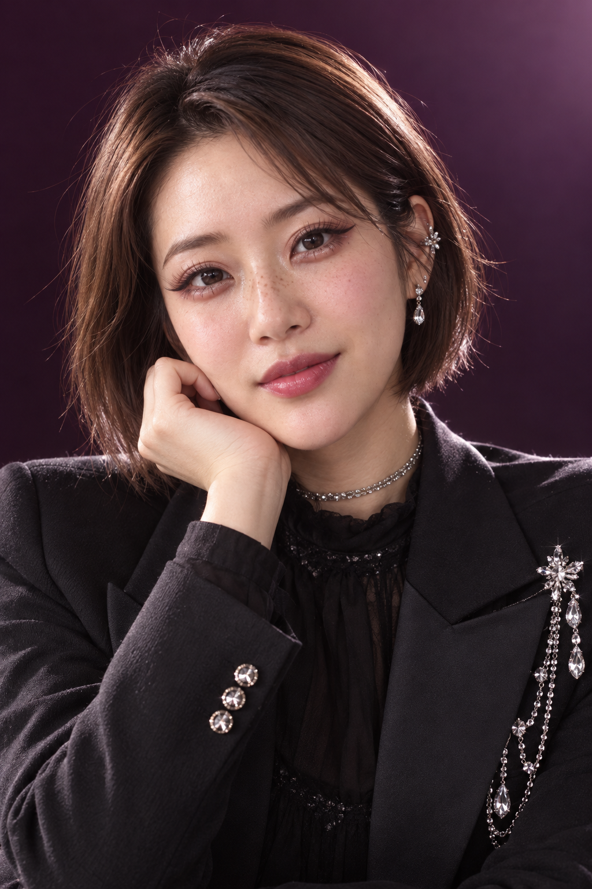
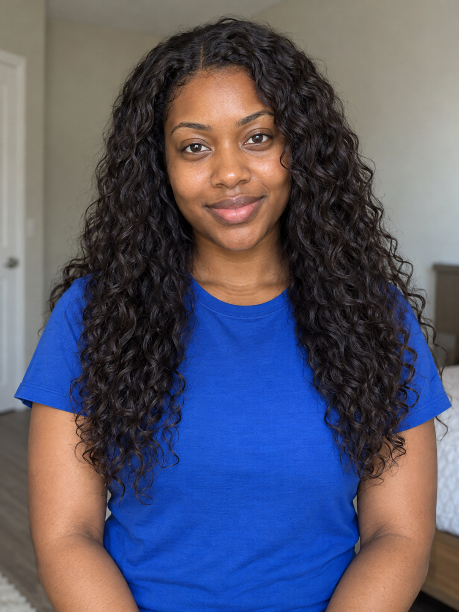
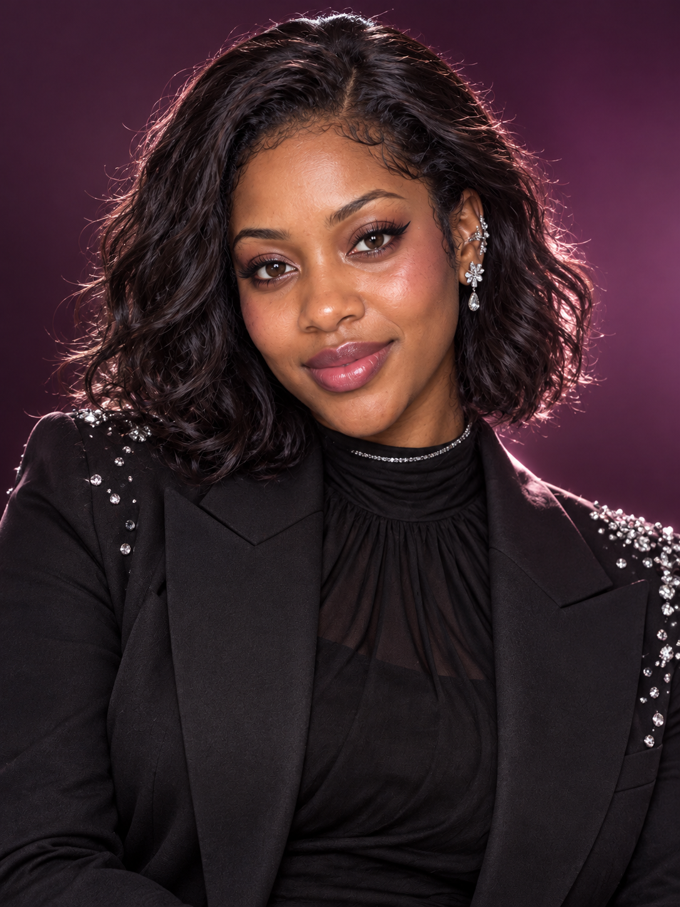

# K-pop 아이돌 등록 검토 — 2026-10-19

사용자가 공개 v4 문구와 두 가상 성인 예시를 확인한 뒤 "좋다 PR"이라고 결과 확정·Draft PR 제출을 요청했습니다. 기존 v4 문구는 수정하지 않았습니다.

| 예시 | AI 가상 원본 | 같은 v4 문구로 생성한 결과 |
| --- | --- | --- |
| 단발·안경 인물 |  |  |
| 긴 곱슬머리 인물 |  |  |

AI 생성 원본·결과 · 가상 27세 성인 사진에 공개 v4 문구만 적용했습니다. 얼굴 인상과 피부색을 살리고 윙 아이라인·속눈썹·블러셔·글로시 립, 단발 볼륨과 크리스털 장식으로 스타일링했습니다. 문구에 따라 안경을 벗겼으며 헤어 실루엣·손 포즈·촬영 범위가 달라졌습니다.

AI 생성 원본·결과 · 긴 곱슬머리의 다른 가상 27세 성인 사진에 같은 v4 문구만 적용했습니다. 얼굴 인상과 짙은 피부색을 살리고 눈화장·블러셔·립을 적용했습니다. 문구의 단발 지시 때문에 긴 머리가 어깨 길이로 짧아졌습니다. 머리 길이 보존에는 실패했으며 자세와 촬영 범위도 바뀌었습니다.

윙 아이라인·컬링 속눈썹·모브 섀도·언더아이 반짝임·핑크 블러셔·로즈 글로시 립이 두 결과에서 보입니다. 메이크업과 헤어 연출 때문에 원본과 인상이 다르게 느껴질 수 있으며 정체성을 완전히 동일하게 복제하는 것은 아닙니다. 추가 인물·읽을 수 있는 문자·로고는 보이지 않습니다.

공개 v4에는 가상 27세와 짧은 단발 지시가 남아 있습니다. 다른 나이대 또는 긴 머리 보존을 보장하지 않습니다. 사용자가 승인한 문구와 실제 예시 연결을 유지하기 위해 제출 단계에서 임의로 일반화하지 않았습니다. 예시 2는 메이크업 변환은 성공했지만 머리 길이 보존에는 실패한 한계 포함 예시입니다.

[실제 적용 문구 v4](kpop-idol-prompt-v4.txt)와 [실제 도구 입력·원본 생성 문구·치수·SHA-256·버전 이력](image-generation-2026-10-19-kpop-idol.json)을 연결합니다. v1·v2의 부족한 메이크업과 v3의 출력 차단 이력도 생성 기록에 구분했습니다. 최종 예시는 같은 원본에 v4만 적용했으며 결과를 덧칠하거나 사진별 추가 지시를 사용하지 않았습니다.

원본·결과 WebP 4개는 원본 PNG와 디코딩 픽셀이 동일한 무손실 변환입니다. 썸네일만 비율을 유지해 폭 560픽셀로 축소했습니다.

전용 브랜치: codex/kpop-idol. 시작 기준: e1a728d958e435dbee5410ab8d80fed1199c8575. 제출 준비 중 최신 main e613dbf156015162fe3fd9ee4933b826a66d2b5b을 fast-forward로 반영했습니다. 기존 38개 항목의 내용과 상대 순서를 유지하고 새 항목 order를 -33로 설정했습니다. 병합·배포는 이번 요청 범위에 포함되지 않습니다.

## 로컬 검증

- npm run check 통과: 단위 검사 19개, 정적 빌드 39개 항목, 데스크톱·모바일 Chromium 검사 28개.
- 두 예시 전환 시 원본·결과·다운로드가 함께 바뀌고 공개 v4 문구는 유지되는 것을 두 화면 크기에서 확인했습니다.
- 기존 38개 카탈로그 항목의 내용·상대 순서 유지, 공개 문구와 두 실제 v4 도구 입력 일치 확인.
- 원본·결과 WebP 4개와 PNG의 디코딩 픽셀 일치 확인. 썸네일은 비율 유지 축소본.
- git diff --check 통과. 공개 생성 기록에 개인 절대 경로·인증 정보 없음.
