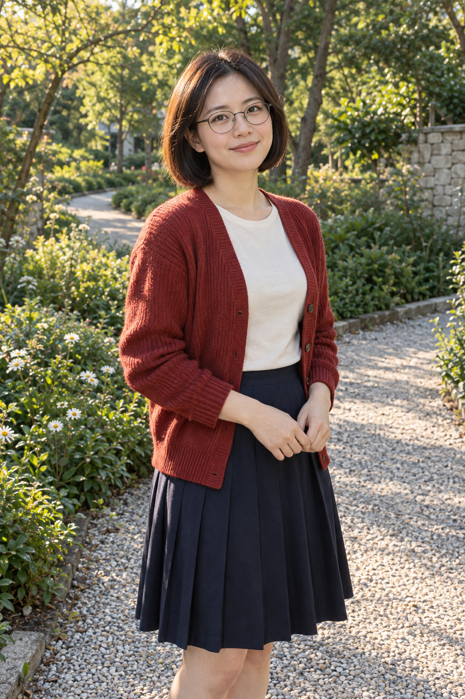
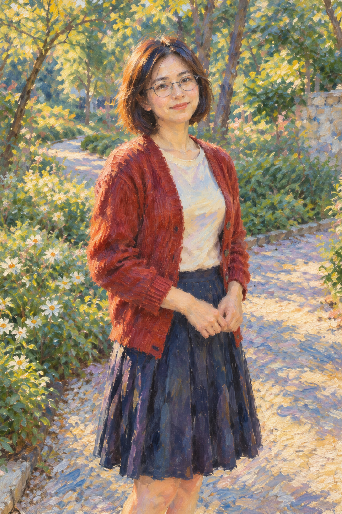
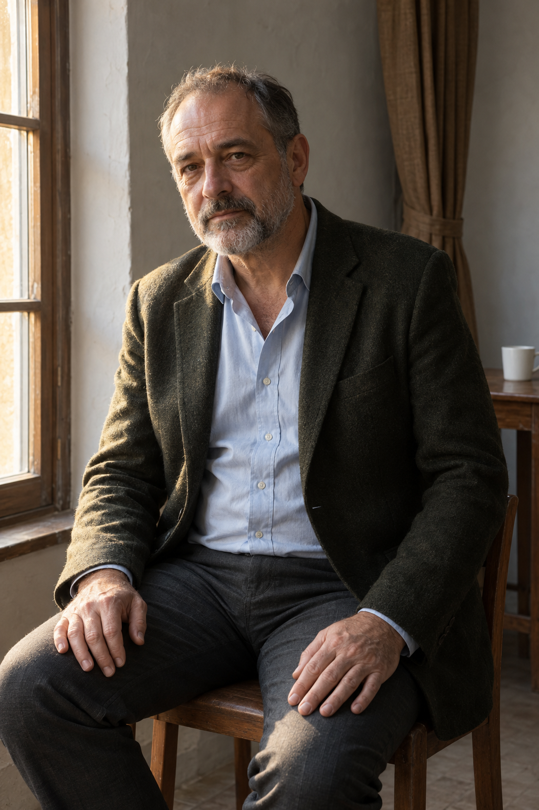
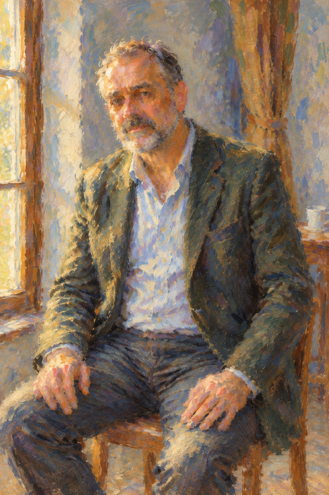

# 모네 인물화 v5 검토

- 승인: 2026-10-22 사용자가 “v5로 확정·기존 PR 요청 진행”을 선택해 사진 한 장용 v5 문구·두 예시와 Draft PR 제출을 확정했다.
- 항목: `monet-portrait`, `codex/monet-painting` 브랜치.
- 공개 문구: [v5](monet-portrait-prompt-v5.txt). [실제 생성 기록](image-generation-2026-10-22-monet-portrait.json).
- 입력 계약: 본인 인물 사진 한 장 + 공개 문구. 작품 이미지·다운로드·추가 스타일 지시가 필요하지 않음.
- 야외 여성·실내 남성 원본과 결과는 모두 AI 가상 예시. 두 입력에 같은 문구를 그대로 적용했다.

| 예시 | 원본 | 결과 |
|---|---|---|
| 야외 여성 |  |  |
| 실내 남성 |  |  |

야외 여성은 단발·안경·붉은 카디건·치마와 자세가 유지됐으며 얼굴과 손가락이 단순화됐다. 색감이 더 선명하고 안경·얼굴 윤곽은 비교적 또렷하다. 실내 남성은 수염·재킷·양손 위치와 창가 구도가 유지됐으며 얼굴과 컵 세부가 줄고 깊은 그늘이 밝아졌다. 넓은 색면과 붓질은 보이지만 특정 모네 작품과의 일치나 정밀한 얼굴 동일성을 보장하지 않는다.

v4는 가상 원본과 사용자 제공 회화 참조 2장을 함께 사용한 제작용 비교였다. 최종 공개 v5는 회화 참조를 제거하고 문구 안에 표현 방식을 기술해 두 원본을 다시 시험했다. v4 결과를 v5로 만든 것처럼 표기하지 않는다. 제공 회화 이미지는 공개 자산에 포함하지 않는다. 참고로 제공 이미지 4번은 [오르세 미술관 기록](https://www.musee-orsay.fr/fr/oeuvres/la-balancoire-1096)의 르누아르 《그네》이며 최종 테스트의 입력이 아니다.

원본과 결과는 Sharp 무손실 WebP 변환 후 디코딩 픽셀 전체가 PNG와 같은지 검사했다. 썸네일만 화면 비율을 유지하며 높이 800px로 축소했다. 카탈로그의 기존 항목과 상대 순서는 보존했다.

## 로컬 검증

- npm ci: 성공, 감사 결과 취약점 0개.
- npm run check: 단위 검사 34/34, 빌드 48개 항목, 데스크톱·모바일 E2E 56/56 통과.
- git diff --check: 통과.
- 원본·결과 무손실 WebP 4개: PNG와 디코딩 픽셀 전체 일치.
- 카탈로그 기존 47개 항목·상대 순서 보존, 신규 order -42.
- 카탈로그·별도 문구 파일·두 실제 변환 입력 문구 일치, 각 입력 사진 한 장만 사용.
- 원격 push dry-run 성공. 현재 검토한 파일로 Draft PR 제출을 진행한다. 병합·배포는 이번 요청 범위에 포함되지 않는다.
