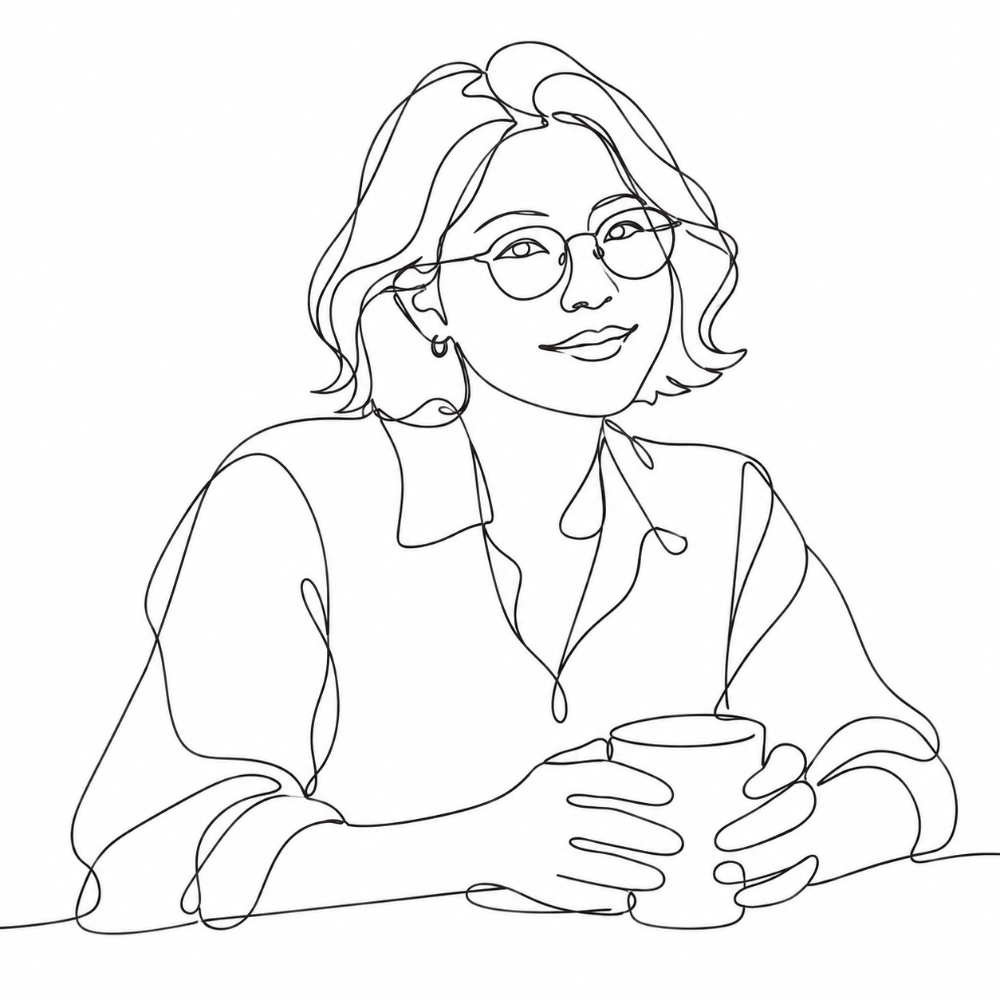
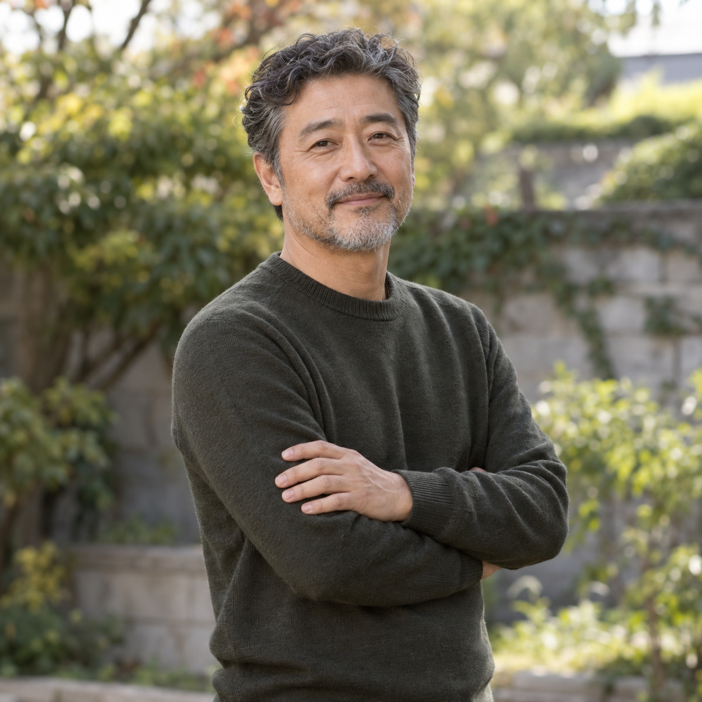
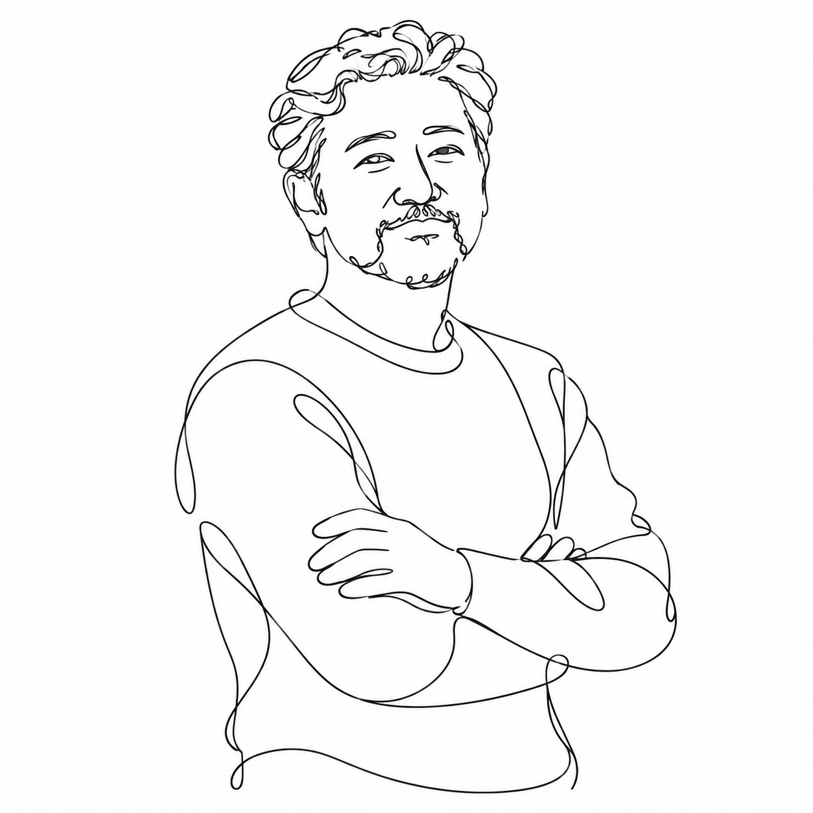

# 원라인 드로잉 v3 등록 검토 — 2026-10-26

사용자가 두 인물 시험 후 **결과 확정·PR 제출**을 선택했다. 공개 문구는 두 결과에 실제 사용한 v3 원문 그대로이며 사진별 보정 지시를 추가하지 않았다. 제출 범위는 갤러리 등록·검증·Draft PR이다.

- 브랜치: codex/line-drawing
- 최초 기준: f21a684fe89d40ca78ba3a7ac01339fd7ad413b5
- 제출 전 최신 main 반영: 74a35c0827ac5e8e662f6fb0f9c07b5c63fe2b4a
- 원본·head 저장소: Q07K/prompt-gallery, remote origin
- 전용 관리 작업 공간을 재사용했고 다른 주제의 변경은 포함하지 않았다.
- 카테고리: 일러스트. 공개 입력 안내는 실제 시험한 인물 사진 한 장으로 한정한다.
- 공개 문구: [v3 원문](one-line-drawing-prompt-v3.txt)
- 실제 요청·원본 생성 문구·치수·SHA-256: [생성 기록](image-generation-2026-10-26-one-line-drawing.json)

## 원본과 결과

두 원본은 AI가 만든 가상 성인 사진이다. 각 시험에는 원본 한 장과 같은 v3 문구만 사용했으며 추가 지시·스타일 참고 이미지·후편집은 없다. 제작 중 사용자 첨부 네 장의 스타일을 눈으로 참고했지만 그 이미지를 변환 도구나 공개 자산에 포함하지 않았다.

| 예시 | AI 가상 원본 | v3 결과 |
|---|---|---|
| 안경·단발·컵 |  |  |
| 곱슬머리·수염·팔짱 |  |  |

## 관찰과 한계

- AI 가상 원본·AI 변환 결과 · 원본 사진 한 장에 공개 v3 문구만 적용했으며 추가 지시·스타일 이미지·후편집은 없습니다. 단발·안경·귀걸이·셔츠와 두 손으로 컵을 감싼 구도를 유지했고, 긴 곡선과 루프로 연결했습니다. 일부 얼굴 선은 분리되어 있으며 귀 아래·옷깃·소매에 장식적인 루프가 생겼고 얼굴과 손가락은 단순화됐습니다. 엄밀한 한 획을 보장하지 않습니다.
- AI 가상 원본·AI 변환 결과 · 원본 사진 한 장에 같은 공개 v3 문구만 적용했으며 추가 지시·스타일 이미지·후편집은 없습니다. 짧은 곱슬머리·수염·크루넥 상의와 팔짱 자세를 유지했습니다. 머리와 수염의 작은 루프는 다소 복잡하며 주름·흰머리 색이 사라져 젊게 느껴질 수 있습니다. 가려진 손의 일부가 드러나고 손가락·손목 형태와 몸통 방향이 재해석됐습니다. 일부 얼굴 선과 작은 검은 눈동자 면이 남으며 엄밀한 한 획을 보장하지 않습니다.
- 두 결과 모두 긴 곡선·루프와 넓은 흰 여백을 사용한다. 엄밀히 단일 경로인지 검증하지 않았으며 일부 분리된 선과 작은 검은 면이 남는다.
- 다른 연령·다인·동물·풍경의 성능은 확인하지 않았다. 손가락의 정확한 재현이나 원본과 같은 나이 인상은 보장하지 않는다.

## 제작 이력과 자산 검증

- v1: 배경·머리카락 선 과밀과 회색 입술 면. v2: 배경 생략과 선 밀도 감소. 두 버전 모두 공개 예시가 아니다.
- 사용자의 원라인 느낌 피드백으로 v3를 제작하고 다른 인물에 원문 그대로 추가 시험했다. 버전별 실제 문구·출력 파일 식별자·해시를 생성 기록에 보존했다.
- 원본 두 장과 결과 두 장을 무손실 WebP로 변환한 뒤 디코딩 RGBA 픽셀의 완전 일치를 확인했다. 썸네일은 첫 결과의 비율을 유지해 너비 480px로 축소했다.
- 첫 예시와 카드 결과·크기·원본 연결이 같으며 각 예시의 원본과 결과는 서로 분리했다.
- 기존 카탈로그 항목과 order를 모두 유지하고 현재 최솟값보다 작은 -56를 새 항목에 부여했다.

## 검증

- npm run check: 단위 검사 34개와 61개 프롬프트 정적 빌드 통과. 최초 브라우저 실행은 48개 통과 뒤 로컬 전체 300초 제한으로 16개가 미실행됐다. 테스트 항목 실패는 없었다.
- npm run test:e2e -- --global-timeout=900000: 같은 전체 브라우저 검사 64개 통과. 데스크톱·모바일 프로젝트, 단일 worker, 각 테스트의 제한과 검증 항목은 유지하고 전체 실행 한도만 15분으로 늘렸다.
- 새 항목 두 예시의 결과·원본·다운로드 연결과 동일 문구 유지가 두 프로젝트 모두에서 검증됐다.
- 공개 문구와 두 실제 입력의 일치, 기존 60개 카탈로그 항목 보존, 문서 링크, 공개 기록의 개인 경로 제거, git diff --cached --check 통과.

## 최신 main 통합

전체 64개 브라우저 검사가 끝난 뒤 다른 프롬프트 한 개가 main에 추가됐다. 당시 통과한 전체 검사의 기준은 6003fe01ffc2150521d995913e4e72330c75ff2c이고, 최종 제출 기준은 74a35c0827ac5e8e662f6fb0f9c07b5c63fe2b4a이다. 새로 병합된 항목까지 기존 61개를 모두 보존하고 새 항목의 order를 -56로 조정했다. 최종 상태에서 npm test 34개, npm run build 62개 공유 페이지, 두 화면 크기의 관련 브라우저 검사 8개를 추가로 통과했다. 관련 검사는 이번 항목의 두 예시 전환, 모든 카드와 원본 이미지 로딩, 문구 복사, 상세 공유 URL을 포함한다. 기존 61개 항목 보존과 최상단 order도 다시 비교했다.
