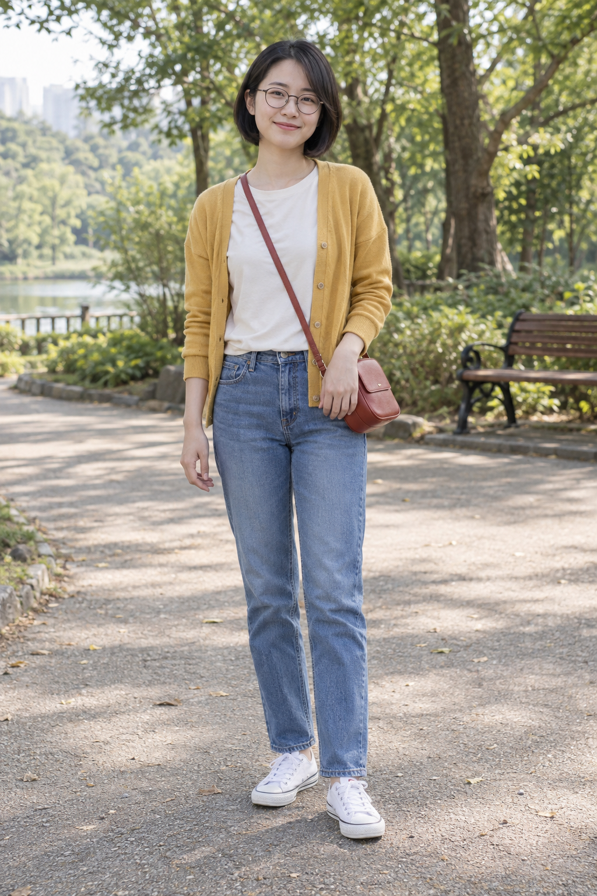
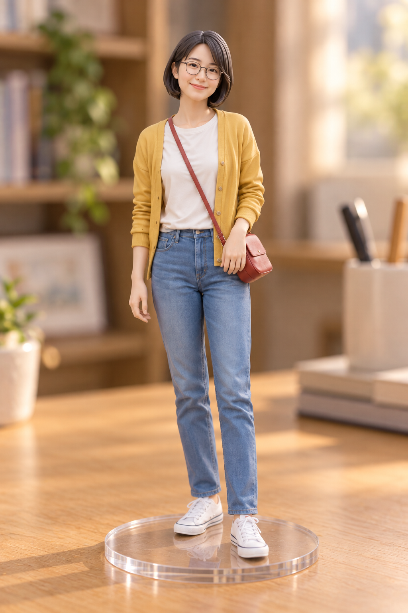

# 사진을 피규어로 — v1 확정 예시

사용자는 2026-10-24에 채팅 선택지에서 **결과 확정·PR 제출**을 선택했습니다. 확정된 v1 문구와 생성 이미지를 수정 없이 등록합니다.

## 원본과 결과

| 입력: AI 가상 성인 전신 사진 | 출력: v1 피규어 변환 |
|---|---|
|  |  |

[실제 공개·시험 문구 v1](photo-to-figurine-prompt-v1.txt) · [도구 입력·생성 파일 식별자·크기·해시·픽셀 검증 기록](image-generation-2026-10-24-photo-to-figurine.json)

내장 image_gen.imagegen으로 가상 원본을 생성하고 그 사진 한 장과 공개 v1 문구만 입력했습니다. 추가 스타일 참조나 사진별 추가 지시, 후편집은 없습니다. 원본·결과 WebP는 PNG와 디코딩 RGBA 픽셀이 동일한 무손실 변환이고, 썸네일만 비율을 유지해 640px 너비로 축소했습니다.

## 관찰

- 인물 한 명과 단발·가르마·안경·의상·가방·포즈 유지
- 매끈한 도색 얼굴과 조형된 머리카락, 투명 받침대와 책상 위 그림자
- 전신과 받침대가 잘리지 않고 실내 제품 사진 구도로 표현

## 한계

- 눈이 커지고 얼굴이 부드럽게 미화됨
- 요청한 약 6등신보다 길쭉한 비례
- 의상에 사실적인 직물 질감이 남음
- 실제 22cm 크기는 이미지 한 장으로 검증 불가
- 가상 성인 전신 한 장만 시험; 다인·반신·다른 연령대 미검증

## 등록과 제출 범위

- 항목: photo-to-figurine / 제품 / 인물 사진 한 장
- 신규 항목은 기존 최솟값보다 작은 order를 부여했으며 기존 항목의 데이터·상대 순서는 보존합니다.
- 브랜치: codex/photo-to-figurine
- 기준 커밋: 9a3565bbad4c039c9726f57e89705b4904538399
- base·head 저장소: Q07K/prompt-gallery, origin
- 승인 범위: 등록·검증·Draft PR 제출. 병합·운영 배포는 포함하지 않습니다.
- 검증 명령: npm run check, git diff --check. 실제 결과는 PR 본문에 기록합니다.
