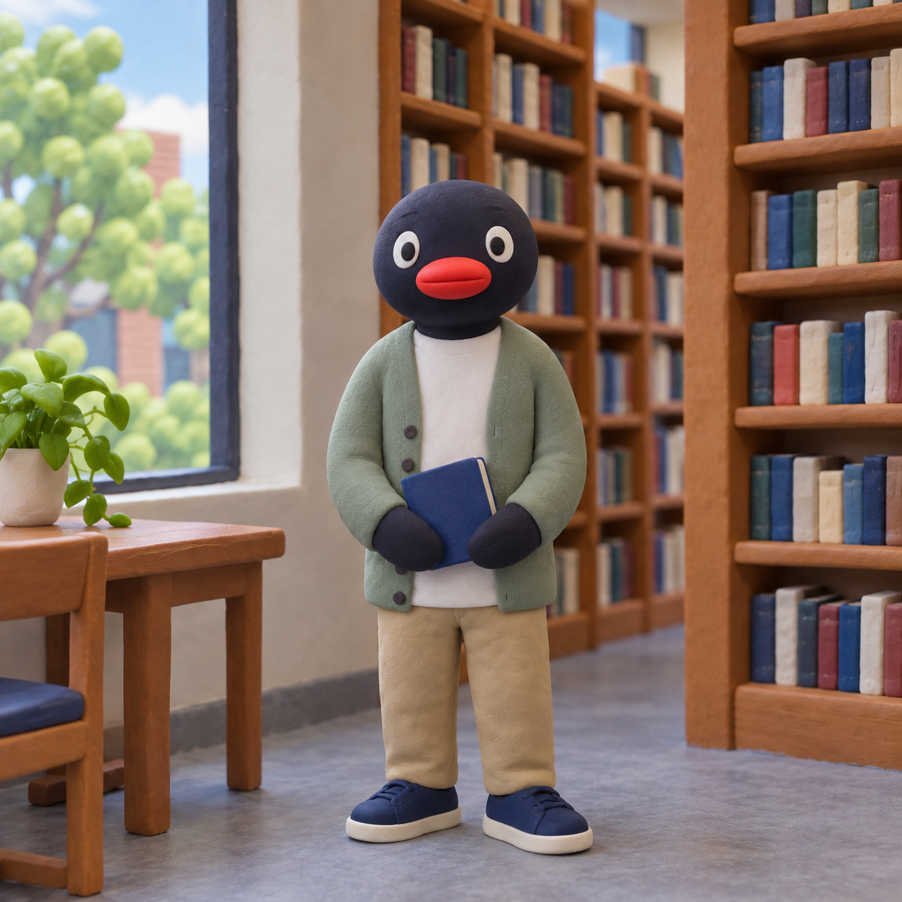
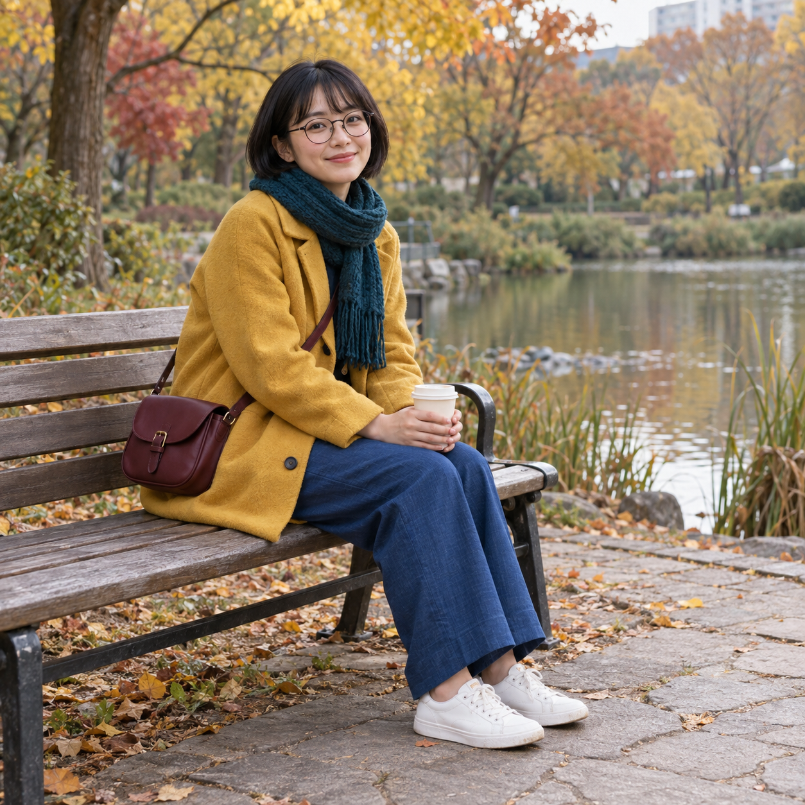
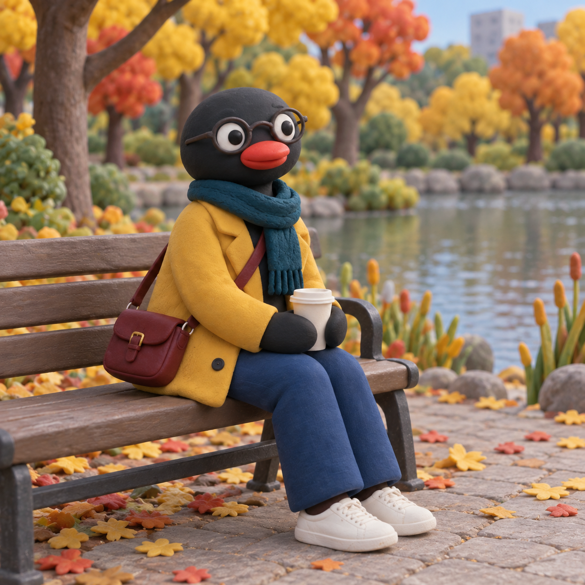
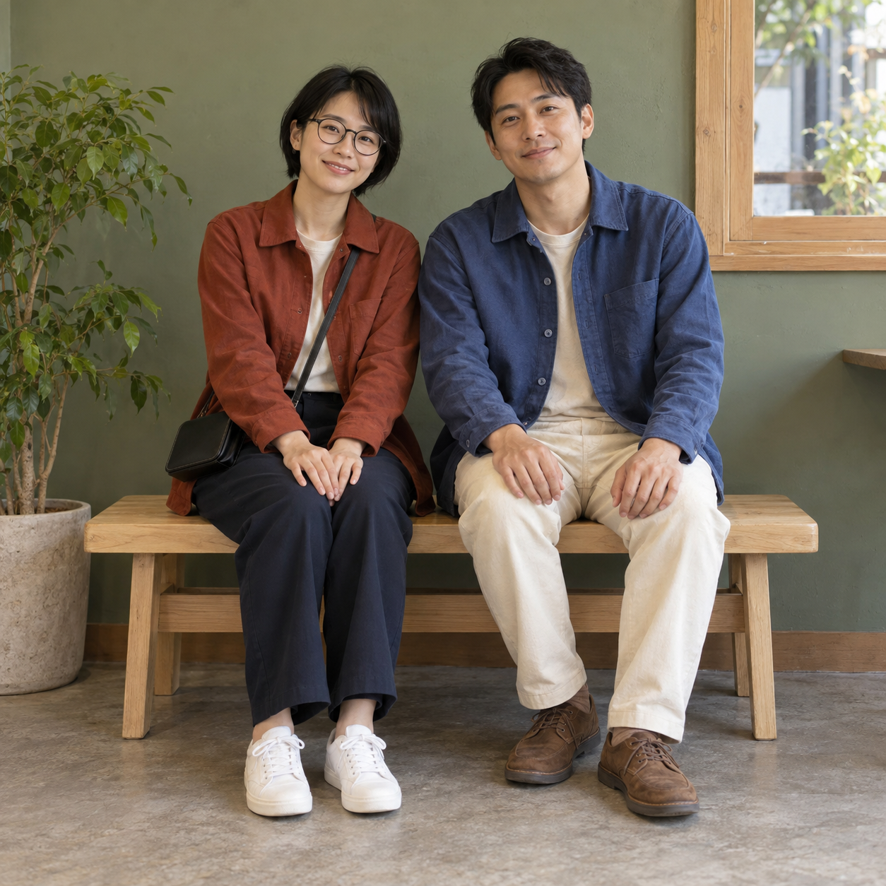
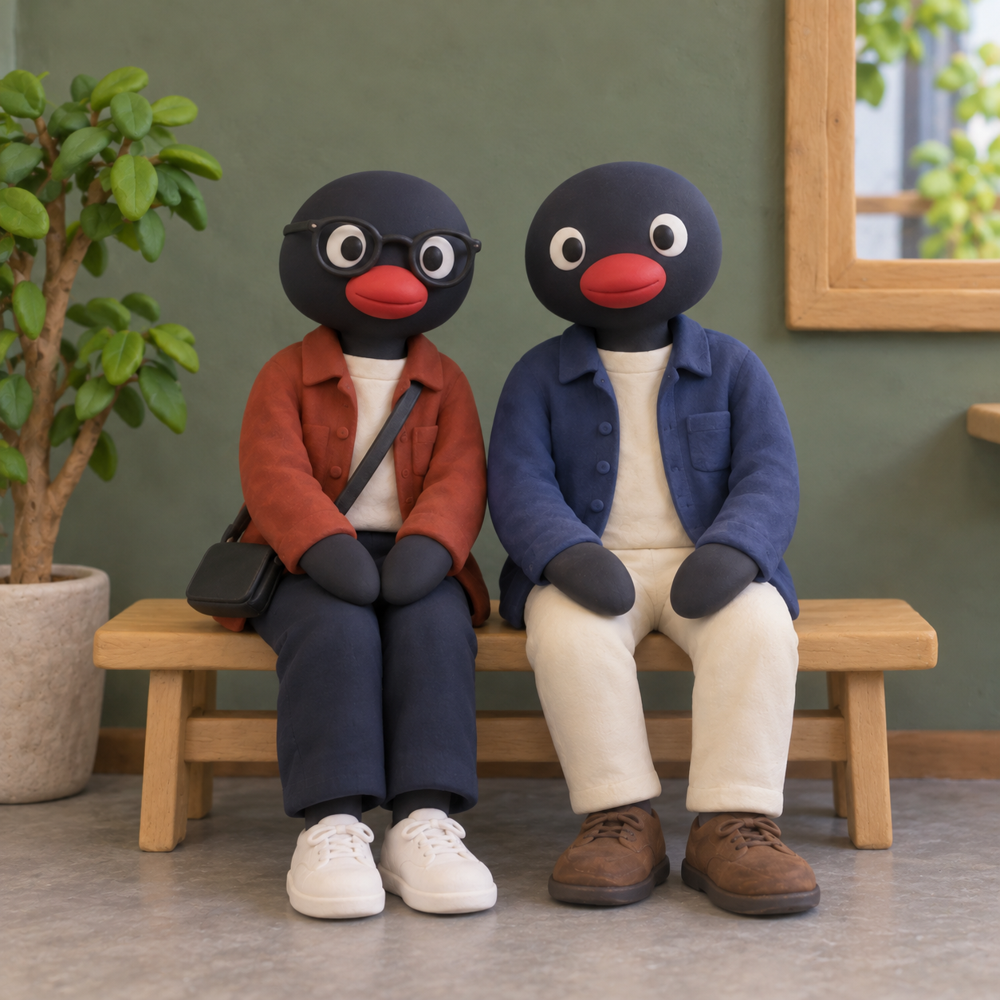

# 핑구 착용물 보존과 사진 한 장 사용 — v6 등록 검토

안경 없는 사람에게 안경이 추가된다는 사용자 보고를 받아 사람별 착용물 유무를 구분했다. 사용자는 v5 세 결과를 검토하고 “결과 확정·PR 제출”을 선택했다. 등록 단계에서 사진 한 장 사용 원칙을 확인해, v5의 착용물 조건을 유지하면서 스타일 참고 의존만 제거한 v6를 같은 세 원본으로 재시험했다. v6 이미지는 별도 확정을 받았다고 표시하지 않으며 이 Draft PR에서 검토할 수 있다.

[실제 공개 v6 문구](pingu-clay-prompt-v6.txt) · [사용자 검토 v5 문구](pingu-clay-prompt-v5-reference-assisted.txt) · [실제 입력·버전·원본 생성 문구·치수·해시](image-generation-2026-10-23-pingu-accessories.json)

| 사례 | AI 가상 원본 | v6 결과 |
|---|---|---|
| 안경 없음 · 도서관 |  |  |
| 안경 있음 · 가을 공원 |  |  |
| 두 사람 · 안경 유무 구분 |  |  |

세 결과 모두 원본 사진 한 장과 동일한 공개 v6 문구만 전달했다. 스타일 참고·사진별 추가 지시·후편집은 없다.

- 안경 없음 · 도서관: AI 가상 원본·AI 변환 결과 · 사진 한 장과 동일한 공개 v6 문구만 사용했으며 스타일 참고·추가 지시·후편집은 없습니다. 안경 없는 상태를 유지하고 가방·목도리·컵을 추가하지 않았습니다. 옷·신발·책과 도서관 배경을 옮겼습니다. 머리 모양과 세밀한 닮음·눈 크기·정확한 자세는 단순화됐습니다. 이 사례는 1회 시험으로 반복 생성의 무오류를 보장하지 않습니다.
- 안경 있음 · 가을 공원: AI 가상 원본·AI 변환 결과 · 사진 한 장과 동일한 공개 v6 문구만 사용했으며 스타일 참고·추가 지시·후편집은 없습니다. 안경·목도리·가방·컵·바지·흰 운동화와 앉은 자세를 유지했습니다. 머리 모양과 세밀한 닮음·눈 크기·정확한 자세는 단순화됐습니다. 이 사례는 1회 시험으로 반복 생성의 무오류를 보장하지 않습니다.
- 두 사람 · 안경 유무 구분: AI 가상 원본·AI 변환 결과 · 사진 한 장과 동일한 공개 v6 문구만 사용했으며 스타일 참고·추가 지시·후편집은 없습니다. 왼쪽 사람만 안경·가방을 유지하고 오른쪽에는 둘 다 추가하지 않았습니다. 두 사람의 의상·신발과 앉은 위치를 유지했습니다. 머리 모양과 세밀한 닮음·눈 크기·정확한 자세는 단순화됐습니다. 이 사례는 1회 시험으로 반복 생성의 무오류를 보장하지 않습니다.

## 비교와 한계

v3의 새 안경 없는 사진 1회 비교에서는 오류가 재현되지 않았다. 사용자 보고를 부정하거나 오류율 감소를 수치화하지 않는다. v4는 안경 없는 입력을 처리했지만 기존 안경·신발을 제거해 폐기했다. v5는 참고 이미지를 함께 사용한 세 사례에서 착용물 조건을 만족했고 사용자가 검토했다. 등록용 v6는 참고 이미지 의존을 없애고 세 사진을 다시 생성했다. 각 버전의 실제 입력과 관찰은 생성 기록에 따로 남겼다.

현재 v6 세 사례에서 안경·가방 유무가 원본과 맞았다. 각 사례 한 번뿐이며 모든 사진·반복 생성의 무오류를 보장하지 않는다. 머리 모양·세밀한 닮음·눈 크기·정확한 자세는 변한다. v5 대비 조형·질감도 조금 달라졌다.

## 자산과 이력

여섯 원본·결과 WebP를 무손실로 변환하고 디코딩한 RGBA 픽셀 전체 일치를 확인했다. 썸네일만 800px로 축소했다. 기존 50개 항목 중 다른 49개와 pingu-clay의 ID·order -44·상대 순서는 보존했다. 과거 v3의 문구·생성 사실은 유지하고 비교 이미지를 당시 커밋에 고정했다. 현재 사용하지 않는 스타일 참고는 공개 자산에서 제거했다.

## 검증과 제출 범위

npm run check 통과: 단위 검사 34/34, 50개 항목 빌드, 데스크톱·모바일 Chromium 검사 60/60. git diff --check 통과. 다른 49개 항목과 전체 ID·order·상대 순서, 단일 사진 입력·실제 문구 일치·자산 치수·해시·문서 링크도 검증했다. 사용자 요청은 Draft PR 제출까지이며 병합·운영 배포는 이 요청에 포함되지 않는다.
