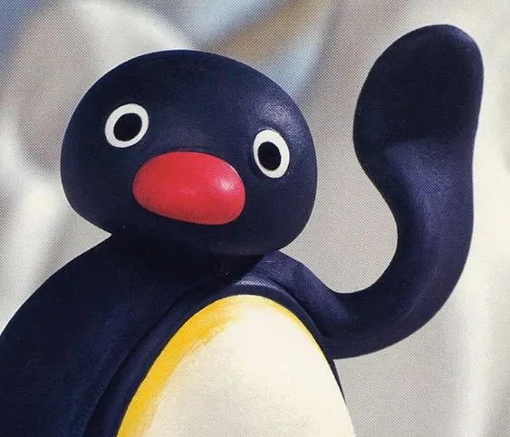

# 핑구 점토 펭귄 v3 등록 검토

사용자가 v3 결과에 대해 “결과 확정·PR 제출”을 선택했다. 같은 전용 브랜치에서 승인된 결과와 문구를 등록하고 Draft PR으로 제출한다. 병합·운영 배포 요청은 없다.

[실제 공개 문구 v3](pingu-clay-prompt-v3.txt) · [실제 입력·문구 이력·치수·해시·픽셀 검증](image-generation-2026-10-22-pingu-clay.json)

| 예시 | 입력 1: AI 가상 원본 | 입력 2: 사용자 제공 스타일 참고 | v3 결과 |
|---|---|---|---|
| 가을 공원의 성인 인물 |  |  |  |

두 원본을 위 순서로 첨부하고 공개 v3 문구 그대로 생성했다. 추가 지시·후편집은 없다. 사용자 제공 참고는 AI 가상 인물 사진과 별개의 입력이며 외부 출처 URL은 제공되지 않았다.

AI 가상 원본·AI 변환 결과 · 성인 인물 사진 1장과 사용자가 제공한 핑구 스타일 참고 1장에 공개 v3 문구를 그대로 적용했습니다. 검은 얼굴·흰 테두리 눈·빨간 부리와 안경·코트·목도리·가방·바지·흰 운동화, 컵을 잡은 동작이 반영됐습니다. 단발머리 특징은 사라졌고 눈 크기와 표면 묘사는 참고와 다릅니다. 문구만 사용한 결과와 다른 입력 유형은 미검증입니다.

v1은 흰 얼굴과 큰 눈이 원작과 달랐고 바지·신발을 생략했다. 사용자 제공 참고를 추가한 v2는 검은 얼굴과 빨간 부리가 개선됐지만 안경·신발이 빠졌다. v3는 두 원본을 그대로 두고 안경·신발 보존을 강조해 다시 시험한 결과다. 이전 결과는 최종 공개 예시로 등록하지 않았다.

원본·스타일 참고·결과는 무손실 WebP로 변환한 뒤 디코딩한 RGBA 픽셀 전체 일치를 확인했다. 썸네일만 비율을 유지해 800px로 축소했다. 기존 49개 항목의 내용·상대 순서와 order는 보존하고 신규 order -44를 부여했다.

## 검증

npm run check 통과: 단위 검사 34/34, 50개 항목 빌드, 데스크톱·모바일 Chromium 검사 58/58. git diff --check 통과. 기존 49개 항목의 내용·상대 순서, 신규 order -44, 공개 문구와 실제 v3 입력의 일치 및 공개 자산 네 파일의 SHA-256을 확인했다. Draft PR 제출 후 해당 head의 GitHub CI와 담당자 검토 대기 상태를 보고한다.
