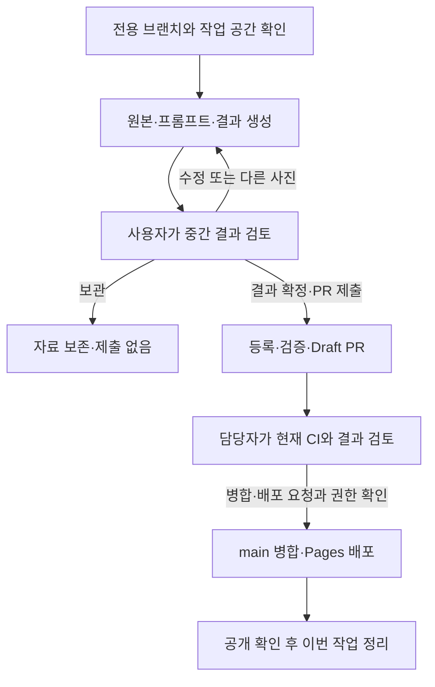

# 사진 변환 프롬프트 작업 스킬 사용 가이드

새 아이디어를 실제 사진으로 시험하고, 사람이 결과를 검토한 뒤 갤러리에 제출하는 방법입니다. **처음에는 결과 검토까지, 결과를 확정하고 제출을 요청하면 Draft PR까지** 진행합니다.

## 1. 준비와 첫 호출

이 저장소를 clone하거나 fork한 폴더를 Codex에서 여세요. 스킬은 저장소의 [.agents/skills/prompt-gallery-workflow](../.agents/skills/prompt-gallery-workflow/SKILL.md)에 포함되어 있어 기여자도 같은 지침을 사용합니다. 개인 스킬 폴더에 복사할 필요는 없습니다. 오래된 복사본을 쓰고 있다면 다른 미완료 작업을 보존하면서 원본 main의 최신 변경을 반영하세요.

채팅에서 스킬을 선택하거나 다음처럼 입력합니다.

```text
$prompt-gallery-workflow 마네킹
```

조금 더 구체적으로 시작할 수도 있습니다.

```text
$prompt-gallery-workflow 내 사진을 짱구 세계의 등장인물처럼 바꾸고 싶어.
첨부할 사진도 가상으로 만들고, 먼저 인물 사진 한 장으로 테스트해줘.
```

실제 사진을 쓰려면 채팅에 첨부하고, 가상 원본이 필요하면 그렇게 말하면 됩니다. 가상 원본과 변환 결과는 구분해서 보여줍니다. 이미지 생성 도구를 사용할 수 없는 환경에서는 생성 테스트를 완료했다고 표시하지 않고 가능한 작업과 남은 단계를 안내합니다.

첫 진행 보고에서 **새로 만들었거나 재사용한 브랜치명, 실제 작업 공간, 기준 커밋**을 확인하세요. 다른 작업이 진행 중인 폴더는 보존하고 별도 작업 공간에서 시작합니다.

## 2. 결과를 보고 채팅에서 선택하기

원본·변환 결과·실제 적용한 프롬프트와 관찰한 장단점을 먼저 보여줍니다. 이때 상태는 **결과 검토 대기**이며, PR을 아직 만들지 않은 이유와 다음 행동을 함께 안내합니다.

| 선택 또는 답변 | 이어지는 행동 |
|---|---|
| **결과 확정·PR 제출** | 표시한 결과·문구를 확정하고 등록·검증·커밋·push·Draft PR 제출 |
| **수정** | 피드백을 반영하여 같은 작업에서 다음 버전 생성·검토 |
| **다른 사진으로 테스트** | 같은 문구를 다른 원본에 적용하고 결과 검토 |
| 자유 입력: **여기서 보관** | 현재 결과와 기록을 보존하고 제출하지 않음 |

지원되는 채팅에서는 클릭형 선택지가 나타납니다. 질문 도구가 없는 환경에서는 같은 항목을 번호로 안내하며 번호나 자유 입력으로 답할 수 있습니다. 미리 선택된 항목이나 응답하지 않은 상태는 승인으로 처리하지 않습니다.

수정할 점은 선택과 함께 구체적으로 말하면 바로 반영합니다.

```text
얼굴이 원본과 너무 달라. 안경과 헤어스타일을 더 유지해서 다시 해줘.
최종 문구 그대로 다른 인물 사진으로 테스트해줘.
이번에는 풍경과 반려동물 사진에도 같은 프롬프트로 해봐.
```

"좋다"는 결과에 대한 평가입니다. PR 제출이나 웹 배포까지 원하면 그 행동을 함께 말하거나 해당 선택지를 선택하세요. 기존에 확정한 결과의 제출·배포를 명확히 요청했다면 같은 확인을 반복하지 않습니다. "ㄱㄱ"는 직전 제안의 범위로 해석하므로, 새 단계로 넘어갈 때는 아래 예시처럼 목적을 적으면 분명합니다.

## 3. 원하는 완료 범위를 지정하기

| 목적 | 요청 예시 | 완료 범위 |
|---|---|---|
| 제출 없이 시험 | `$prompt-gallery-workflow 마네킹 테스트만. PR 만들지 마.` | 결과·문구·검토 기록 보존 |
| 승인한 결과 제출 | `이 결과와 문구로 확정하고 PR 제출해줘.` | 등록·로컬 검사·Draft PR·CI 상태 보고 |
| 담당자가 공개 | `이 결과로 확정했어. 웹에 배포하고 이번 브랜치도 정리해줘.` | 역할·권한 확인, PR·CI·병합·Pages·공개 확인·정리 |
| 일반 기여자가 공개 요청 | `이 결과를 웹에 올려줘.` | 원본 프로젝트 대상 PR과 담당자 인계 |

"테스트만", "로컬에서만", "PR 없이" 같은 제한은 후속 대화에도 유지됩니다. 이 경우 첫 선택지는 **테스트 결과 확정·보관**으로 바뀝니다. 나중에 제출하고 싶으면 "테스트 전용 제한을 풀고 이 결과로 PR 제출해줘"라고 알려주세요.

새 결과의 선택과 게시까지 맡기려면 그 범위를 명시할 수 있습니다. 예: "중간 검토 없이 네가 결과를 선택해서 PR까지 제출해줘." 이 요청도 병합·배포 권한을 자동으로 부여하지는 않습니다.

## 4. 전체 흐름과 역할



**일반 기여자**는 자신의 브랜치나 fork에서 원본 프로젝트에 PR을 제출합니다. 제출이 끝나면 PR 링크와 CI·담당자 검토 대기 상태를 보고하고, 미병합 브랜치는 수정용으로 남깁니다. fork 준비와 제출 명령은 [기여 안내](../CONTRIBUTING.md)를 참고하세요.

**담당자**는 확인된 역할·실제 병합 권한·해당 배포 요청이 있을 때 현재 커밋의 필수 CI 이후 병합·배포합니다. 다른 기여자의 fork 브랜치는 삭제하지 않습니다. 이 스킬을 사용하는 것만으로 저장소 권한이 생기지는 않습니다.

## 5. 진행 보고와 재개

| 현재 단계 | 보고에서 확인할 내용 |
|---|---|
| 작업 시작 | 신규 생성 또는 재사용, 실제 브랜치·작업 공간·기준 커밋 |
| 중간 검토 | 원본·결과·실제 문구, 검토 대기, PR 미생성 이유, 선택지와 다음 행동 |
| PR 제출 | 실제 커밋 SHA·PR 링크·현재 CI 상태·검토 대기 |
| 배포 | 병합 커밋의 Pages 성공, 공개 페이지 확인 결과 |
| 정리 | 실제 정리한 이번 브랜치·작업 공간과 보존한 자료 |

아직 만들지 않은 커밋·PR이나 실행하지 않은 CI는 **미생성·미실행**으로 표시합니다. 사용자 검토 대기는 실패가 아닙니다. 제출을 요청했는데 PR 생성에 실제 문제가 있다면 오류·시도·보존한 자료·남은 단계를 설명합니다.

다음 대화에서 "마네킹 작업 이어서, 최종 문구로 다른 사진 테스트해줘"처럼 주제를 알려주면 기존 브랜치·문구·생성 기록부터 확인해 재개합니다. 질문 응답을 기다리는 중에는 검토 자료를 보존하며 임의로 게시하지 않습니다. 출력은 작업 공간의 `output/imagegen/<주제>-<날짜>/`에 보관하고, 제출할 자산과 생성 이력은 승인한 범위에서 갤러리에 등록합니다.

외부 fork의 CI 실행이 담당자 승인 대기이면 그 상태를 안내합니다. CI 실패·배포 실패·공개 이미지 오류가 있으면 수정에 필요한 브랜치와 작업 공간을 보존합니다. [검사·배포 기준](testing-and-deployment.md)과 [프롬프트 등록 원칙](prompt-publishing.md)에서 자세한 기준을 확인할 수 있습니다.
