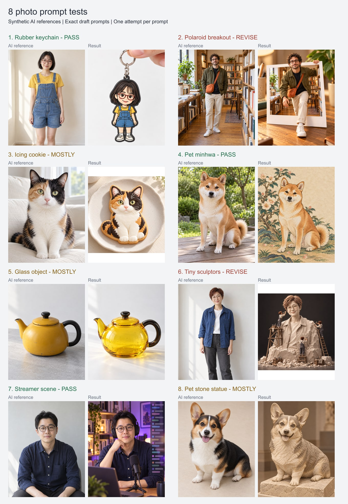

# 조사 프롬프트 8종 실제 생성 테스트

테스트일: 2026-10-16, 한국 시간. [조사 문서의 한국어 초안 8종](photo-prompt-research-2026-10-16.md)을 내장 `image_gen.imagegen` 도구로 실행했다. 도구가 제공하지 않은 모델 버전은 추정하지 않는다.

후속 작업: 1·4번과 6·8번을 합친 통합 석상 프롬프트를 최종 선정해 공개 갤러리에 등록했다. [최종 3종 검토 기록](selected-prompts-review-2026-10-16.md)을 참고한다. 아래 내용은 최초 8종 테스트 당시의 관찰을 보존한다.

각 항목에 서로 다른 **AI 원본 사진 1장**을 먼저 생성하고, 해당 원본만 첨부해 초안을 글자 수정이나 추가 지시 없이 그대로 보냈다. 총 원본 8장과 결과 8장을 만들었으며, 재시도·선별·수작업 보정은 하지 않았다. 실제 사용자 사진은 사용하지 않았다. 아래 평가는 각 한 번의 생성 결과를 육안 비교한 판단이며 일반적인 성공률을 의미하지 않는다.

## 결과 요약

| 번호 | 프롬프트 | 판정 | 주요 관찰 | 원본 · 결과 |
| --- | --- | --- | --- | --- |
| 1 | 고무 키링 | **충족** | 안경·단발·옷 색과 고무 두께·금속 고리 반영 | [원본](../output/imagegen/research-tests-2026-10-16/rubber-keychain.reference.png) · [결과](../output/imagegen/research-tests-2026-10-16/rubber-keychain.png) |
| 2 | 입체 폴라로이드 | **보완 권장** | 프레임 밖으로 나오지만, 별도의 손이 사진을 들지 않음 | [원본](../output/imagegen/research-tests-2026-10-16/polaroid-breakout.reference.png) · [결과](../output/imagegen/research-tests-2026-10-16/polaroid-breakout.png) |
| 3 | 아이싱 쿠키 | **대체로 충족** | 반점·눈 색·쿠키 질감 반영. 세부 장식은 요청보다 복잡함 | [원본](../output/imagegen/research-tests-2026-10-16/icing-cookie.reference.png) · [결과](../output/imagegen/research-tests-2026-10-16/icing-cookie.png) |
| 4 | 반려동물 민화 | **충족** | 시바견 특징·꽃나무·먹선·종이 질감 반영 | [원본](../output/imagegen/research-tests-2026-10-16/pet-minhwa.reference.png) · [결과](../output/imagegen/research-tests-2026-10-16/pet-minhwa.png) |
| 5 | 유리 공예품 | **대체로 충족** | 주전자 형태와 유리 굴절·기포 반영. 별도 받침은 누락 | [원본](../output/imagegen/research-tests-2026-10-16/glass-object.reference.png) · [결과](../output/imagegen/research-tests-2026-10-16/glass-object.png) |
| 6 | 작은 조각가들 | **보완 권장** | 작업자 3명·크기 대비 반영. 캐릭터보다 사실적인 석조 흉상 | [원본](../output/imagegen/research-tests-2026-10-16/tiny-sculptors.reference.png) · [결과](../output/imagegen/research-tests-2026-10-16/tiny-sculptors.png) |
| 7 | 스트리머 방송 화면 | **충족** | 안경·입가의 점·셔츠를 유지하고 장비·조명·패널 반영 | [원본](../output/imagegen/research-tests-2026-10-16/streamer-scene.reference.png) · [결과](../output/imagegen/research-tests-2026-10-16/streamer-scene.png) |
| 8 | 반려동물 석상 | **대체로 충족** | 자세·큰 귀·석재와 받침 반영. 어두운 무늬가 색차로도 남음 | [원본](../output/imagegen/research-tests-2026-10-16/pet-stone.reference.png) · [결과](../output/imagegen/research-tests-2026-10-16/pet-stone.png) |

**충족 3종, 대체로 충족 3종, 보완 권장 2종.** 판정은 모든 조건의 기계적인 합격 여부가 아니라 주요 표현과 관찰된 제한을 함께 고려한 편집 판단이다. 공개 갤러리 등록·배포는 수행하지 않았다.

## 원본과 결과 비교

각 쌍의 왼쪽은 AI 원본, 오른쪽은 초안만 적용한 결과다. 비교판은 실제 파일을 비율 유지 축소해 배치했다. 정사각형 결과에는 여백을 넣었으며 이미지를 자르거나 새로운 장면을 생성하지 않았다.

## 항목별 검토

### 1. 고무 키링

빨간 둥근 안경, 검은 단발, 노란 티셔츠와 데님 멜빵바지가 유지됐다. 고무의 두께·검은 가장자리·은색 고리의 연결이 보이고 손가락은 고리만 잡는다. 글자는 없다. 원본에서 보이지 않던 무릎 아래와 신발은 새로 생성됐으며, 얼굴은 캐릭터로 단순화됐다.

### 2. 입체 폴라로이드

안경·곱슬머리·수염·올리브 재킷·주황 가방·흰 운동화와 서점 배경이 유지됐다. 상체와 한쪽 발이 프레임 밖으로 이어지고 접촉 그림자가 보인다. 인물의 중복도 없다.

다만 사진을 별도의 손이 들지 않고 프레임이 책상에 서 있으며, 인물 자신이 프레임을 잡는다. 인물도 요청한 3D 캐릭터보다 실사에 가깝다. **원문 조건 완전 충족 예시로 쓰면 안 된다.** 후속 수정에서는 사진을 잡는 외부 손과 프레임 속 인물의 역할을 명확히 구분하고, 3D 캐릭터 재질·비율을 구체화할 수 있다. 이 수정안은 아직 실행하지 않았다.

### 3. 아이싱 쿠키

얼굴 반점의 좌우 배치, 황록색 눈과 분홍 코가 유지됐다. 한 개의 쿠키에 노릇한 가장자리와 두께·도톰한 아이싱이 나타나며 사진을 인쇄한 느낌은 아니다. 귀 안쪽·가슴·눈에는 세밀한 결과 입체 묘사가 남아, 요청한 굵은 선·단순한 색 덩어리보다 복잡하다. 실제 베이킹으로 제작할 수 있는 도안인지는 검증하지 않았다.

### 4. 반려동물 민화

삼각 귀, 밝은 눈썹·볼·가슴, 짙은 눈과 말린 꼬리 등 시바견 특징이 유지됐다. 꽃나무·장식적인 식물·먹선·종이 질감과 여백이 반영됐고 추가 동물·사람·글자·인장은 없다. 전통 민화에서 영감을 받은 표현을 확인한 것이며 특정 시대의 미술사적 정확성을 평가한 것은 아니다.

### 5. 유리 공예품

노란 몸체, 왼쪽 주둥이, 오른쪽 검은 손잡이와 뚜껑 배치가 유지됐다. 물건 자체가 색유리로 바뀌고 두꺼운 가장자리·기포·굴절·빛 반사가 보인다. 불필요한 유리 상자는 생성되지 않았다. 다만 요청한 별도 흰색 받침은 보이지 않으며, 흰색 표면에 바로 놓여 있다. 세부 비율까지 원본과 동일한 것은 아니다.

### 6. 작은 조각가들

짧은 적갈색 머리와 둥근 안경, 얼굴의 인상이 반영됐다. 작은 작업자 세 명, 발판·사다리·도구·깎아낸 조각과 크기 대비가 명확하다. 어깨와 받침 일부는 미완성이다.

다만 부드러운 3D 캐릭터보다 사실적인 석조 흉상에 가깝고 상반신 위주로 재구성됐다. 원본 파란 재킷도 돌 색으로 바뀌었다. **현재 결과는 장면 구성은 충족하지만 스타일 조건은 미충족이다.** 후속 수정에서는 조각상의 재질·캐릭터 비율과 사실적인 석상 표현 사이의 우선순위를 명확히 할 수 있다. 아직 수정·재생성하지 않았다.

### 7. 스트리머 방송 화면

원본의 안경·헤어스타일·입가의 점·남색 셔츠가 유지됐다. 헤드폰·마이크·책장·보라색 조명과 글자 없는 오른쪽 반투명 패널이 반영됐다. 얼굴과 보이는 손을 UI가 가리지 않는다. 턱을 괴는 자세와 한쪽 손은 새로 구성됐다. 얼굴 보존 평가는 이 한 장의 육안 비교에 한정한다.

### 8. 반려동물 석상

코기의 큰 귀·짧은 다리·앉은 몸 방향·정면을 향한 얼굴·열린 입과 혀를 유지했다. 거친 조각결·돌 받침·전시장 배경이 반영됐고 글자는 없다. 어두운 등과 얼굴 반점은 짙은 음영·색차로도 남아 음각만으로 무늬를 옮겼다고 단정하기 어렵다. 따뜻한 조명 때문에 회백색보다 베이지색에 가깝다.

## 저장·무결성 확인

- [실제 도구 입력·원본 생성 프롬프트·파일 크기·해시](../output/imagegen/research-tests-2026-10-16/generation-log.json)
- [테스트한 한국어 프롬프트 8종](../output/imagegen/research-tests-2026-10-16/prompts.json)
- [판정 데이터](../output/imagegen/research-tests-2026-10-16/reviews.json)

원본 8장의 SHA-256이 서로 다른지, 각 호출의 입력 경로가 해당 원본 한 장인지, 변환 문구가 조사 초안과 일치하는지 확인했다. 결과는 정사각형 2종(쿠키·조각가)과 약 4:5 세로형 6종이며 원본과 결과의 실제 픽셀 크기를 기록했다. PNG 원본은 보정하지 않고 보관했다. 비교판만 Sharp로 축소·배치했다.

기능·공개 카탈로그 변경이 없는 콘텐츠 테스트이므로 앱의 전체 빌드·브라우저 검사는 실행하지 않았다. 후속 공개 등록 시에는 기존 등록 원칙에 따라 예시 설명과 제한을 포함하고 필요한 전체 검사를 수행한다.
