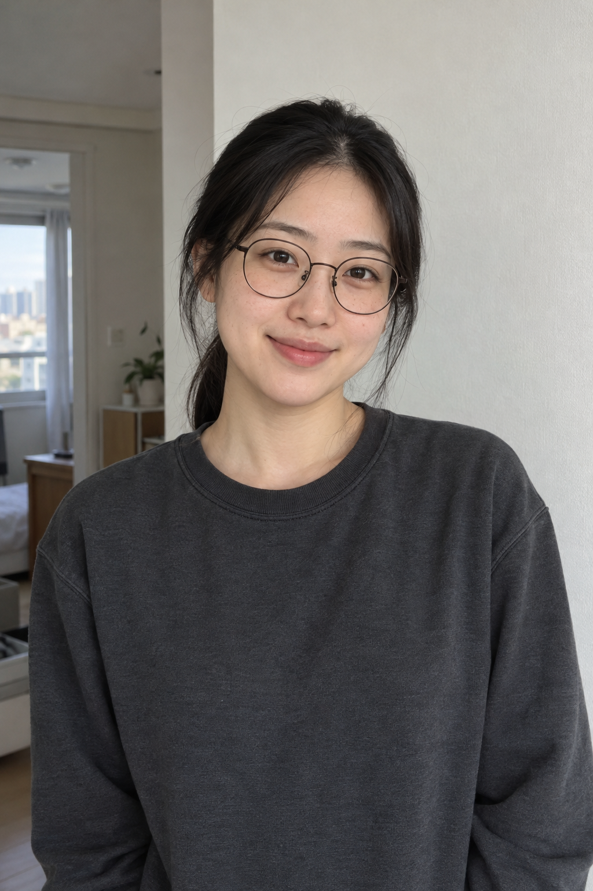

# 학창 시절 첫사랑 v2 검토 — 2026-10-26

사진 속 내가 누군가의 첫사랑으로 기억된다는 주제로, 시간이 지나 살짝 이상화된 인상과 따뜻한 오후 햇살을 표현했다. 사용자가 v2 결과에 “결과 확정·PR 제출”로 응답하여 이 버전과 예시를 확정했다.

## 공개 입력과 출력

| 입력: AI 가상 성인 여성 | 출력: 공개 v2 문구만 적용 |
|---|---|
|  |  |

- [공개 문구 v2](school-first-love-prompt-v2.txt)
- [실제 생성 입력·버전 이력·치수·SHA-256](image-generation-2026-10-26-school-first-love.json)

실제 사용자 사진이 아닌 AI 가상 원본 한 장으로 시험했다. v2는 v1 결과를 다시 편집하지 않고 같은 원본 사진과 공개 문구만 전달해 생성했다. 추가 스타일 이미지, 사진별 보충 지시, 후편집은 없다.

## 관찰과 한계

- 원형 안경·묶은 검은 머리·주근깨와 전반적인 이목구비 인상이 남았다.
- 교복과 교실, 턱을 괴고 바라보는 작은 미소, 머리카락을 감싸는 역광과 밝은 창가가 표현됐다.
- v1보다 눈가와 피부 표현을 부드럽게 정돈하고, 빛 번짐·낮은 대비로 회상 분위기를 보강했다.
- 미화의 강도와 닮음은 주관적이며 동일인 판별 수치를 측정하지 않았다. 나이 인상과 주변 장면은 재해석됐다.
- 공책에는 흐린 필기 형태가 남지만 검토 크기에서 읽을 수 있는 문구는 식별하지 못했다.
- 턱을 괸 손은 일부 가려져 모든 손가락 구조를 확인하기 어렵다.
- 가상 여성 1인 사진에서만 시험했다. 남성·다른 연령·다인 입력은 미시험이다.

## 등록 확인

- v2 문구는 실제 생성 입력과 공개 텍스트 파일·카탈로그에서 일치한다.
- 원본과 결과는 각각 1024×1536 무손실 WebP이며, PNG와 디코딩 RGBA 픽셀이 동일함을 비교했다.
- 썸네일은 결과 비율을 유지한 480×720이다.
- 기존 59개 항목의 값과 배열 내 상대 순서를 유지하고, 새 항목 order는 기존 최솟값보다 작은 -54로 지정했다.
- source와 head는 Q07K/prompt-gallery, remote는 origin이다.
- 기존 codex/school-first-love 브랜치를 재사용했다. 시작 기준 커밋은 f21a684fe89d40ca78ba3a7ac01339fd7ad413b5이다.
- 제출 범위는 Draft PR까지다. 병합·운영 배포는 이번 요청 범위에 포함되지 않는다.

## 로컬 검증

- npm run check 통과: 단위 검사 34개, 빌드 60개 항목, 데스크톱·모바일 Chromium 검사 62개.
- 최신 origin/main의 기존 59개 데이터 항목과 새 카탈로그의 기존 부분이 일치함을 확인.
- 공개 텍스트·카탈로그·실제 v2 도구 입력의 문구가 일치함을 확인.
- 검토 문서의 상대 링크와 git diff --check를 확인.
- CI·담당자 검토는 PR 제출 이후 별도로 확인한다. 로컬 검사 성공은 운영 배포 성공을 뜻하지 않는다.
