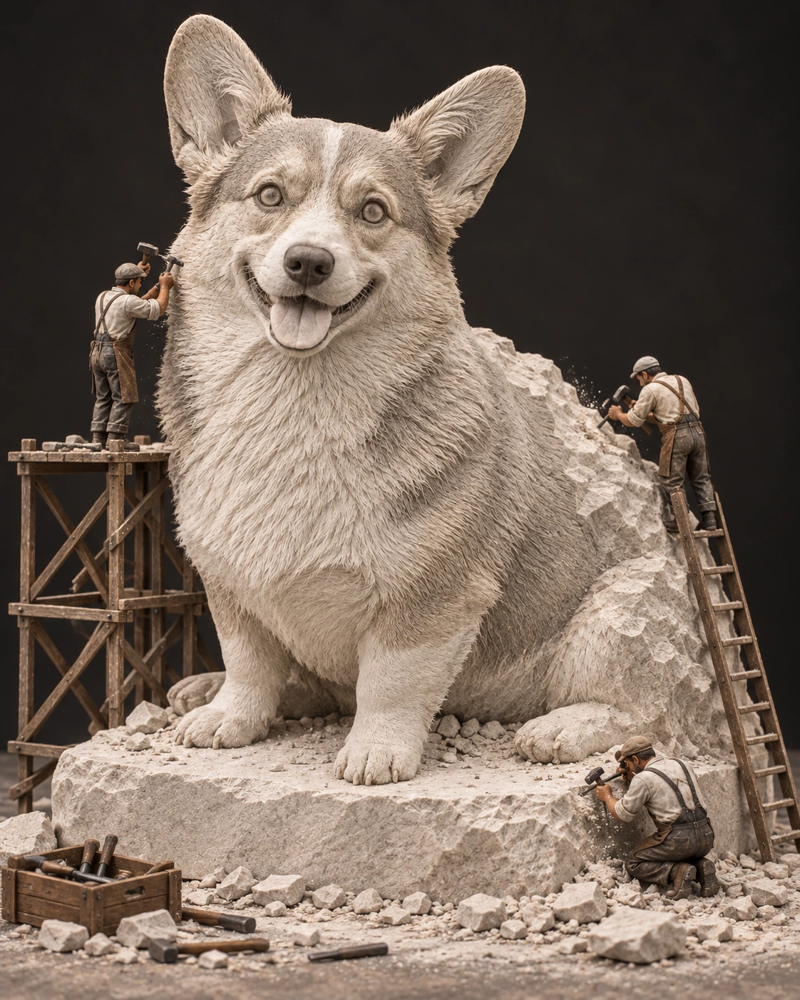

# 사진 변환 프롬프트 3종 등록 검토

2026-10-16. 사용자가 8종 테스트에서 선택한 1번 고무 키링, 4번 반려동물 민화와 6·8번을 합친 석상 작업 장면을 신규 항목으로 등록한다. 기존 12개 항목은 유지하며 새 3개를 순서대로 상단에 배치한다.

| 순서 | ID | 제목 | 입력 | 생성·검토 |
| --- | --- | --- | --- | --- |
| 1 | `rubber-keychain` | 내 사진으로 만드는 고무 키링 | 인물·반려동물·물건 사진 1장 | 승인된 1번 테스트의 문구·원본·결과를 그대로 사용 |
| 2 | `pet-minhwa` | 우리 집 반려동물을 민화 속 주인공으로 | 반려동물 사진 1장 | 승인된 4번 테스트의 문구·원본·결과를 그대로 사용 |
| 3 | `stone-sculptors` | 내 사진을 작은 조각가들의 석상으로 | 인물 또는 반려동물 사진 1장 | 통합 문구로 인물·코기 원본을 각각 시험. 코기를 대표 예시로 사용 |

사진은 모두 내장 이미지 생성 도구로 만든 가상 원본이며 실제 사용자 사진이 아니다. 원본·결과를 자르거나 수작업 보정하지 않고 WebP로 변환했다. 썸네일도 결과의 비율을 유지했다. 각 항목의 공개 문구와 실제 사용 문구는 동일하다.

## 고무 키링

[원본](../assets/images/rubber-keychain.reference.webp) · [결과](../assets/images/rubber-keychain.webp)

빨간 둥근 안경·검은 단발·노란 티셔츠와 데님 멜빵바지가 유지됐다. 고무 두께·검은 가장자리·은색 연결 고리가 보이고 손가락이 고리만 잡는다. 원본에 없던 무릎 아래와 신발은 생성됐다. 이 제한은 상세 예시 설명에도 표시했다.

## 반려동물 민화

[원본](../assets/images/pet-minhwa.reference.webp) · [결과](../assets/images/pet-minhwa.webp)

시바견의 귀·눈썹·볼·가슴·말린 꼬리와 대표 색을 유지했다. 꽃나무·먹선·장식적인 식물·종이 질감과 여백이 표현됐다. 추가 동물·사람·글자·인장은 없다. 특정 시대의 정확한 민화 복원으로 설명하지 않고 전통 회화에서 영감을 받은 결과로 안내한다.

## 6번과 8번의 통합

6번의 작은 작업자·발판·사다리·미완성 조각 장면과 8번의 단단한 석재·돌 받침을 하나로 합쳤다. 이전 6번의 부드러운 캐릭터 표현 대신 사실적인 석회암 조각을 명시해 재질과 스타일 조건을 일치시켰다. 인물은 의상과 머리 모양을, 반려동물은 귀·몸·자세와 무늬를 조각 표현으로 옮긴다.

같은 최종 프롬프트를 인물과 코기 원본에 각각 한 번 보냈으며 별도 스타일 이미지나 추가 지시는 사용하지 않았다. 재시도는 없었다. 전체 최종 문구는 공개 카탈로그와 아래 생성 기록에 보관한다.

### 대표 예시: 반려동물

[원본](../assets/images/stone-sculptors.reference.webp) · [결과](../assets/images/stone-sculptors.webp)

중심 코기 석상 한 개, 작은 작업자 세 명, 발판·사다리·돌 조각·도구와 미완성 몸통 가장자리가 보인다. 원본의 큰 귀·짧은 다리·앉은 몸 방향·열린 입과 혀를 유지했다. 털색은 같은 돌 색으로 바뀌고, 원래의 검은 등·얼굴 무늬는 단순화됐다. 원래 색이나 모든 무늬를 완전히 보존했다고 설명하지 않는다. 조명으로 돌이 따뜻한 베이지색에 가깝게 보이는 부분이 있다.

### 추가 확인: 인물

[원본](assets/selected-prompts-2026-10-16/stone-sculptors.portrait.reference.webp) · [결과](assets/selected-prompts-2026-10-16/stone-sculptors.portrait.webp)

짧은 머리·안경·재킷과 바지의 형태, 편하게 내린 팔 자세가 반영됐다. 중심 조각상과 작은 작업자 세 명의 크기 대비가 명확하고 전부 돌 재질로 변했다. 원본에서 보이지 않던 발과 신발은 생성됐다. 주변 사다리의 아래 끝은 이미지 가장자리와 가깝고 일부 잘린다. 서로 다른 두 원본에서 확인한 것이며 일반적인 성공률을 뜻하지 않는다.

## 생성 기록

[실제 입력·원본 생성 문구·아티팩트와 공개 파일 해시](image-generation-2026-10-16-selected.json)에 승인된 두 항목과 통합 항목의 생성 이력을 별도로 보관했다. 조사에서 발견한 외부 사례는 각 카드의 스타일 참고 링크로 구분하며, 공개 한국어 문구는 이 프로젝트에서 작성했다.
