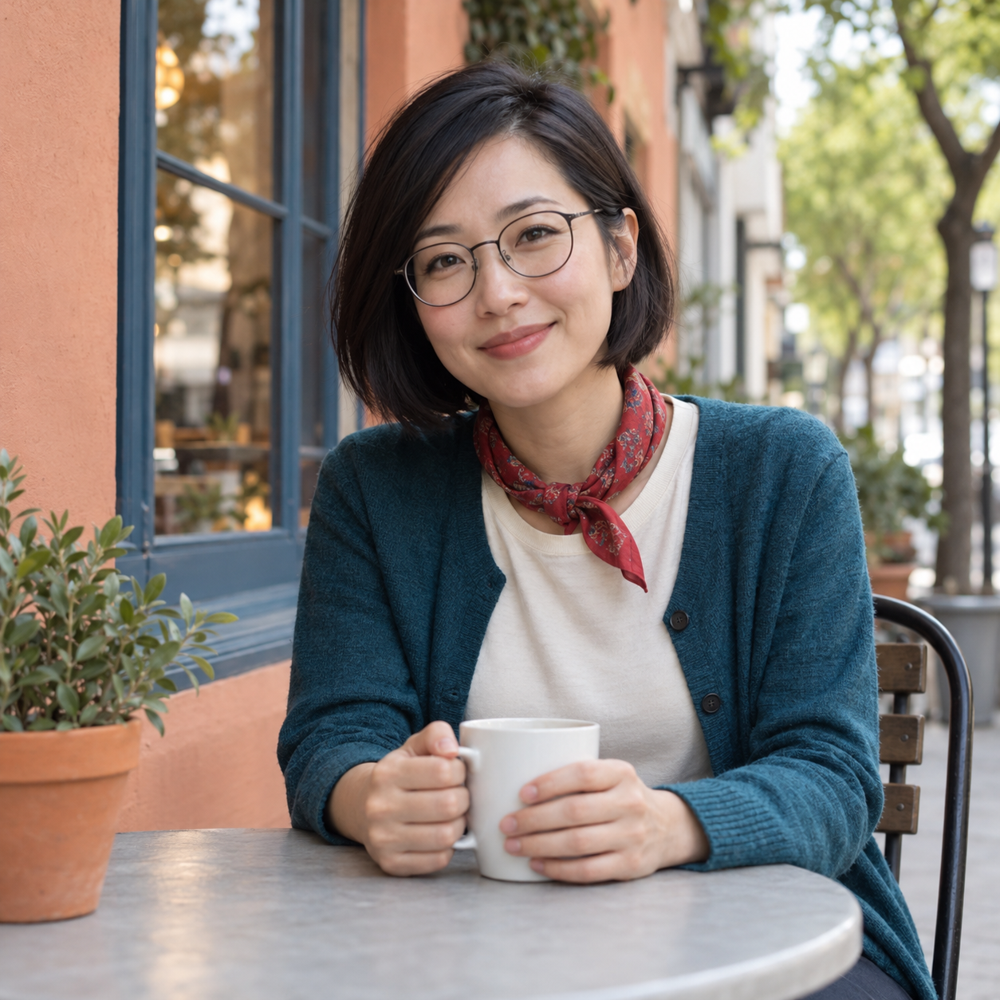
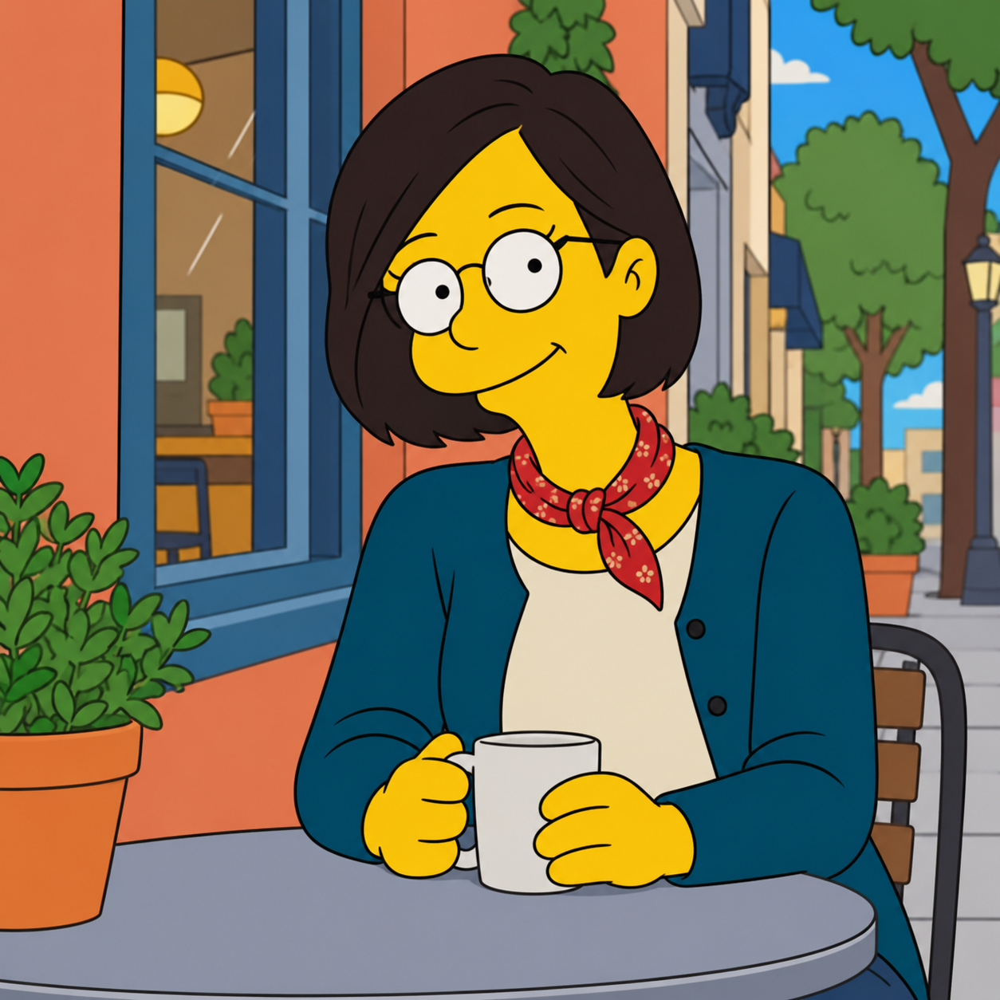

# 심슨 사진 변환 v2 검토

가상 성인 한 명의 카페 사진을 내장 image_gen 도구로 변환했다. 사용자는 v1에 “좀 더 심슨 스럽게”라고 피드백한 뒤 v2에 “결과 확정·PR 제출”을 선택했다.

## 공개 예시

| AI 가상 원본 | v2 결과 |
|---|---|
|  |  |

실제 공개 문구는 [카탈로그](../data/prompts.json)의 simpsons 항목과 [생성 기록](image-generation-2026-10-24-simpsons.json)에 동일하게 보관했다. 원본 한 장과 v2 문구만 적용했으며 추가 스타일 이미지·추가 지시·후편집은 없다.

## 수정과 관찰

- v1의 붉은 입술 면과 뾰족한 턱이 사라지고, 앞으로 둥글게 돌출된 입 주변과 넓은 입선이 생김
- 붙어 있는 큰 흰 눈과 점 동공, 단순한 머리카락 덩어리가 심슨 캐릭터의 인상을 강화함
- 원본의 단발머리·둥근 안경·청록색 카디건·빨간 스카프·머그잔을 든 자세를 유지함
- 인물 1명이며 원본의 창·화분·테이블·의자 위치 관계가 대체로 유지됨

## 한계

- 스타일 과장이 커지면서 원본 인물의 얼굴 닮음은 줄어듦
- 머리카락과 일부 넓은 색 면에는 약한 명암이 남아 완전한 무음영 지시는 부분적으로만 충족함
- 안경의 아래 테와 눈 외곽선이 겹쳐 각각의 선이 완전히 분리되어 보이지는 않음
- 가상 인물 사진 1장에 대한 수정 시험이며 다른 사진은 미검증
- 배경의 큰 구조는 유지됐으나 세부 건물과 가로등 등은 재해석됐다.

원본·최종 결과는 무손실 WebP로 변환했고 디코딩한 RGBA 픽셀의 일치를 확인했다. 썸네일은 비율을 유지해 가로 640px로 축소했다. 자산의 실제 치수·SHA-256과 버전별 생성 입력은 생성 기록에 있다. v1은 카탈로그에 등록하지 않았고 생성 사실만 이력으로 남겼다.
