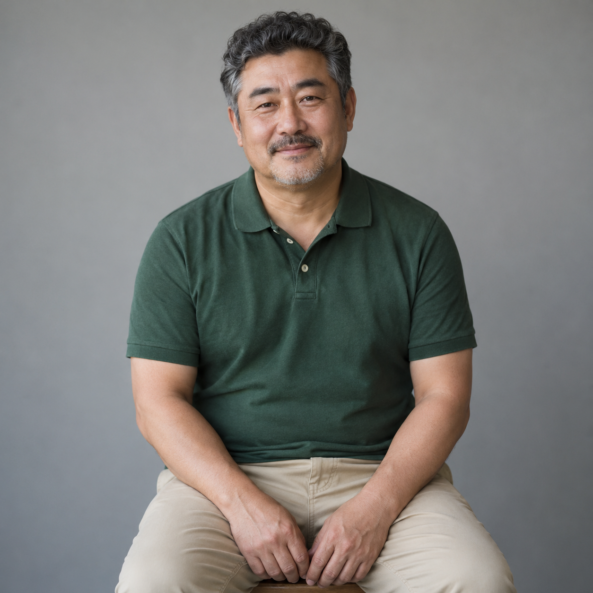
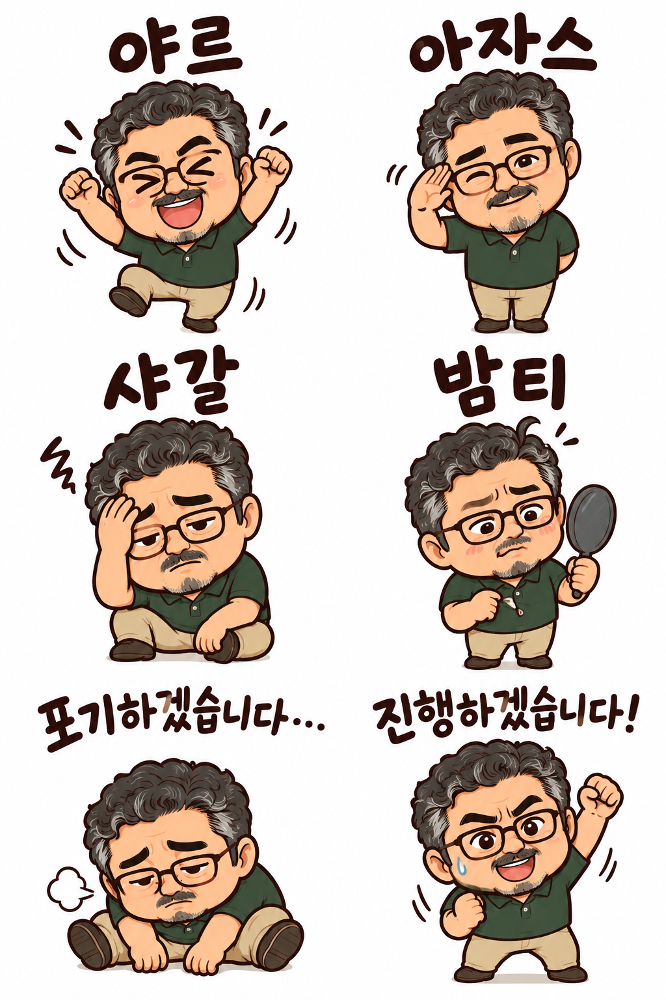
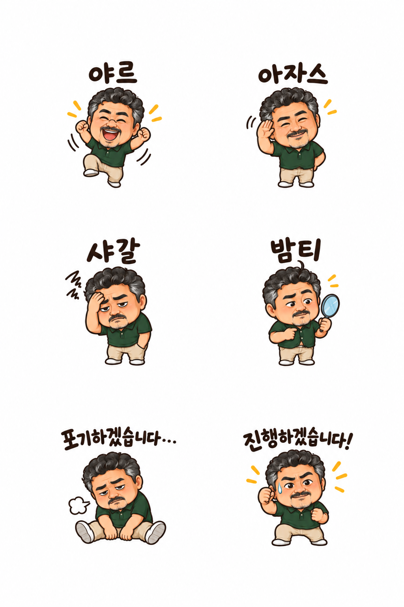
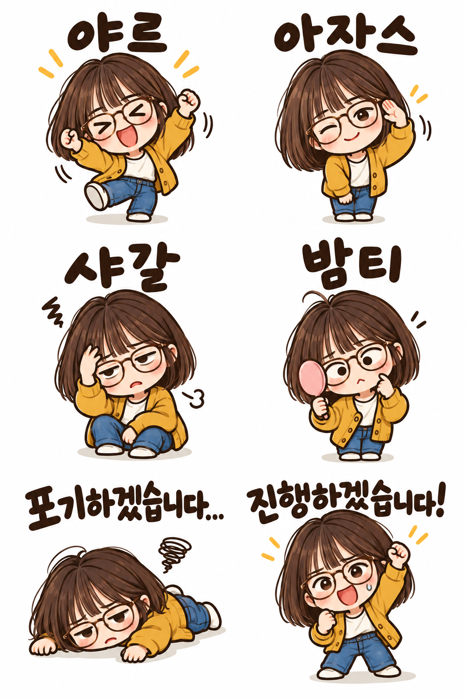

# 야르·아자스·샤갈! 카톡 리액션 — 2026.10

사용자가 여백 확대 시안을 확정하고 PR 제출을 요청했다. 제목은 실제 표현과 조사 시점을 표시한다. 과거 문구(v1)는 사용자의 지적으로 제외했다.

## 승인한 남성 시안

AI 가상 원본·결과 · 사용자가 확정한 남성 시안입니다. 사진에 v2 문구를 적용한 뒤 생성된 시트를 별도 AI 편집해 이모티콘 사이와 바깥 여백을 넓혔습니다. 공개 v3만 단독 적용한 결과는 아닙니다. 곱슬머리·수염·초록색 폴로셔츠는 유지됐지만 원본에 없는 안경이 6칸 모두 추가됐습니다. 흰 배경의 정적 시트입니다.

세로 x=512, 가로 y=512와 y=1024 경계에 진한 픽셀이 0개여서 직사각형 6등분이 가능함을 확인했다. 14% 여백은 지시 목표이며 정확한 달성값으로 보장하지 않는다.

## 공개 v3 단독 적용

AI 가상 원본·결과 · 단발·안경 인물 사진 한 장과 공개 v3 문구만으로 생성했습니다. 단발머리·안경·노란 카디건과 6개 문구가 유지됐습니다. 여백은 승인한 별도 편집 시안보다 좁고, 지정한 각 칸 14% 여백이 정확히 지켜지지는 않았습니다. 잘라 쓰기 전 글씨와 효과선을 확인하세요.

v3는 v2의 문구·동작을 유지하고 승인된 여백 조건을 추가했다. 원본 한 장과 공개 문구만 전달했으며 기존 이모티콘 시트를 참조하지 않았다. 원본별 지시 추가나 후편집은 없다.

## 최근 용례 조사

- [야르: 2026-10-15 사용자 질문](https://m.korean.go.kr/front/onlineQna/onlineQnaView.do?mn_id=216&pageIndex=1&qna_seq=337248&searchCondition=&searchKeyword=): 질문자의 사용 사례이며 국립국어원이 뜻을 공인했다는 의미는 아니다.
- [샤갈·밤티·야르: 2026-08-25 칼럼](https://v.daum.net/v/20260825004241745)
- [아자스 용법과 2025~2026 유행 시기](https://www.instablank.com/meme/16)
- [포기/진행: 2026년 9월 HSAD 밈 소개](https://www.ad.co.kr/journal/column/show.do?ukey=596026): 오래된 문자 캡처의 재유행, 두 이모티콘으로 나눠 활용.
- [위픽 아카이브](https://letter.wepick.kr/post/23942)에서 고맙투우사가 유행 종료로 분류돼 제외했다.

실시간 인기 순위나 모든 10대의 사용을 검증한 조사는 아니다. 고정된 2026.10 구성으로, 문구를 바꾸면 재시험이 필요하다.

## 기록과 검증

[실제 프롬프트·원본 생성 문구·도구 입력·치수·해시](image-generation-2026-10-19-slang-chat-reactions-2026-10.json)

전체 크기 WebP는 Sharp 무손실 변환 후 디코딩 RGBA 일치를 확인했고 썸네일은 비율을 유지했다. 승인 결과와 공개 문구 단독 시험 결과를 서로 같은 생성 조건으로 설명하지 않는다.

검증 결과: npm run check 통과 — 단위 검사 19개, 빌드(43개), 데스크톱·모바일 브라우저 검사 34개 성공. git diff --check 통과. 기준 커밋과 비교해 기존 카탈로그 42개 전체와 순서가 보존됨을 확인했다.
