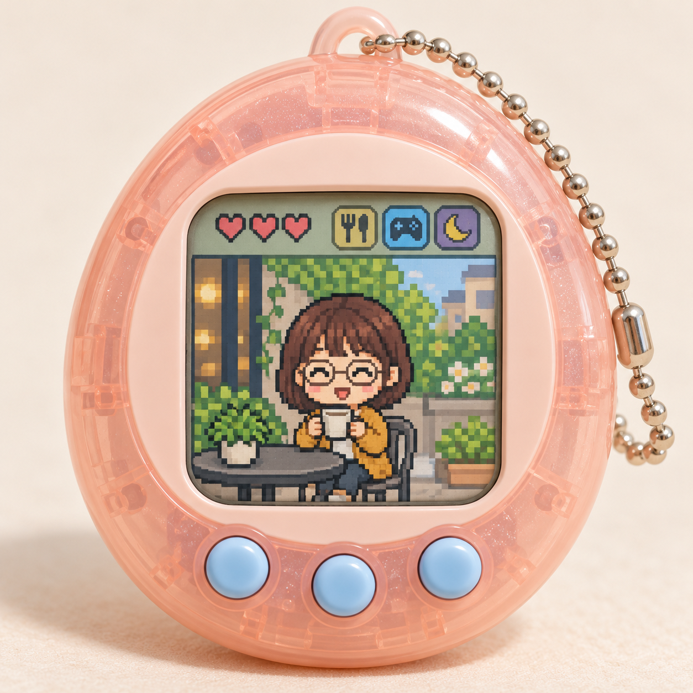

# 다마고치 등록 검토 — 2026-10-19

사용자가 v1 결과와 문구를 확정하고 Draft PR 제출을 요청했습니다. 전용 브랜치 codex/tamagotchi의 기준 커밋은 cd583d3eda13fd0d052aac0c85bf5f82720f6d9a입니다.

| AI 가상 인물 원본 | 공개 v1 문구만 적용한 결과 |
| --- | --- |
|  |  |

AI 생성 원본·결과 · 가상 성인 사진 한 장에 공개 v1 문구만 적용했습니다. 단발머리·둥근 안경·노란 가디건·흰 머그컵과 카페 장면을 살려 반투명 분홍색 기기의 픽셀 캐릭터로 바꿨습니다. 표정은 원본의 잔잔한 미소에서 눈을 감고 활짝 웃는 모습으로 달라졌고, 실제 얼굴의 세부 유사성은 낮아집니다. 인물 한 장만 시험했습니다.

하트 3개와 음식·놀이·수면 아이콘, 파란 버튼 3개, 상단 고리와 볼 체인을 확인했습니다. 캐릭터와 배경은 화면 안의 사각 픽셀로 통일됐으며 읽을 수 있는 글자·로고·워터마크는 보이지 않습니다.

[실제 적용 문구 v1](tamagotchi-prompt-v1.txt)와 [실제 입력·치수·파일 해시](image-generation-2026-10-19-tamagotchi.json)를 보관합니다. 공개 문구는 실제 시험 문구와 같으며 사진별 추가 지시나 후편집은 없습니다. 원본과 결과 WebP는 PNG와 디코딩 픽셀이 동일한 무손실 변환이며, 썸네일은 비율을 유지한 560×560 축소본입니다.

기존 36개 항목의 내용과 상대 순서를 유지하고 신규 항목의 order를 -31로 설정했습니다. 등록·로컬 검증 후 Draft PR을 제출하며, 병합·배포는 이번 요청 범위에 포함되지 않습니다.

## 로컬 검증

- npm run check 통과: 단위 검사 19개, 빌드 37개 항목, 데스크톱·모바일 Chromium 검사 26개.
- git diff --check 통과.
- 기존 36개 항목의 내용·순서 보존, 공개 문구와 실제 v1 시험 문구 일치, 무손실 WebP 디코딩 픽셀 일치 확인.
