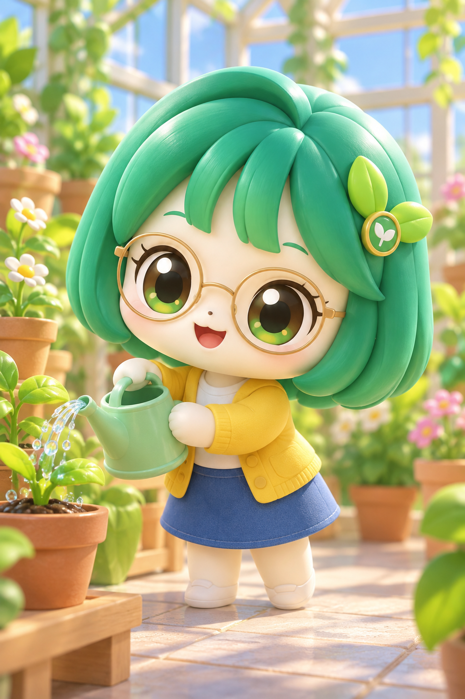

# 티니핑 v12 등록 검토

2026-10-19. 사용자가 상징색 방향의 v12 성인·남자아이 결과를 검토하고 **결과 확정·PR 제출**을 선택했다. 이 두 승인 결과를 등록하며 추가 생성이나 문구 수정은 하지 않았다.

## 입력과 문구

[실제 공개 문구](teenieping-prompt-v12.txt) · [첨부 참고와 순서](teenieping-input-guide.md) · [실제 생성 입력·파일 해시](image-generation-2026-10-19-teenieping.json)

각 예시는 사용자 제공 참고 3장과 해당 AI 가상 원본 한 장을 함께 넣고 같은 v12 문구를 적용했다. 공개 문구는 실제 변환 문구와 정확히 같다. 사진 한 장만의 결과로 표시하지 않는다. 참고 파일도 docs/references/teenieping 안에 원본 바이트 그대로 보관한다. 비공개 경로나 인증 정보는 공개 기록에 넣지 않는다.

| 예시 | 원본 | 결과 | 관찰 |
|---|---|---|---|
| 가상 성인·식물 돌봄 |  |  | 노란 상징색 머리·금빛 눈, 금테 안경·노란 상의·파란 치마·두 손 물뿌리개. 치마색 복구. |
| 가상 남자아이·독서 |  |  | 청록 머리·초록 눈, 남색 네모 안경·초록 후드·베이지 바지와 앉은 독서. 꼬리 보이지 않음. |

머리색 변경은 사용자가 선택한 판타지 상징색 방향의 의도적 변화다. 머리·옷의 세밀한 질감, 사람 귀 같은 형태, 원본과 다른 머리 끝/시선이 남는다. 실제 아이나 전문가가 스타일을 승인했다고 주장하지 않는다. 여자아이·다인물·동물·풍경은 v12로 시험하지 않았다.

## 등록과 자산 검증

신규 ID teenieping을 기존 최솟값보다 작은 order로 최상단에 넣었다. 기존 40개 항목의 내용·순서는 그대로 두고 총 41개다. 원본·결과 네 파일은 자르거나 보정하지 않고 무손실 WebP로 변환했으며 디코딩 RGBA 픽셀이 PNG와 완전히 같음을 검증했다. 썸네일만 결과 비율을 유지해 축소했다. 참고 3장은 원본 PNG 바이트 그대로 복사했다.

## 검사와 제출

npm run check를 통과했다. 단위·데이터 검사 19개, 공유 상세 페이지 41개 빌드, 데스크톱·모바일 Chromium 브라우저 검사 30개가 모두 성공했다. 새 최상단 카드, 두 예시의 결과/원본 전환·확대·다운로드, 정확한 공개 문구 복사와 공유 URL, 검색·북마크·모바일 가로 넘침을 검사했다. 공개 문구와 두 실제 요청의 일치, 새 문서의 상대 링크, 기존 40개 항목 보존, 픽셀/참고 파일 일치도 확인했다. 제출 직전 origin/main은 기준 커밋과 같았다.

Draft PR 제출 범위이며 병합·배포는 요청받지 않았다. 로컬 검사 성공을 원격 CI나 Pages 배포 성공으로 표시하지 않는다. 원격 상태는 제출된 PR에서 확인한다.
