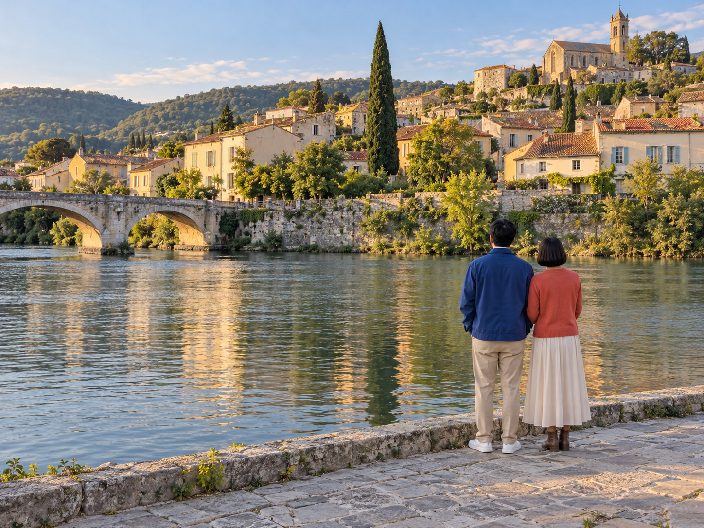
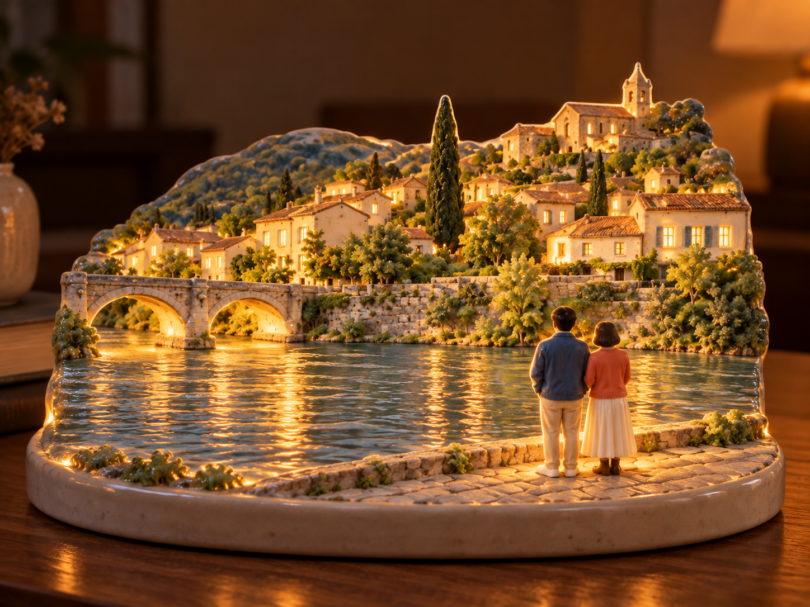
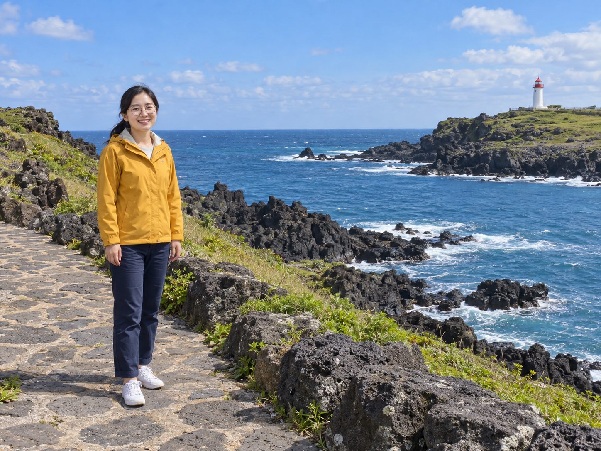
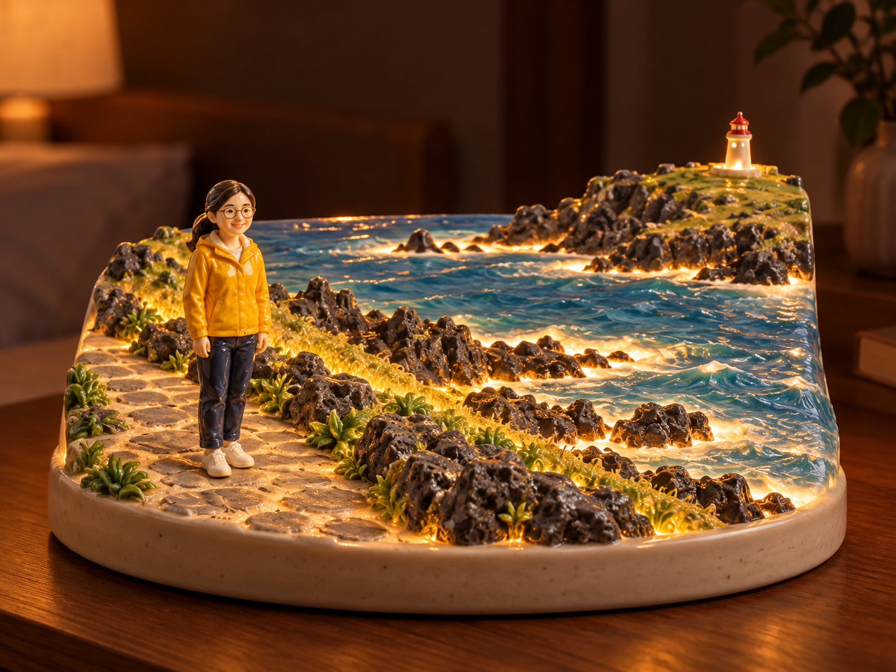

# 여행 사진 도자기 무드등 v3 등록 검토

사진 속 장소와 사람을 따뜻한 도자기 무드등으로 바꾸는 항목을 등록했습니다. 공개 예시는 같은 v3 문구와 원본 한 장씩만 전달한 두 결과이며, 원본·인물은 모두 AI로 만든 가상 자료입니다. v1·v2의 이전 풍경 시험은 탐색 기록으로 남기고 공개 v3의 재현 예시로 표시하지 않습니다.

[실제 공개 문구](travel-ceramic-nightlight-prompt-v3.txt) · [실제 입력·치수·SHA-256 기록](image-generation-2026-10-19-travel-ceramic-nightlight.json)

## 강변 여행 · 두 사람의 뒷모습

| 가상 원본 | v3 결과 |
| --- | --- |
|  |  |

AI 가상 원본·결과 · 강변의 성인 두 명 사진 한 장에 공개 v3 문구만 적용했습니다. 인원수·좌우 순서·뒷모습·파란 재킷과 붉은 카디건·서 있는 위치, 두 아치 다리·언덕 마을·큰 나무를 반영했습니다. 인물이 원본보다 조금 작아지고 손발·의복·창문 세부가 단순화됐으며, 수면에는 실제 물처럼 보이는 반사가 남았습니다.

## 해안 여행 · 한 사람의 정면

| 가상 원본 | v3 결과 |
| --- | --- |
|  |  |

AI 가상 원본·결과 · 해안의 성인 한 명 사진 한 장에 공개 v3 문구만 적용했습니다. 노란 재킷·남색 바지·흰 신발·안경·묶은 머리·내린 양팔과 왼쪽 위치, 오른쪽 등대와 바다·해안 바위를 반영했습니다. 인물은 원본보다 작아지고 얼굴과 몸이 큰 머리·짧은 몸의 귀여운 도자기 인형 비례로 바뀌었습니다. 얼굴 동일성을 정밀하게 보존한 예시는 아닙니다.

## 문구와 자산

- 공개 문구와 두 실제 변환 문구의 일치를 확인했습니다. 사진별 추가 지시와 결과 후편집은 없습니다.
- 원본·결과 WebP 네 파일은 PNG와 디코딩 픽셀이 완전히 같습니다. 썸네일은 첫 예시의 비율을 유지해 축소했습니다.
- 기존 항목과 순서를 유지하고 새 항목만 최상단에 추가했습니다.
- 물 표면·인물 비례·얼굴 단순화의 한계는 갤러리의 예시 설명에도 표시했습니다.
- 제출 브랜치는 codex/seven-photo-ideas이며 main 대상 Draft PR을 요청받았습니다. 병합·배포는 이번 요청 범위에 포함되지 않습니다.

기록 정리: 기기별 절대 경로는 같은 파일의 저장소 상대 경로로 정리했습니다. 생성 문구와 이미지 바이트는 변경하지 않았습니다. 삭제된 도구 출력은 파일 식별자만 남겼습니다.

## 등록 검증

- npm run check 통과: 단위 검사 19개, 정적 빌드(44개 항목), 데스크톱·모바일 Chromium 브라우저 검사 36개.
- 새 항목의 예시 전환·원본 연결·다운로드·동일 문구 유지가 두 화면 크기에서 통과했습니다.
- 기존 카탈로그 항목과 순서를 변경하지 않았고 새 order는 -38입니다.
- 공개 v3와 두 실제 생성 문구의 완전 일치, 원본 한 장씩 전달, PNG→WebP 네 파일의 무손실 픽셀 일치를 확인했습니다.
- git diff --check 통과. 공개 CI 결과는 PR의 현재 head 검사로 별도 확인합니다.
