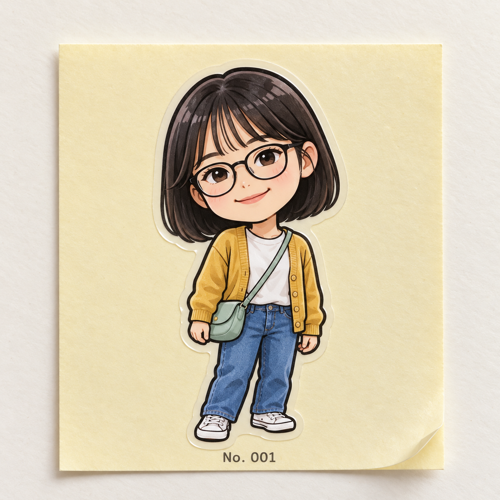

# 띠부띠부씰 v1 등록 검토

사용자가 표시된 v1 결과와 실제 문구를 확정하고 Draft PR 제출을 요청했습니다. 브랜치는 codex/ttibu-sticker이며 시작 커밋 cd583d3eda13fd0d052aac0c85bf5f82720f6d9a에서 최신 main e1a728d958e435dbee5410ab8d80fed1199c8575를 반영했습니다.

| AI 가상 인물 원본 | 공개 v1 문구만 적용한 결과 |
| --- | --- |
|  |  |

AI 생성 원본·결과 · 가상 성인 인물 사진 한 장에 공개 v1 프롬프트만 적용했습니다. 단발머리·둥근 안경·노란 카디건·흰 티셔츠·청바지·흰 운동화·민트색 크로스백을 살려 노란 이형지 위의 수집용 씰로 바꿨습니다. 얼굴과 옷의 채색은 옛날 평면 인쇄 씰보다 세밀하며, 가장 뚜렷하게 들린 모서리는 씰 필름이 아닌 이형지입니다. 실제 소형 크기는 확인할 수 없고, 동물·풍경·단체 사진은 아직 시험하지 않았습니다.

검은 외곽선과 큰 머리·작은 몸의 비례, 반투명 칼선 테두리, 연노란 정사각형 이형지, No. 001 표기를 확인했습니다. 대상이 잘리지 않았으며 추가 인물·장식용 스티커·포장지·손·로고·워터마크는 보이지 않습니다.

[실제 문구 v1](ttibu-sticker-prompt-v1.txt)과 [실제 입력·치수·SHA-256](image-generation-2026-10-19-ttibu-sticker.json)을 보관합니다. 공개 문구와 실제 시험 문구는 동일하며 사진별 추가 지시나 후편집은 없습니다. 원본·결과 WebP는 PNG와 디코딩 픽셀이 같은 무손실 변환이며 썸네일은 비율을 유지한 560×560 축소본입니다.

기존 37개 항목의 내용·상대 순서를 보존하고 새 항목의 order를 -32로 설정했습니다. 이번 제출 범위는 Draft PR이며 병합·배포는 포함되지 않습니다.

## 로컬 검증

- npm run check 통과: 단위 검사 19개, 38개 항목 빌드, 데스크톱·모바일 Chromium 검사 26개.
- git diff --check 통과.
- 기존 37개 항목의 내용·상대 순서 보존, 공개 문구와 실제 v1 시험 문구 일치 확인.
- 원본·결과 무손실 WebP 디코딩 픽셀 일치와 검토 문서 링크 확인.
