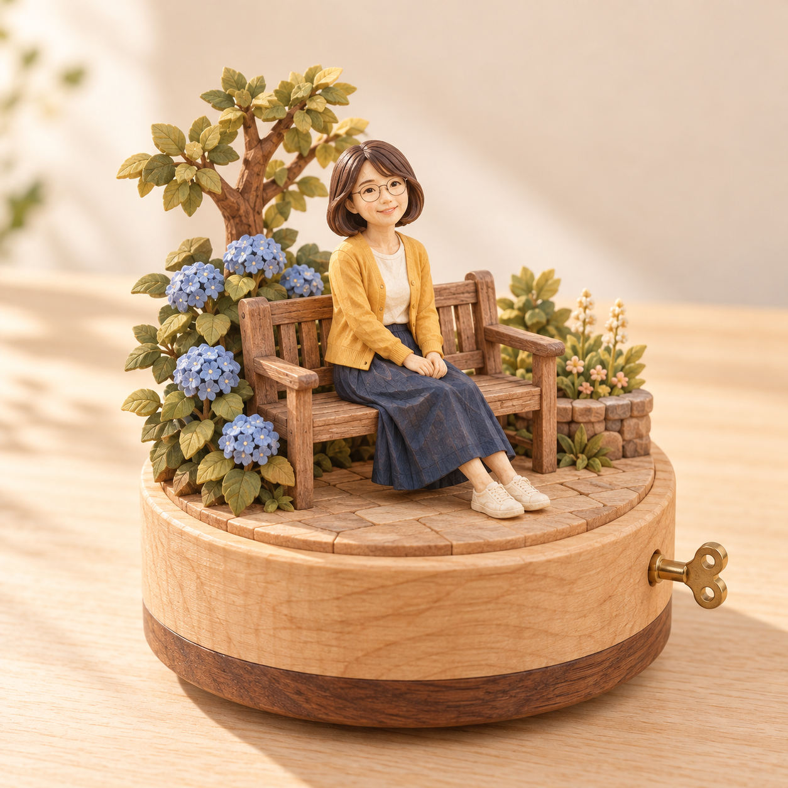

# 원목 오르골 v3 검토 — 2026-10-25

사용자가 v3 결과와 문구를 “결과 확정·PR 제출”로 승인했다. 범위는 등록·검증·Draft PR 제출이다.

## 원본과 결과

| AI 가상 원본 | 공개 v3 문구로 생성한 결과 |
|---|---|
|  |  |

[실제 적용 문구 v3](wooden-music-box-prompt-v3.txt) · [생성 기록](image-generation-2026-10-25-wooden-music-box.json)

AI 가상 성인 사진 한 장만 첨부하고 공개 문구를 그대로 적용했다. 추가 지시·스타일 참고·후편집 없음.

## 피드백과 확인

- v1: 유리돔·도자기 스타일을 시험했으나 사용자가 원목 오르골 느낌을 요청했다.
- v2: 모든 요소를 나뭇결·조각 질감이 보이는 원목으로 변경했다. 사용자가 원목 방향을 좋다고 평가하고 잘림 수정을 요청했다.
- v3: 같은 원본으로 전체 실루엣·여백 지시를 강화해 재생성했다. 나무 꼭대기와 소품·받침대·태엽이 프레임 안에 들어왔다. 안경·단발·의상 색·앉은 자세와 좌측 수국을 유지한다. 재생성으로 나무 위치와 받침대 배색은 v2와 달라졌다.

## 한계

얼굴은 원본보다 둥글고 젊게 단순화됐다. 배경의 세부는 목각 소품으로 재해석됐다. 제품 잘림은 없지만 프롬프트의 최소 12% 여백·75% 점유 수치는 엄밀히 충족하지 않았다(상하 여백 약 8%). 인물 사진 한 장만 시험해 동물·사물·풍경에 대한 적용성은 미검증이다. 정지 이미지로 실제 회전·음악 및 기계 작동은 확인할 수 없다.

## 자산과 검증

원본·결과를 Sharp 무손실 WebP로 변환하고 RGBA 디코딩 픽셀의 동일성을 확인했다. 썸네일은 원본 비율을 유지한 480px 너비다. 카탈로그의 기존 항목과 순서를 그대로 유지하고 신규 order를 -52로 배치했다. 공개 문구와 실제 v3 입력의 일치를 확인했다.

필수 검증 결과: `npm run check` 성공 — 단위 검사 34개 통과, 58개 프롬프트 빌드 성공, 데스크톱·모바일 Chromium 브라우저 검사 62개 통과. `git diff --check` 통과. 기존 카탈로그 항목·순서 보존과 공개 문구/실제 입력 일치를 별도로 확인했다.
