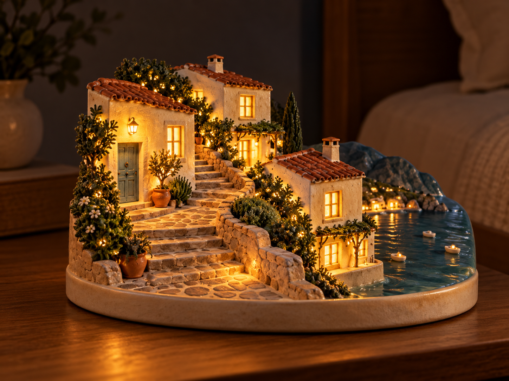

# 여행 사진 무드등 — 선택된 v1 원본 기록

사용자 요청으로 나머지 여섯 아이디어의 이미지·문구·사용하지 않는 가상 원본과 생성 폴더의 해당 원본 복사본을 삭제했습니다. 무드등만 유지합니다.

[실제 v1 문구](07-travel-nightlight.prompt.txt) · [실제 도구 입력](07-travel-nightlight.tool-input.json)

v1은 해안 마을의 집·문·지붕을 고정한 시험 문구입니다. 다른 여행 사진에는 장면 보존 조건을 일반화한 v2를 같은 문구로 적용했습니다. [v2 후속 시험](../travel-nightlight-universal-2026-10-19/review.md)

브랜치: codex/seven-photo-ideas. 기준 커밋: 41a6f31278223fd689cbba7042b711a785f83573. 검토 대기. PR·커밋·CI 미생성/미실행.
