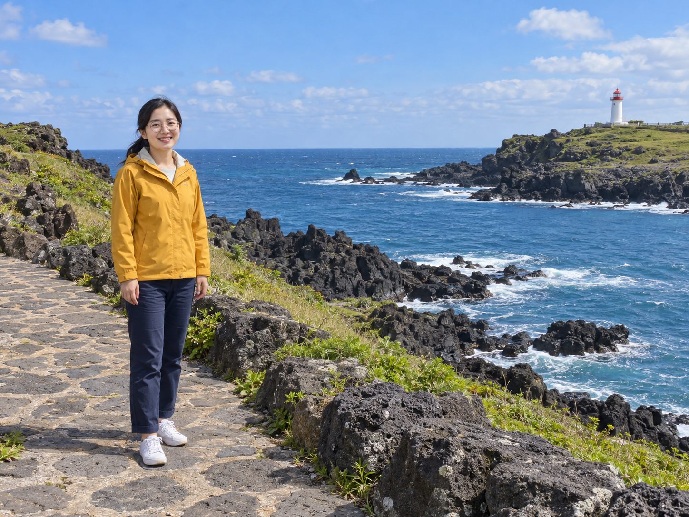
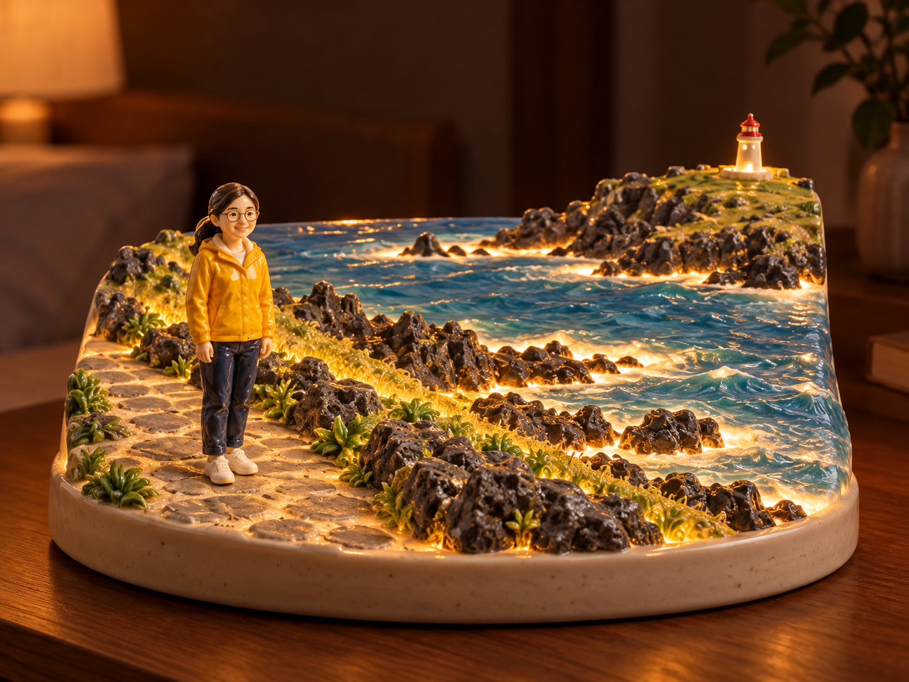
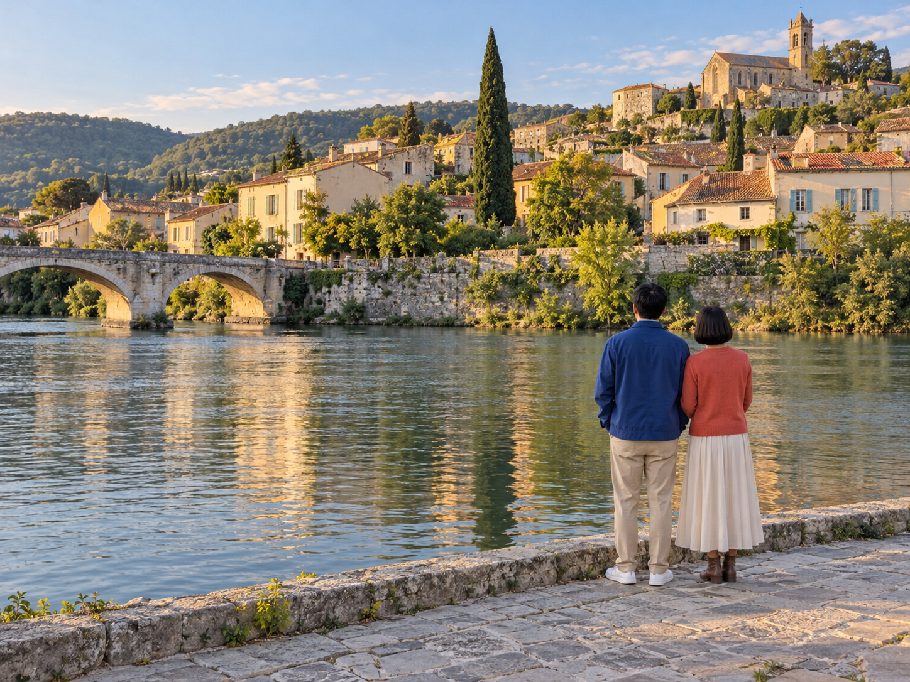
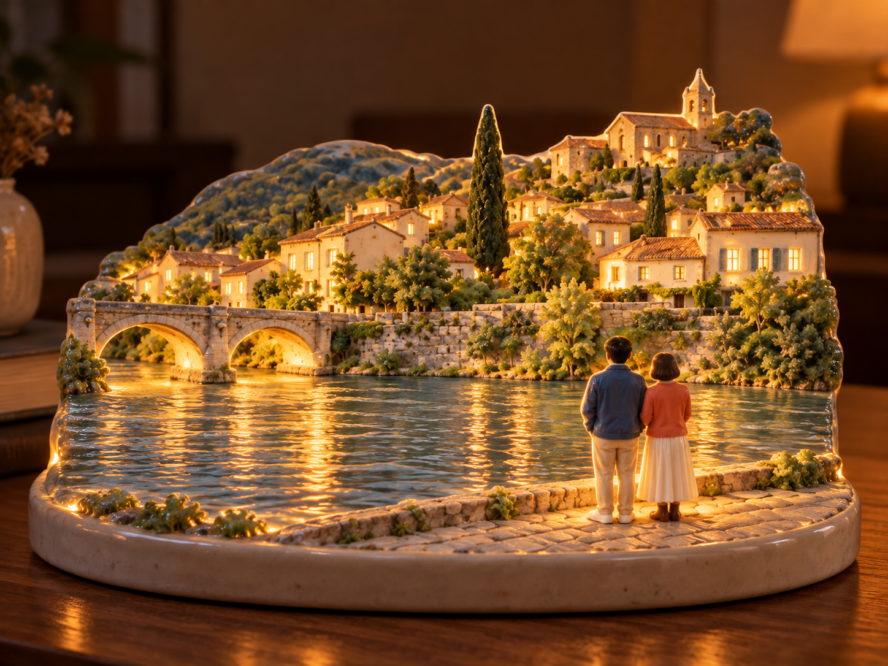

# 인물이 포함된 여행 풍경 → 도자기 무드등 v3

상태: 결과 검토 대기. 사용자 요청에 따라 인물 1명·2명이 있는 서로 다른 여행 풍경 두 장으로 시험했습니다. 모두 AI가 만든 가상 성인과 가상 여행 사진이며 사용자 실제 사진이 아닙니다. 내장 image_gen 사용. 각 변환에는 해당 원본 한 장과 동일한 v3 문구만 전달했으며 후편집은 하지 않았습니다.

## 문구 변경

v2의 '사람은 넣지 마' 조건을 제거하고, 원본 속 사람의 수·함께 있는 관계·위치·상대 크기·자세·머리·의상 색을 같은 도자기 재질의 조형물로 유지하도록 v3에 명시했습니다. 작은 얼굴과 뒷모습에 없는 세부를 꾸며 넣지 않게 했고, 원본에 사람이 없으면 추가하지 않는 조건도 넣었습니다. 이전 인물 없는 세 테스트는 여전히 v2 기록이며 v3로 재시험한 결과가 아닙니다.

[실제 v3 문구](transform-v3.prompt.txt) · [생성 기록](generation-record.json) · [이전 v2 시험](../travel-nightlight-universal-2026-10-19/review.md)

## 1. 해안 풍경 + 인물 1명

| 가상 원본 | v3 무드등 |
| --- | --- |
|  |  |

인물 1명을 유지했다. 노란 재킷·남색 바지·흰 신발·안경·묶은 머리·내린 양팔과 왼쪽 위치, 오른쪽 빨간 지붕 등대·바다·검은 해안 바위가 이어진다. 인물이 원본보다 배경 대비 작아졌으며 얼굴과 몸은 큰 머리·짧은 몸의 귀여운 도자기 인형 비례로 재해석됐다. 인상 단서는 있지만 정밀한 얼굴 동일성까지 충족했다고 판단하지 않는다. 바다는 유광 유약·레진 또는 실제 물처럼 보이는 표현이 혼재한다.

[원본 생성 문구](coast-one-person.reference.prompt.txt) · [실제 변환 입력](coast-one-person.tool-input.json)

## 2. 강변 풍경 + 인물 2명

| 가상 원본 | v3 무드등 |
| --- | --- |
|  |  |

인물 2명과 좌우 순서·나란히 선 관계·뒷모습·옷 색·서 있는 위치를 유지했다. 왼쪽의 두 아치 다리와 중앙 큰 측백나무·언덕 마을·오른쪽 위 교회가 이어진다. 사람은 도자기 인형으로 통일됐고 바닥에 연결된다. 원본 대비 인물이 조금 작아지고 의복·손발·건물·창문 세부가 단순화됐다. 수면의 사실적인 반사 표현은 남는다.

[원본 생성 문구](bridge-two-people.reference.prompt.txt) · [실제 변환 입력](bridge-two-people.tool-input.json)

## 이어갈 작업

- 현재 브랜치: `codex/seven-photo-ideas` (기존 작업 공간 재사용)
- 실제 작업 공간: `C:/Users/kgh07/.codex/worktrees/seven-photo-ideas/prompt-gallery`
- 기준 커밋: `41a6f31278223fd689cbba7042b711a785f83573`
- 이번 요청은 추가 시험입니다. 결과 확정·제출 요청이 없어 커밋·push·PR·CI는 미생성/미실행.
- 다음 행동: 사용자 피드백에 따른 인물 비례·재질 수정, 추가 원본 시험 또는 결과 확정. 명시적 제출 요청 뒤 등록·검증·Draft PR 단계로 진행.
