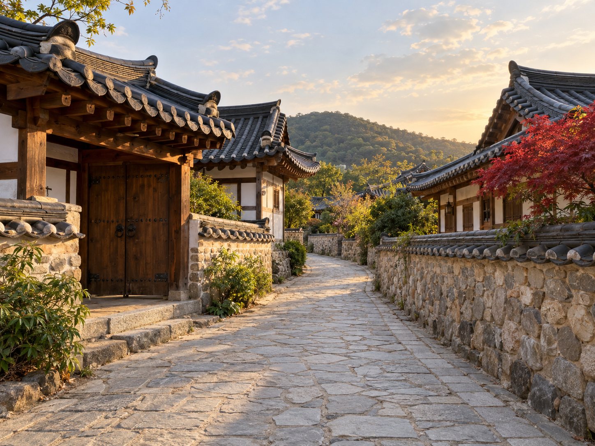
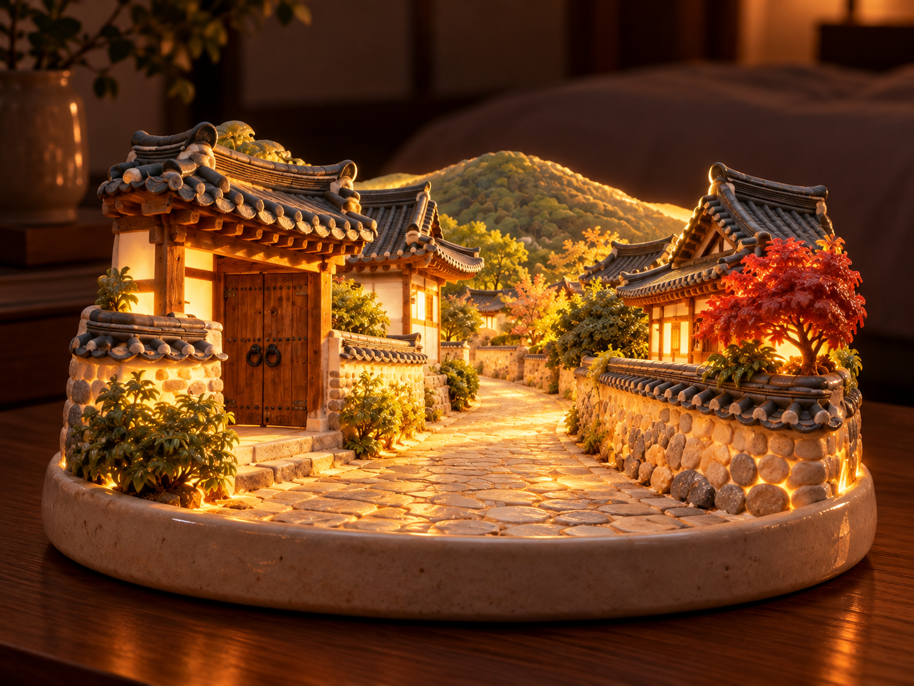
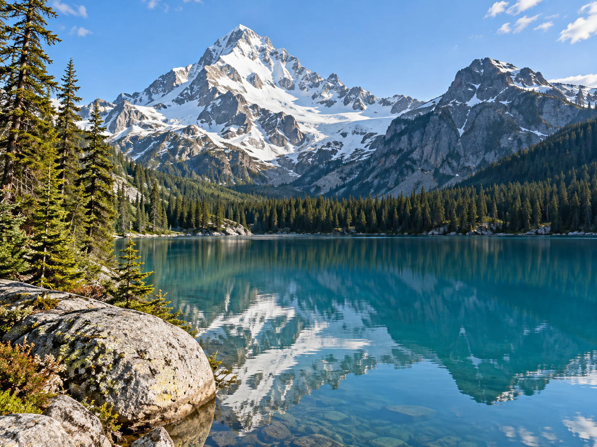
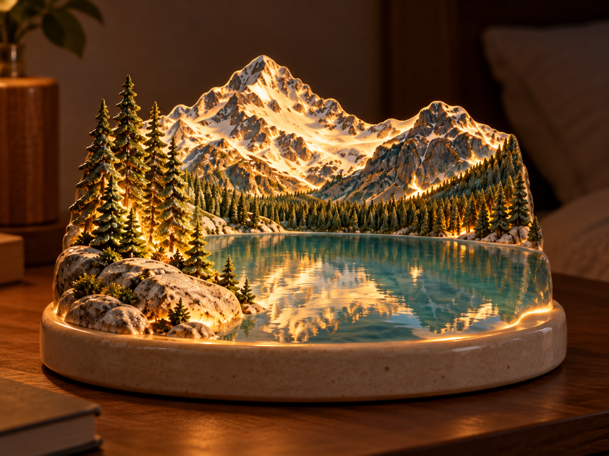
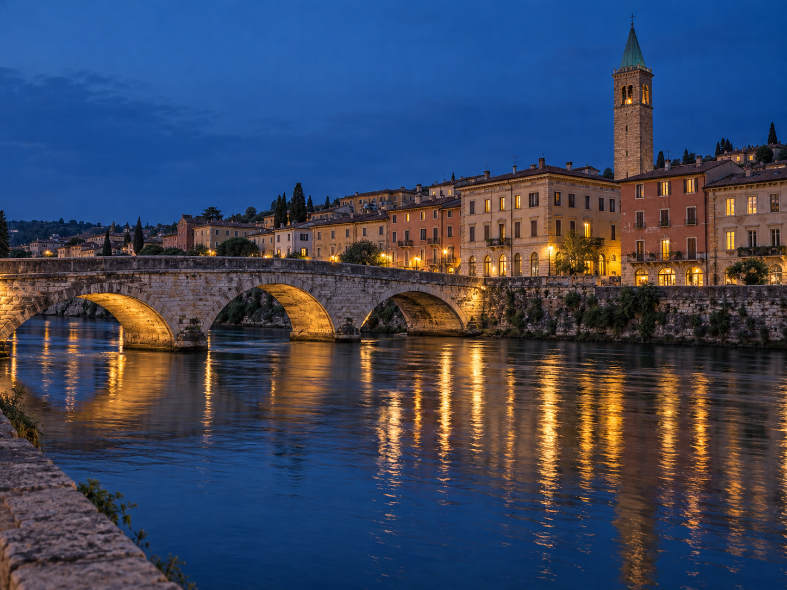
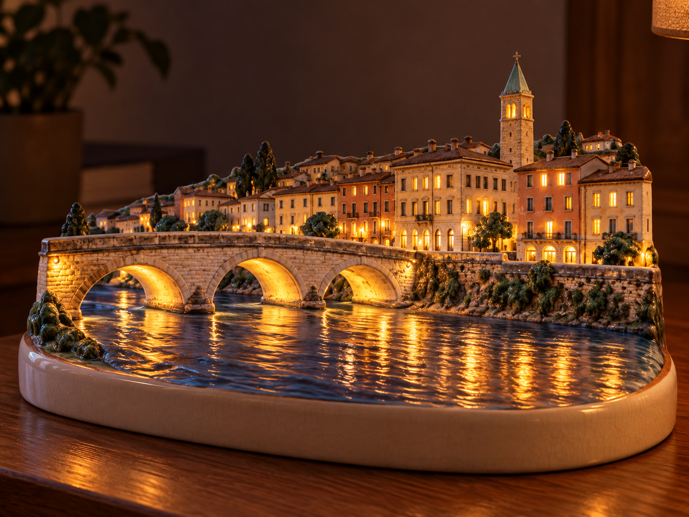

# 여행 사진 무드등 v2 — 다른 사진 시험 / 검토 대기

한옥 골목·산과 호수·도심 강변을 AI 가상 원본으로 생성한 뒤 동일한 v2 문구를 각 원본 한 장에 적용했습니다. 사용자 실제 사진이 아닙니다. 사진별 추가 변환 지시와 출력 후편집은 없습니다. 내장 image_gen을 사용했습니다.

v1의 해안 마을·집 세 채·파란 문·지붕 고정 조건은 다른 입력을 덮어쓸 우려가 있어 v2에서 제거했습니다. 형태·색·상대 배치를 원본에 맞춰 보존하고, 자연 풍경에도 건물 추가 없이 조명 효과를 내도록 바꿨습니다. v1 예시는 v1 기록으로 보존하고 v2 결과로 표시하지 않습니다.

[세 장에 동일하게 적용한 실제 v2 문구](transform-v2.prompt.txt) · [생성 기록](generation-record.json)

## 1. 한옥 골목

| AI 가상 원본 | v2 결과 |
| --- | --- |
|  |  |

왼쪽 대문·회색 기와·돌담·굽은 골목·오른쪽 붉은 단풍·뒤 언덕의 상대 배치를 유지했다. 담장과 벽, 지형 경계에 빛이 나고 원본에 없던 해안 마을을 추가하지 않았다. 세부 잎·기와가 조밀하고 담장이 실제 도자기보다 미니어처 석재처럼 보이는 부분이 있다.

[원본 생성 문구](hanok.reference.prompt.txt) · [실제 변환 도구 입력](hanok.tool-input.json)

## 2. 산과 호수

| AI 가상 원본 | v2 결과 |
| --- | --- |
|  |  |

왼쪽 높은 설산과 오른쪽 낮은 봉우리·짙은 숲·청록 호수·왼쪽 앞 바위를 유지했다. 집·창문·다리를 추가하지 않고 산과 물가의 경계에서 빛이 나온다. 능선·바위 형태와 나무 수는 단순화·재해석됐고, 수면은 도자기 유약보다 실제 물이나 레진처럼 보인다.

[원본 생성 문구](alpine-lake.reference.prompt.txt) · [실제 변환 도구 입력](alpine-lake.tool-input.json)

## 3. 도심 강변

| AI 가상 원본 | v2 결과 |
| --- | --- |
|  |  |

세 아치 다리·강·연속된 건물·오른쪽 초록 지붕 종탑의 배치가 잘 이어진다. 창과 다리 아래의 따뜻한 조명이 무드등으로 읽힌다. 창문 수·강변 수목·벽돌 세부는 달라졌고, 물 표면은 실제 물처럼 사실적인 표현이 남는다.

[원본 생성 문구](city-river.reference.prompt.txt) · [실제 변환 도구 입력](city-river.tool-input.json)

## 현재 상태

- 사용자 요청으로 나머지 여섯 아이디어의 이미지·문구·사용하지 않는 가상 원본과 생성 폴더 복사본 총 36개를 삭제했습니다. 삭제 대상이 남지 않았음을 확인했습니다. [삭제 기록](../seven-photo-ideas-2026-10-19/cleanup-log.json)
- 브랜치: `codex/seven-photo-ideas` (기존 작업 공간 재사용)
- 작업 공간: `C:/Users/kgh07/.codex/worktrees/seven-photo-ideas/prompt-gallery`
- 기준 커밋: `41a6f31278223fd689cbba7042b711a785f83573`
- 결과 검토 대기. 결과 확정·제출 요청이 없어 커밋·push·PR·CI는 미생성/미실행.
- 다음 행동: 원하면 재질·발광을 수정하거나 다른 원본으로 같은 문구를 추가 시험. 결과 확정과 PR 제출 요청 뒤 등록·검증·Draft PR 진행.

후속: [인물이 포함된 풍경 v3 시험](../travel-nightlight-people-2026-10-19/review.md). 위 인물 없는 세 결과는 v2를 사용한 기록입니다.
